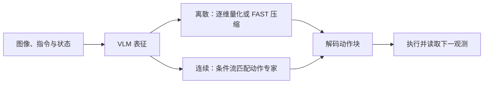
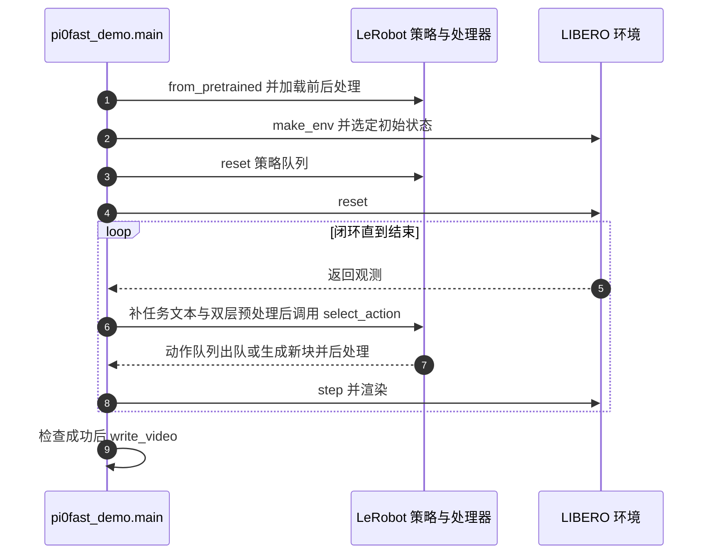

# Xbotics 第11讲：VLA 模型导览 —— 从 OpenVLA 到 π0 家族 / Xbotics Lecture 11: VLA Model Tour: From OpenVLA to the π0 Family

## 一句话定义

按动作表示把 OpenVLA、π0、π0-FAST、π0.5 和 SmolVLA 放到同一张地图：逐维离散、频域压缩离散和连续生成对应不同的执行开销。

## 英文缩写速查

| 缩写 | 英文全称 | 简要说明 |
|---|---|---|
| VLA | Vision-Language-Action | 以视觉和语言条件生成机器人动作 |
| DCT | Discrete Cosine Transform | 在时间维把动作块转换为频率系数 |
| BPE | Byte-Pair Encoding | 将量化系数序列压缩成动作 token |

## 为什么重要

同样使用视觉语言骨干，性能瓶颈可能在动作量化、动作块解码、前缀计算或控制调度，不能只看参数量或离线 loss。

## 核心原理

OpenVLA 用双视觉编码器与 Llama 2 预测量化动作 token。π0 在 VLM 上接连续流匹配专家；FAST 对动作块做 DCT、量化与 BPE，再走自回归。π0.5 两阶段利用两种表示；SmolVLA 加入异步队列。

## 工程实践

可先用 π0-FAST 官方课例运行一条 LIBERO episode，对照 π0 家族：记录固定初始条件、队列填充、动作后处理与成功指示，比较时再用标准多局入口。

## 源码运行时序图

依据[可运行源码入口](https://github.com/Xbotics-Embodied-AI-club/Xbotics-Embodied-AI-Handbook/blob/342247fb71dd0ee15386b6eab80543c50593d3c1/code/vla/4_vla_inference/4_2_pi0fast_pi05_infer/pi0fast_demo.py)静态核对；本次未独立运行该实验。

## 局限与风险

单次成功录像使用指定初始状态和任务，不是总体成功率。离散和连续是类别，不能用一条线性轴给方法排先后；模型大小不单独界定真机延迟。

## 关联页面

课程：端到端操作。

- [课程主节点](xbotics-embodied-ai-handbook.md)
- [第10讲：模仿学习实战 —— ACT、Diffusion 与 Flow Matching](xbotics-handbook-lecture-10.md)
- [第12讲：VLA 微调实战 —— 从全量 SFT 到 LoRA 上真机](xbotics-handbook-lecture-12.md)
- [VLA 方法](../methods/vla.md)
- [π0](paper-pi0.md)
- [机器人 Transformer RT 系列](../methods/robotics-transformer-rt-series.md)

## 参考来源

- [章节来源归档](../../sources/courses/xbotics-handbook-lecture-11.md)
- [官方网页全文](https://xbotics-embodied-ai-club.github.io/Xbotics-Embodied-AI-Handbook/part3-end-to-end/11-VLA%E6%A8%A1%E5%9E%8B%E5%AF%BC%E8%A7%88.html)
- [固定版本书稿](https://github.com/Xbotics-Embodied-AI-club/Xbotics-Embodied-AI-Handbook/blob/342247fb71dd0ee15386b6eab80543c50593d3c1/docs/part3-end-to-end/11-VLA%E6%A8%A1%E5%9E%8B%E5%AF%BC%E8%A7%88.md)

## 推荐继续阅读

- [官方第 11 讲](https://xbotics-embodied-ai-club.github.io/Xbotics-Embodied-AI-Handbook/part3-end-to-end/11-VLA%E6%A8%A1%E5%9E%8B%E5%AF%BC%E8%A7%88.html)：查阅正文、配图和课程给出的参考资料。
