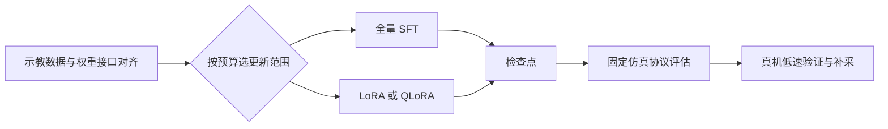
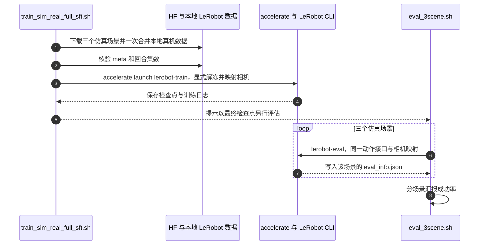

# Xbotics 第12讲：VLA 微调实战 —— 从全量 SFT 到 LoRA 上真机 / Xbotics Lecture 12: Hands-on VLA Fine-Tuning: Full SFT, LoRA, and Robot Deployment

## 一句话定义

将参数更新范围与学习信号作为两个独立维度，用 SO-101 实验串起全量 SFT、LoRA SFT、多卡与仿真到真机的校验。

## 英文缩写速查

| 缩写 | 英文全称 | 简要说明 |
|---|---|---|
| SFT | Supervised Fine-Tuning | 使用示教作为监督更新策略 |
| PEFT | Parameter-Efficient Fine-Tuning | 仅训练少量新增或选择的参数 |
| LoRA | Low-Rank Adaptation | 用低秩旁路拟合权重增量 |
| DDP | Distributed Data Parallel | 各卡复制模型并同步梯度 |

## 为什么重要

微调前先查观测键、摄像头视角和关节动作是否匹配。接口错了，增加样本量或可训练参数也很难修复部署失效。

## 核心原理

全量 SFT 更新全部模型参数；LoRA 固定骨干并学习低秩增量，QLoRA 再量化冻结权重。DDP 与切分训练状态针对不同的显存瓶颈，Sim2Real 则处理观测与动力学域差。

## 工程实践

用 §2.4 的 `train_sim_real_full_sft.sh` 合并三份仿真与九份真机数据、核对摄像头键并显式关闭两项冻结默认值；检查训练日志中的实际可训练参数数量，再用 `eval_3scene.sh` 对三个仿真任务分别验收。

## 源码运行时序图

依据[可运行源码入口](https://github.com/Xbotics-Embodied-AI-club/Xbotics-Embodied-AI-Handbook/blob/342247fb71dd0ee15386b6eab80543c50593d3c1/code/vla/5_vla_finetune/5_2_smolvla_full_sft/train_sim_real_full_sft.sh)静态核对；本次未独立运行该实验。

## 局限与风险

旧脚本未显式关闭冻结视觉塔和仅训专家的默认选项，不能凭目录名认定全模型更新；旧 ReachCube 数据与现行 PickPlaceCube40 评测也不同。新版统一任务比较展示了 loss 差距不必然形成成功率差距。

## 关联页面

课程：端到端操作。

- [课程主节点](xbotics-embodied-ai-handbook.md)
- [第11讲：VLA 模型导览 —— 从 OpenVLA 到 π0 家族](xbotics-handbook-lecture-11.md)
- [第13讲：VLA 前沿 —— 跑得更快、记得更久、用上全身](xbotics-handbook-lecture-13.md)
- [VLA 方法](../methods/vla.md)
- [π0](paper-pi0.md)
- [模仿学习](../methods/imitation-learning.md)

## 参考来源

- [章节来源归档](../../sources/courses/xbotics-handbook-lecture-12.md)
- [官方网页全文](https://xbotics-embodied-ai-club.github.io/Xbotics-Embodied-AI-Handbook/part3-end-to-end/12-VLA%E5%BE%AE%E8%B0%83%E5%AE%9E%E6%88%98.html)
- [固定版本书稿](https://github.com/Xbotics-Embodied-AI-club/Xbotics-Embodied-AI-Handbook/blob/342247fb71dd0ee15386b6eab80543c50593d3c1/docs/part3-end-to-end/12-VLA%E5%BE%AE%E8%B0%83%E5%AE%9E%E6%88%98.md)

## 推荐继续阅读

- [官方第 12 讲](https://xbotics-embodied-ai-club.github.io/Xbotics-Embodied-AI-Handbook/part3-end-to-end/12-VLA%E5%BE%AE%E8%B0%83%E5%AE%9E%E6%88%98.html)：查阅正文、配图和课程给出的参考资料。
