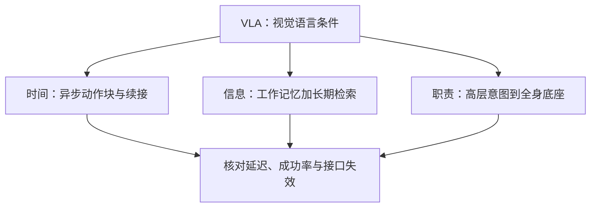
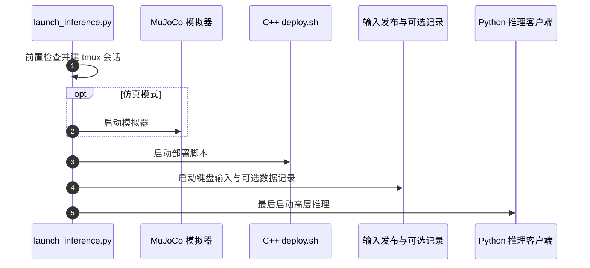

# Xbotics 第13讲：VLA 前沿 —— 跑得更快、记得更久、用上全身 / Xbotics Lecture 13: VLA Frontiers: Real Time, Long Memory, and Whole-Body Control

## 一句话定义

在控制频率、任务时域和身体自由度三个方面考察 VLA 的新接口：连续动作续接、显式记忆和高层意图接全身底座。

## 英文缩写速查

| 缩写 | 英文全称 | 简要说明 |
|---|---|---|
| RTC | Real-Time Chunking | 边执行边生成并对齐后续动作块 |
| KV | Key–Value | 注意力前缀缓存用于减少重复计算 |
| WBC | Whole-Body Control | 将高层目标执行为稳定全身运动 |

## 为什么重要

实时、记忆和运动底座都在减少单模型必须同步完成的工作；分层把风险转移到接口，不能只用加速倍数或演示视频判断部署效果。

## 核心原理

RTC 在执行旧动作块时生成且对齐新块，和异频计算、远近端分步或投机生成是不同取舍。记忆可用序列、检索库或想象；全身策略可将语言条件变成潜在意图或分块命令，由 HOVER/SONIC 类控制器实现。

## 工程实践

测首帧与续接的端到端延迟、观测陈旧度、长程记忆任务和跨任务成功率。全身一线另对照 NVIDIA 官方 SONIC launcher，从模拟器开始检查推理客户端和低层控制器分工。

## 源码运行时序图

依据[可运行源码入口](https://github.com/NVlabs/GR00T-WholeBodyControl/blob/1e1ec4f5f27e6c3e03048f693bd7c60cce04afda/gear_sonic/scripts/launch_inference.py)静态核对；本次未独立运行该实验。

## 局限与风险

加速比要对齐计时区间；不同记忆基准和提升口径不可横比。SONIC 代码是本讲引用的官方底座例子，不是教材为整讲编写的统一实验。

## 关联页面

课程：端到端操作。

- [课程主节点](xbotics-embodied-ai-handbook.md)
- [第12讲：VLA 微调实战 —— 从全量 SFT 到 LoRA 上真机](xbotics-handbook-lecture-12.md)
- [第14讲：强化学习入门 —— 从策略梯度到 PPO](xbotics-handbook-lecture-14.md)
- [SONIC](nvidia-sonic.md)
- [移动操作](../tasks/loco-manipulation.md)
- [视觉语言动作策略](../methods/vla.md)

## 参考来源

- [章节来源归档](../../sources/courses/xbotics-handbook-lecture-13.md)
- [官方网页全文](https://xbotics-embodied-ai-club.github.io/Xbotics-Embodied-AI-Handbook/part3-end-to-end/13-VLA%E5%89%8D%E6%B2%BF.html)
- [固定版本书稿](https://github.com/Xbotics-Embodied-AI-club/Xbotics-Embodied-AI-Handbook/blob/342247fb71dd0ee15386b6eab80543c50593d3c1/docs/part3-end-to-end/13-VLA%E5%89%8D%E6%B2%BF.md)

## 推荐继续阅读

- [官方第 13 讲](https://xbotics-embodied-ai-club.github.io/Xbotics-Embodied-AI-Handbook/part3-end-to-end/13-VLA%E5%89%8D%E6%B2%BF.html)：查阅正文、配图和课程给出的参考资料。
