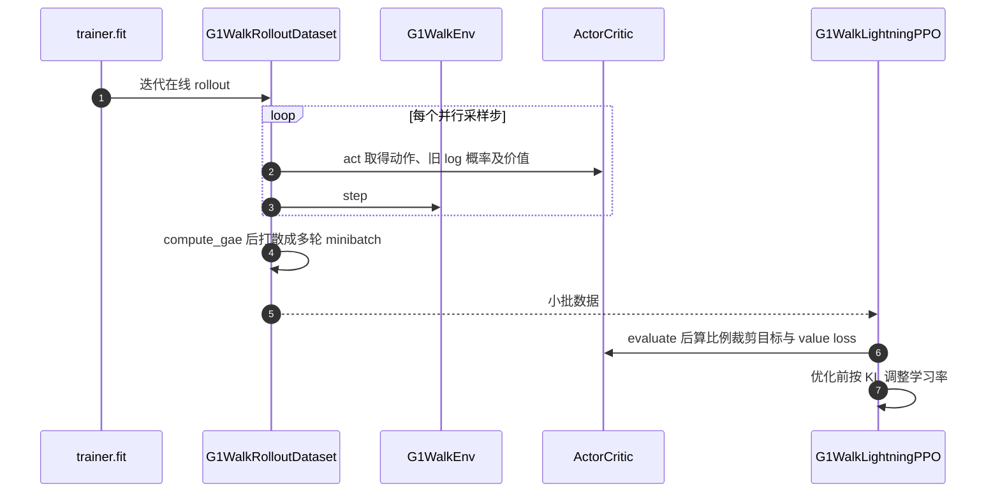

# Xbotics 第14讲：强化学习入门 —— 从策略梯度到 PPO / Xbotics Lecture 14: Introduction to Reinforcement Learning: From Policy Gradients to PPO

## 一句话定义

在仿真 G1 速度跟踪的相同任务和预算下对比 REINFORCE、A2C 和 PPO，再把算法迁到参考动作跟踪。

## 英文缩写速查

| 缩写 | 英文全称 | 简要说明 |
|---|---|---|
| A2C | Advantage Actor-Critic | 用价值基线估计策略动作优势 |
| GAE | Generalized Advantage Estimation | 加权时序差分残差以估计优势 |
| PPO | Proximal Policy Optimization | 对新旧策略概率比的目标做裁剪 |
| KL | Kullback–Leibler Divergence | 监控策略更新幅度 |

## 为什么重要

优先判断失败来自奖励和观测、样本方差还是策略更新幅度。统一环境和评分比并列不同基准奖励更有诊断价值。

## 核心原理

REINFORCE 用采样回报估计策略梯度，A2C 用 critic 与 GAE 降低方差。PPO 存旧 log 概率，用裁剪目标、多轮 minibatch 复用和 KL 调节学习率改善更新稳定性。

## 工程实践

从 G1 `train_v3_ppo.py` 跟踪 rollout、旧 log 概率、GAE 到各 minibatch loss，并检查速度跟踪和动作跟随用的是不同奖励；视频参考轨迹还涉及姿态恢复及 GMR 重定向。

## 源码运行时序图

依据[可运行源码入口](https://github.com/Xbotics-Embodied-AI-club/Xbotics-Embodied-AI-Handbook/blob/342247fb71dd0ee15386b6eab80543c50593d3c1/code/rl/1_rl_basics/1_1_g1_walk_rl/train_v3_ppo.py)静态核对；本次未独立运行该实验。

## 局限与风险

课程的速度跟踪对比统一预算；动作跟随中的原版 PPO/BeyondMimic 权重训练预算不同，只可作能力参照。控制策略与奖励曲线均不直接证明真机安全。

## 关联页面

课程：强化学习。

- [课程主节点](xbotics-embodied-ai-handbook.md)
- [第13讲：VLA 前沿 —— 跑得更快、记得更久、用上全身](xbotics-handbook-lecture-13.md)
- [第15讲：GRPO 后训练 —— 让 VLM 学会数数、让 VLA 自我提升](xbotics-handbook-lecture-15.md)
- [PPO](../methods/ppo.md)
- [移动操作](../tasks/loco-manipulation.md)
- [强化学习](../methods/reinforcement-learning.md)

## 参考来源

- [章节来源归档](../../sources/courses/xbotics-handbook-lecture-14.md)
- [官方网页全文](https://xbotics-embodied-ai-club.github.io/Xbotics-Embodied-AI-Handbook/part4-reinforcement-learning/14-%E5%BC%BA%E5%8C%96%E5%AD%A6%E4%B9%A0%E5%85%A5%E9%97%A8.html)
- [固定版本书稿](https://github.com/Xbotics-Embodied-AI-club/Xbotics-Embodied-AI-Handbook/blob/342247fb71dd0ee15386b6eab80543c50593d3c1/docs/part4-reinforcement-learning/14-%E5%BC%BA%E5%8C%96%E5%AD%A6%E4%B9%A0%E5%85%A5%E9%97%A8.md)

## 推荐继续阅读

- [官方第 14 讲](https://xbotics-embodied-ai-club.github.io/Xbotics-Embodied-AI-Handbook/part4-reinforcement-learning/14-%E5%BC%BA%E5%8C%96%E5%AD%A6%E4%B9%A0%E5%85%A5%E9%97%A8.html)：查阅正文、配图和课程给出的参考资料。
