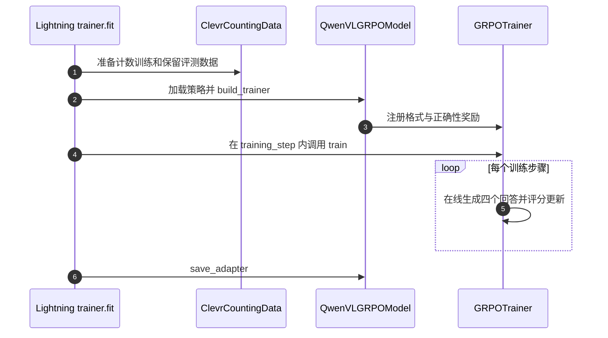

# Xbotics 第15讲：GRPO 后训练 —— 让 VLM 学会数数、让 VLA 自我提升 / Xbotics Lecture 15: GRPO Post-Training: Counting with VLMs and Improving VLAs

## 一句话定义

先以可判分的视觉计数演示组内相对策略更新，再对照 SimpleVLA-RL、RLinf 和从真实经验学习的 RECAP。

## 英文缩写速查

| 缩写 | 英文全称 | 简要说明 |
|---|---|---|
| GRPO | Group Relative Policy Optimization | 以组内打分估计相对优势 |
| VLM | Vision-Language Model | 从图像和问题产生文本回答 |
| KL | Kullback–Leibler Divergence | 约束更新后的策略偏离参考模型 |
| SFT | Supervised Fine-Tuning | 在强化学习前建立最低可用行为 |

## 为什么重要

VLM 与离散动作 VLA 可以共享一个按组比较结果的外环；任务能否重复采样、是否有区分性奖励，决定这个外环是不是合适。

## 核心原理

GRPO 用相同条件的多条输出做相对优势，从而不单独训练 critic。计数实验结合格式与答案奖励；SimpleVLA-RL 把奖励替换为模拟器终局任务成功，RECAP 则引入分布式价值与优势条件，用于真实经验。

## 工程实践

按固定评测题分别记录答案准确率和格式合规率；接机器人仿真时记录同初始状态的组内成败分布，并与未做 RL 的 SFT 策略对照。

## 源码运行时序图

依据[可运行源码入口](https://github.com/Xbotics-Embodied-AI-club/Xbotics-Embodied-AI-Handbook/blob/342247fb71dd0ee15386b6eab80543c50593d3c1/code/rl/2_grpo_posttraining/2_1_grpo_vlm_counting/train_grpo_qwen2_vl.py)静态核对；本次未独立运行该实验。

## 局限与风险

全成功或全失败的组缺少相对奖励信号。没有可可靠计算的动作 log 概率或无法廉价重置的真机任务，不能原样照搬计数案例；RECAP 不是同一个 GRPO 实现。

## 关联页面

课程：强化学习。

- [课程主节点](xbotics-embodied-ai-handbook.md)
- [第14讲：强化学习入门 —— 从策略梯度到 PPO](xbotics-handbook-lecture-14.md)
- [第16讲：Off-policy 强化学习 —— 从仿真提速到真机落地](xbotics-handbook-lecture-16.md)
- [GRPO](../methods/grpo.md)
- [SimpleVLA-RL](paper-simplevla-rl.md)
- [视觉语言动作策略](../methods/vla.md)

## 参考来源

- [章节来源归档](../../sources/courses/xbotics-handbook-lecture-15.md)
- [官方网页全文](https://xbotics-embodied-ai-club.github.io/Xbotics-Embodied-AI-Handbook/part4-reinforcement-learning/15-GRPO%E5%90%8E%E8%AE%AD%E7%BB%83.html)
- [固定版本书稿](https://github.com/Xbotics-Embodied-AI-club/Xbotics-Embodied-AI-Handbook/blob/342247fb71dd0ee15386b6eab80543c50593d3c1/docs/part4-reinforcement-learning/15-GRPO%E5%90%8E%E8%AE%AD%E7%BB%83.md)

## 推荐继续阅读

- [官方第 15 讲](https://xbotics-embodied-ai-club.github.io/Xbotics-Embodied-AI-Handbook/part4-reinforcement-learning/15-GRPO%E5%90%8E%E8%AE%AD%E7%BB%83.html)：查阅正文、配图和课程给出的参考资料。
