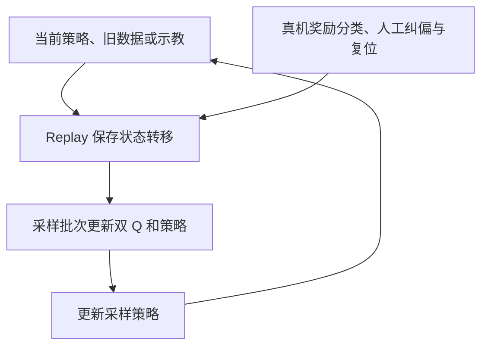
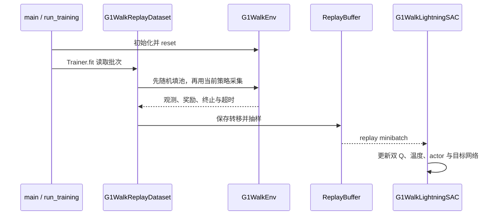

# Xbotics 第16讲：Off-policy 强化学习 —— 从仿真提速到真机落地 / Xbotics Lecture 16: Off-Policy Reinforcement Learning: From Faster Simulation to Real-Robot Deployment

## 一句话定义

课程从真机采样成本出发，依次讲解表格 Q-learning、DQN、DDPG、TD3、SAC 与像素策略 squint，并回到 G1 仿真和 SO-101 真机 HIL-SERL 的不同验证口径。

## 英文缩写速查

| 缩写 | 英文全称 | 简要说明 |
|---|---|---|
| SAC | Soft Actor-Critic | 把熵作为目标的一部分的离策略演员评论家算法 |
| TD3 | Twin Delayed Deep Deterministic Policy Gradient | 双评论家、延迟策略更新和目标动作平滑 |
| UTD | Update-to-Data Ratio | 每单位新采样对应的网络更新强度 |
| HIL-SERL | Human-in-the-Loop Sample-Efficient Reinforcement Learning | 用人类示教和干预提升真机训练样本效率 |

## 为什么重要

离策略更新将采样策略和被更新的策略解开，旧经验、示教与训练中的纠偏才有机会一起复用。真机瓶颈往往是带复位、人力和磨损的交互，而非每秒的梯度计算。

## 核心原理

以随机批次重放转移并做价值自举；TD3 抑制 Q 高估，SAC 把熵纳入目标，squint 的像素示例另引入分布式价值。HIL-SERL 用示教池、视觉奖励分类器、短时人工干预与自动复位组合在线采样，并分开 actor 与 learner。

## 工程实践

G1 对照同时画环境步数和墙钟时间，明确摔倒终止与超时截断的 bootstrap 差异。首次做 SO-101 接触实验应先验证安全边界、奖励误判和复位，再看无帮助成功率、干预率与执行耗时。

## 源码运行时序图

依据[可运行源码入口](https://github.com/Xbotics-Embodied-AI-club/Xbotics-Embodied-AI-Handbook/blob/342247fb71dd0ee15386b6eab80543c50593d3c1/code/rl/1_rl_basics/1_1_g1_walk_rl/train_v4_sac.py)静态核对；本次未独立运行该实验。

## 局限与风险

课上 SAC 的简单仿真结果、FastTD3/FastSAC 的报道及 HIL-SERL 论文真机数字不是同一个硬件/基准；SO-101 真机章节提供复现路径而不是课程作者已完整跑出的同样战绩。

## 关联页面

课程：强化学习。

- [课程主节点](xbotics-embodied-ai-handbook.md)
- [第15讲：GRPO 后训练 —— 让 VLM 学会数数、让 VLA 自我提升](xbotics-handbook-lecture-15.md)
- [第17讲：VLN 理论基础](xbotics-handbook-lecture-17.md)
- [SAC](../methods/sac.md)
- [TD3](../methods/td3.md)
- [移动操作](../tasks/loco-manipulation.md)

## 参考来源

- [章节来源归档](../../sources/courses/xbotics-handbook-lecture-16.md)
- [官方网页全文](https://xbotics-embodied-ai-club.github.io/Xbotics-Embodied-AI-Handbook/part4-reinforcement-learning/16-%E7%9C%9F%E6%9C%BA%E5%BC%BA%E5%8C%96%E5%AD%A6%E4%B9%A0.html)
- [固定版本书稿](https://github.com/Xbotics-Embodied-AI-club/Xbotics-Embodied-AI-Handbook/blob/342247fb71dd0ee15386b6eab80543c50593d3c1/docs/part4-reinforcement-learning/16-%E7%9C%9F%E6%9C%BA%E5%BC%BA%E5%8C%96%E5%AD%A6%E4%B9%A0.md)

## 推荐继续阅读

- [官方第 16 讲](https://xbotics-embodied-ai-club.github.io/Xbotics-Embodied-AI-Handbook/part4-reinforcement-learning/16-%E7%9C%9F%E6%9C%BA%E5%BC%BA%E5%8C%96%E5%AD%A6%E4%B9%A0.html)：查阅正文、配图和课程给出的参考资料。
