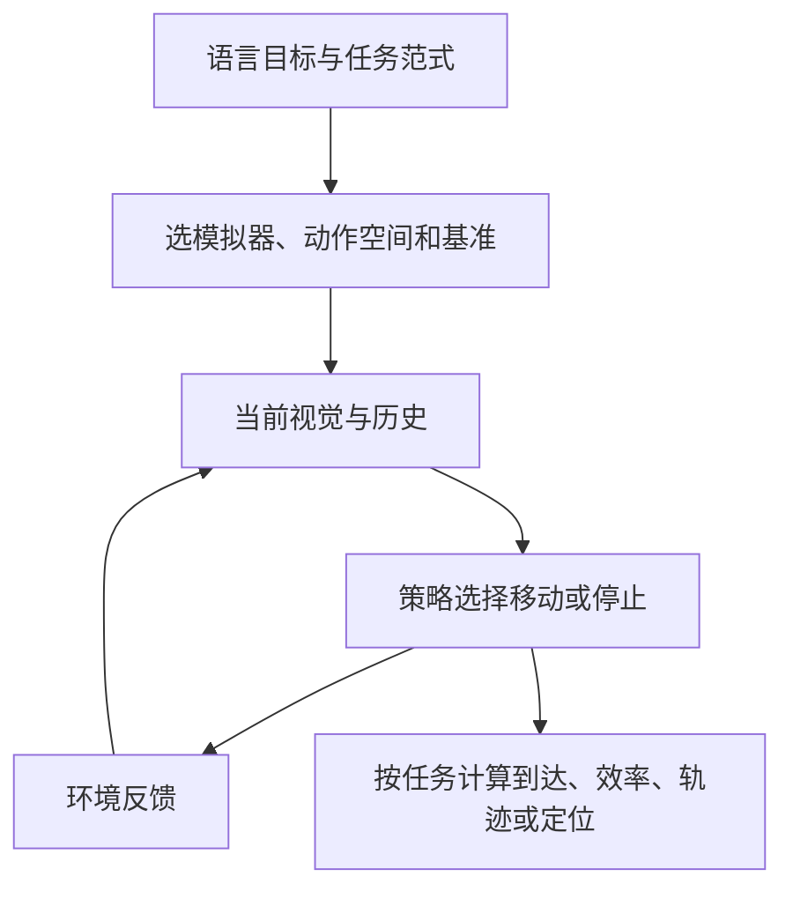

# Xbotics 第17讲：VLN 理论基础 / Xbotics Lecture 17: Vision-and-Language Navigation: Tasks and Benchmarks

## 一句话定义

把 VLN 定义为视觉观测、语言目标和历史条件下的序贯动作决策，并梳理室内、城市、空中、互动与协作任务，以及仿真器和数据集。

## 英文缩写速查

| 缩写 | 英文全称 | 简要说明 |
|---|---|---|
| VLN | Vision-and-Language Navigation | 将语言目标与视觉观测接到空间移动决策 |
| SPL | Success weighted by Path Length | 在成功回合用最短路与实际路径之比评价效率 |
| nDTW | normalized Dynamic Time Warping | 归一化轨迹匹配质量 |
| RGS | Remote Grounding Success | 远程目标定位成功率 |

## 为什么重要

同样叫导航，跟随细粒度路径、寻找指定物体、判断远端目标是否正确和执行跨房间任务不是一个问题。先理解评价目标，才能判断排行榜差别究竟来自数据还是策略。

## 核心原理

任务可用部分可观测决策过程组织：输入包含指令、当前视觉和历史，执行动作后再次观察，直至停止或预算耗尽。课程以 R2R、RxR、R4R、VLN-CE、REVERIE 等说明语言粒度、连续性、路径长度和目标定位要求的变化；再扩展户外、无人机、真实与多智能体基准。

## 工程实践

实验表同时标注环境与原生动作空间、场景划分、终点容差、可见状态和成功定义。SR/SPL 报是否到达与绕路，nDTW 或 CLS 报路径一致性，REVERIE 类任务另报目标定位指标。

## 源码运行时序图

不适用：本讲未确认可据以还原运行调用链的教程实现；概念流程图不代表源码执行。

## 局限与风险

Matterport 图上的离散邻点预测不是连续底盘控制；仿真器数字要和环境、动作、任务指标配对。该讲是定义与基准综述，没有独立 runnable 样例可画时序。

## 关联页面

课程：视觉语言导航。

- [课程主节点](xbotics-embodied-ai-handbook.md)
- [第16讲：Off-policy 强化学习 —— 从仿真提速到真机落地](xbotics-handbook-lecture-16.md)
- [第18讲：VLN 实操与评测](xbotics-handbook-lecture-18.md)
- [视觉语言导航](../tasks/vision-language-navigation.md)
- [目标物体导航](../tasks/zero-shot-object-navigation.md)
- [评测选型](../queries/embodied-eval-benchmark-selection-loop.md)

## 参考来源

- [章节来源归档](../../sources/courses/xbotics-handbook-lecture-17.md)
- [官方网页全文](https://xbotics-embodied-ai-club.github.io/Xbotics-Embodied-AI-Handbook/part5-vln/17-vln-theory.html)
- [固定版本书稿](https://github.com/Xbotics-Embodied-AI-club/Xbotics-Embodied-AI-Handbook/blob/342247fb71dd0ee15386b6eab80543c50593d3c1/docs/part5-vln/17-vln-theory.md)

## 推荐继续阅读

- [官方第 17 讲](https://xbotics-embodied-ai-club.github.io/Xbotics-Embodied-AI-Handbook/part5-vln/17-vln-theory.html)：查阅正文、配图和课程给出的参考资料。
