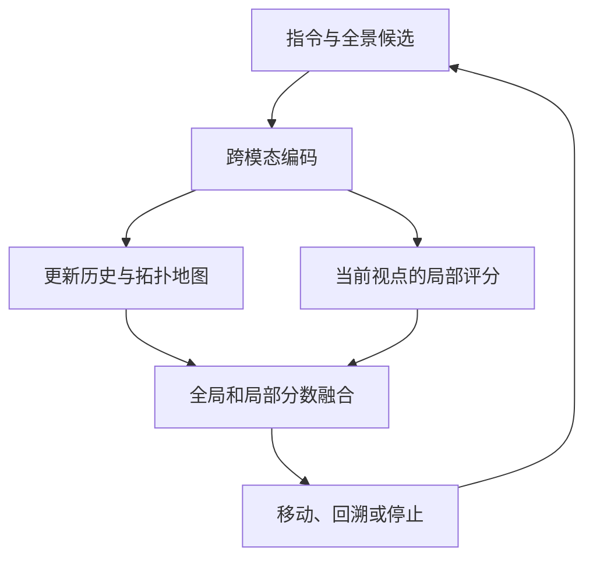
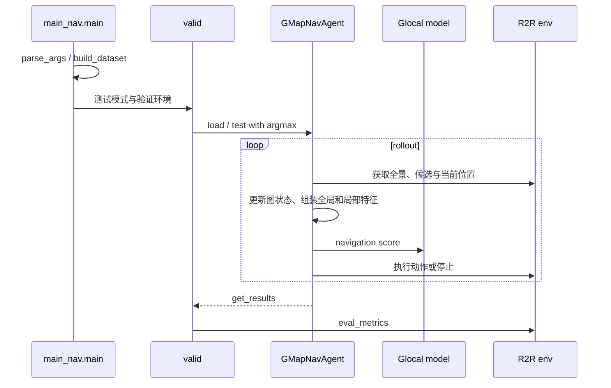

# Xbotics 第18讲：VLN 实操与评测 / Xbotics Lecture 18: Vision-and-Language Navigation: Methods and Practice

## 一句话定义

讲解 VLN 从 Seq2Seq 和 Speaker-Follower/EnvEdit 增强，经 Transformer 预训练、历史状态与地图记忆，演进到 LLM 推理、世界预测和双系统协作。实践分别指向 R2R 基线、DUET 和 InternVLA-N1。

## 英文缩写速查

| 缩写 | 英文全称 | 简要说明 |
|---|---|---|
| Seq2Seq | Sequence-to-Sequence | 把指令序列映射为逐步产生的动作序列 |
| DUET | Dual-scale Graph Transformer | 结合远处拓扑计划与当前视点动作判断 |
| LLM | Large Language Model | 可担当导航规划或推理中枢 |
| NE | Navigation Error | 最终位置与目标位置的距离 |

## 为什么重要

路线选择不是单纯扩大语言模型；局部候选是否可执行、过去看过什么、全局图如何搜索都影响长程导航。把推理和执行的接口看清，能把理解失败和控制失败分开复盘。

## 核心原理

早期模型按观测逐步解码，语言生成和视觉编辑分别扩充指令与环境。DUET 同时维护已访问/候选节点的拓扑图和全景局部表征，融合全局与局部分数；LLM 路线另把通识推理、回溯和工具调用接到导航环。

## 工程实践

按课程顺序建立简单 R2R 基线后再在匹配的 Matterport 数据、特征与权重上运行 DUET。对比 seen/unseen、NE、SR、SPL 及失败轨迹；InternVLA-N1 则先跑官方双系统推理示例，再决定是否安装完整仿真。

## 源码运行时序图

依据[可运行源码入口](https://github.com/cshizhe/VLN-DUET/blob/93e8b233164bc079a6db48b8a0a78d123ec8de41/map_nav_src/r2r/main_nav.py)静态核对；本次未独立运行该实验。

## 局限与风险

实验复现依赖 Matterport 资源许可、特征、权重和各项目依赖版本，离散图实验不保证连续环境同等指标；时序图仅跟踪实际核对的 DUET 评测入口。

## 关联页面

课程：视觉语言导航。

- [课程主节点](xbotics-embodied-ai-handbook.md)
- [第17讲：VLN 理论基础](xbotics-handbook-lecture-17.md)
- [第19讲：Embodied Agent](xbotics-handbook-lecture-19.md)
- [视觉语言导航](../tasks/vision-language-navigation.md)
- [零样本物体导航](../tasks/zero-shot-object-navigation.md)
- [导航运行时参考](paper-navmcp-long-horizon-navigation.md)

## 参考来源

- [章节来源归档](../../sources/courses/xbotics-handbook-lecture-18.md)
- [官方网页全文](https://xbotics-embodied-ai-club.github.io/Xbotics-Embodied-AI-Handbook/part5-vln/18-vln-practice.html)
- [固定版本书稿](https://github.com/Xbotics-Embodied-AI-club/Xbotics-Embodied-AI-Handbook/blob/342247fb71dd0ee15386b6eab80543c50593d3c1/docs/part5-vln/18-vln-practice.md)

## 推荐继续阅读

- [官方第 18 讲](https://xbotics-embodied-ai-club.github.io/Xbotics-Embodied-AI-Handbook/part5-vln/18-vln-practice.html)：查阅正文、配图和课程给出的参考资料。
