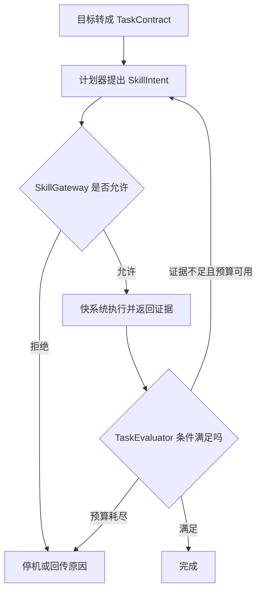
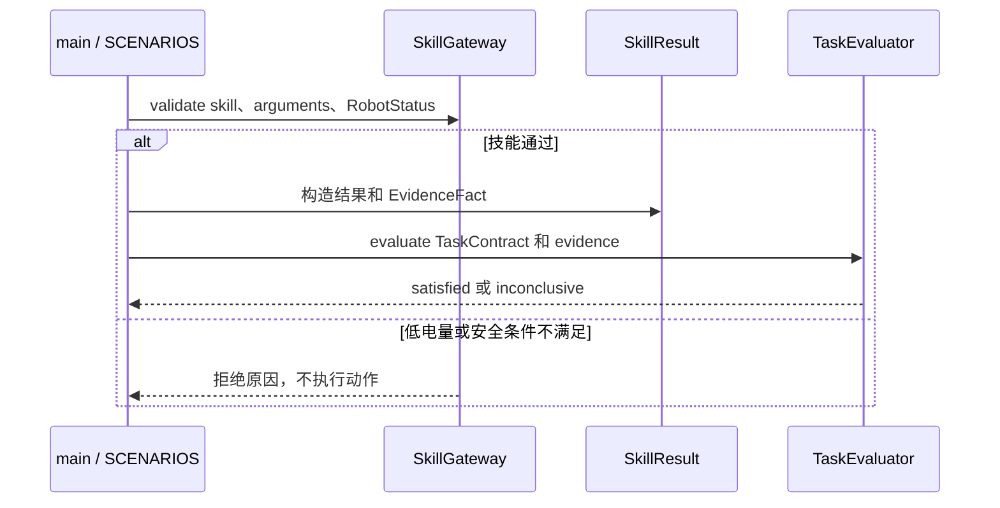

# Xbotics 第19讲：Embodied Agent / Xbotics Lecture 19: Embodied Agent

## 一句话定义

以机器人为例拆解模型、Harness 与快系统控制之间的边界，并通过任务契约、技能契约、证据与独立判定演示可靠闭环。

## 英文缩写速查

| 缩写 | 英文全称 | 简要说明 |
|---|---|---|
| LLM | Large Language Model | 负责理解、规划和更新意图的模型层 |
| VLM | Vision-Language Model | 将观察和语言目标在模型输入层关联 |
| VLA | Vision-Language-Action | 能按观测和指令产生动作的策略组件 |

## 为什么重要

对话回答成功和执行器函数正常返回都不是物理任务成功；模型输出只有经过技能校验、状态保护和证据核验后才能改变任务状态。

## 核心原理

慢系统把目标变成 SkillIntent；SkillGateway 检查已注册技能、参数和机器人状态，快系统负责真实动作。SkillResult 提供可追溯、时效合格的证据，TaskEvaluator 对照任务契约判定满足或证据不足，反馈给重规划、询问、停止等分支。

## 工程实践

先跑无硬件 task_contract_demo 的成功、有返回无证据、低电量、预算耗尽四个场景；另用 agent_skills 展示第一次抓取失败后更新计划。上真机前独立验证技能输入、安全门、证据来源和过期策略。

## 源码运行时序图

依据[可运行源码入口](https://github.com/Xbotics-Embodied-AI-club/Xbotics-Embodied-AI-Handbook/blob/342247fb71dd0ee15386b6eab80543c50593d3c1/code/lecture19/simulation/task_contract_demo.py)静态核对；本次未独立运行该实验。

## 局限与风险

示例是教学脚手架，契约输出和电量规则不能替代独立急停、力限位、时限和真机验收。高层 LLM 的签名合法也不能证明动作对人或环境安全。

## 关联页面

课程：Agent、世界模型与综合实践。

- [课程主节点](xbotics-embodied-ai-handbook.md)
- [第18讲：VLN 实操与评测](xbotics-handbook-lecture-18.md)
- [第20讲：世界模型 —— 预测、规划与数据飞轮](xbotics-handbook-lecture-20.md)
- [视觉语言动作模型](../methods/vla.md)
- [移动操作](../tasks/loco-manipulation.md)
- [导航运行时参考](paper-navmcp-long-horizon-navigation.md)

## 参考来源

- [章节来源归档](../../sources/courses/xbotics-handbook-lecture-19.md)
- [官方网页全文](https://xbotics-embodied-ai-club.github.io/Xbotics-Embodied-AI-Handbook/part6-agent-world-model/19-embodied-agent.html)
- [固定版本书稿](https://github.com/Xbotics-Embodied-AI-club/Xbotics-Embodied-AI-Handbook/blob/342247fb71dd0ee15386b6eab80543c50593d3c1/docs/part6-agent-world-model/19-embodied-agent.md)

## 推荐继续阅读

- [官方第 19 讲](https://xbotics-embodied-ai-club.github.io/Xbotics-Embodied-AI-Handbook/part6-agent-world-model/19-embodied-agent.html)：查阅正文、配图和课程给出的参考资料。
