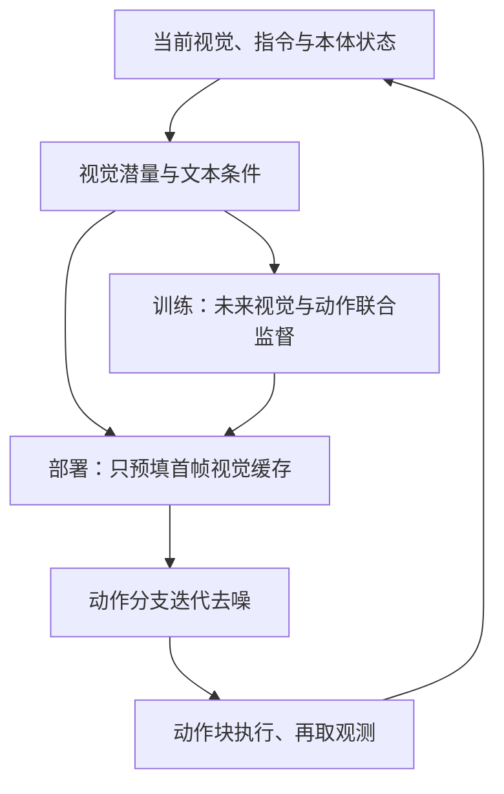
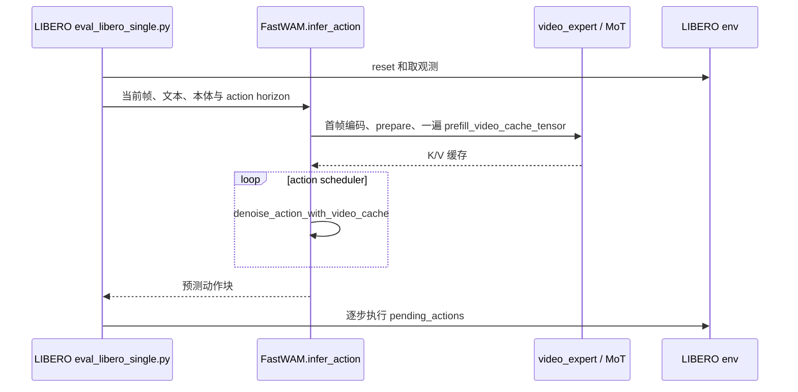

# Xbotics 第20讲：世界模型 —— 预测、规划与数据飞轮 / Xbotics Lecture 20: World Models

## 一句话定义

从预测动作后果切入，区分面向策略学习的世界模型、学习型仿真器、机器人视频世界建模，最后以 Fast-WAM 的 LIBERO 实验拆解训练和部署预算。

## 英文缩写速查

| 缩写 | 英文全称 | 简要说明 |
|---|---|---|
| WAM | World Action Model | 将未来世界预测和动作学习耦合的模型族 |
| AC-WM | Action-Conditioned World Model | 给定候选动作预测后续世界状态 |
| IDM | Inverse Dynamics Model | 从当前/后续状态推断造成该变化的动作 |
| MoT | Mixture of Transformers | Fast-WAM 中用于两分支交互的结构 |

## 为什么重要

需要先问模型是给策略增强训练、为规划生成可滚动预测，还是形成可执行动作；看起来像真机的视频并不表明控制可以落地。

## 核心原理

课程按照表示、预测骨干、从未来到动作及联合训练解释潜变量、扩散/流式预测、动作条件和逆动力学。Fast-WAM 训练时一起使用世界与动作目标；常规部署把当前帧的视觉 K/V 预填并复用，动作分支迭代，不生成和解码完整未来视频。

## 工程实践

先做 LIBERO 单任务低试次数烟测再扩评，记录配置、checkpoint、seed、成功率与端到端推理延迟。比较 Fast-WAM、Joint、IDM 时分别使用配套 checkpoint 与模型配置，并统一测量边界，打开未来视频属于诊断路线。

## 源码运行时序图

依据[可运行源码入口](https://github.com/yuantianyuan01/FastWAM/blob/7faa71108368fbb3b6885649f112af607427a2d4/experiments/libero/eval_libero_single.py)静态核对；本次未独立运行该实验。

## 局限与风险

动作侧提速依赖该架构的首帧条件、掩码和缓存设计，不能外推到一切 WAM；小样本 smoke test 仅检验入口与配置，不支持论文级结论。

## 关联页面

课程：Agent、世界模型与综合实践。

- [课程主节点](xbotics-embodied-ai-handbook.md)
- [第19讲：Embodied Agent](xbotics-handbook-lecture-19.md)
- [第21讲：具身智能前沿进展 —— 综合闭环与答辩](xbotics-handbook-lecture-21.md)
- [Fast-WAM](paper-fast-wam.md)
- [视觉语言动作模型](../methods/vla.md)
- [扩散生成](../methods/diffusion-motion-generation.md)

## 参考来源

- [章节来源归档](../../sources/courses/xbotics-handbook-lecture-20.md)
- [官方网页全文](https://xbotics-embodied-ai-club.github.io/Xbotics-Embodied-AI-Handbook/part6-agent-world-model/20-world-model.html)
- [固定版本书稿](https://github.com/Xbotics-Embodied-AI-club/Xbotics-Embodied-AI-Handbook/blob/342247fb71dd0ee15386b6eab80543c50593d3c1/docs/part6-agent-world-model/20-world-model.md)

## 推荐继续阅读

- [官方第 20 讲](https://xbotics-embodied-ai-club.github.io/Xbotics-Embodied-AI-Handbook/part6-agent-world-model/20-world-model.html)：查阅正文、配图和课程给出的参考资料。
