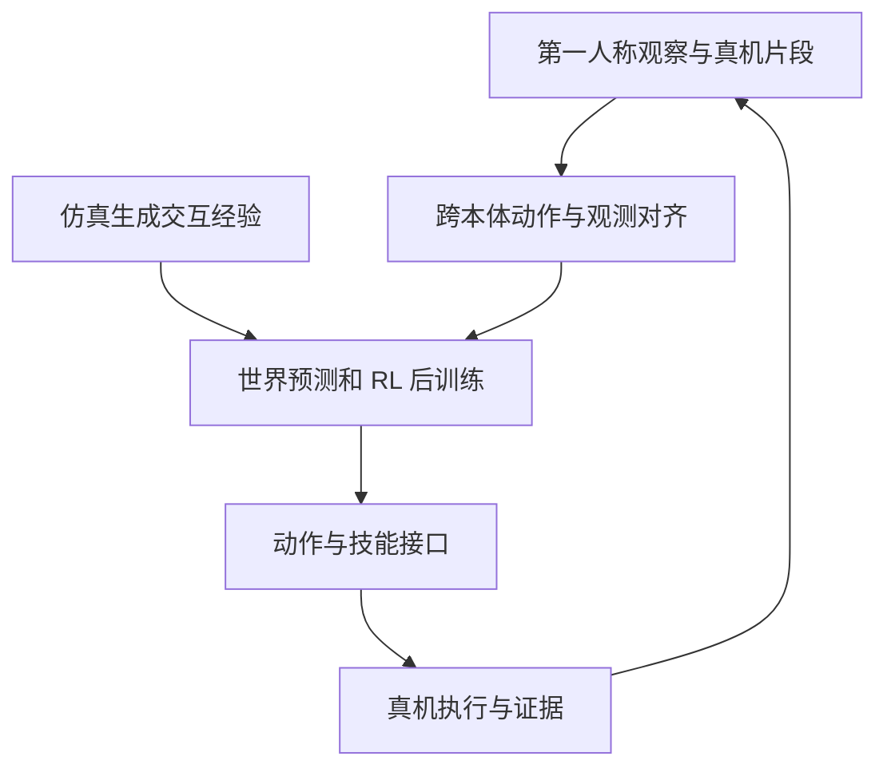

# Xbotics 第21讲：具身智能前沿进展 —— 综合闭环与答辩 / Xbotics Lecture 21: Frontiers in Embodied Intelligence

## 一句话定义

结课用四条线回看具身系统：WAM 扩展经验、Agentic Action 进入动作接口、仿真与 RL 生产经验、第一人称视频提供可对齐的人类观察。

## 英文缩写速查

| 缩写 | 英文全称 | 简要说明 |
|---|---|---|
| WAM | World Action Model | 随世界经验扩展的预测和动作模型 |
| RL | Reinforcement Learning | 以交互奖励做策略训练或任务后训练 |
| 3D Flow | Three-Dimensional Scene Flow | 表示物体和手等在三维空间的运动变化 |

## 为什么重要

四条线互相补位：生成更丰富场景解决覆盖，RL 解决任务后训练，软件技能接口负责可控和可检查执行，人类视角让观测数据更易规模化。

## 核心原理

区分视频与潜空间的世界预测，并追踪模型到可交互仿真器的变化；将动作按 API、技能、控制粒度分层；以 Real2Sim、Sim2Real 和回流闭环准备/校准训练样本。第一人称观察可通过手轨迹、伪动作、实体关系、3D Flow 或潜动作补监督，但动作语义另需对齐。

## 工程实践

选工作时按观测分布、动作表示、数据来源、任务反馈、真机指标做同一张表；仿真比较明确谁生成场景、谁执行物理和谁验收，第一人称路线另验证主动观察与跨本体迁移。

## 源码运行时序图

不适用：本讲未确认可据以还原运行调用链的教程实现；概念流程图不代表源码执行。

## 局限与风险

本章是教学综述和趋势判断，不是统一横评或可复现实验。人手相机过程的相似不等于机器人动作、力觉与接触相同；生成场景的多样性不保证可行任务或可靠泛化。章节明确无独立代码。

## 关联页面

课程：Agent、世界模型与综合实践。

- [课程主节点](xbotics-embodied-ai-handbook.md)
- [第20讲：世界模型 —— 预测、规划与数据飞轮](xbotics-handbook-lecture-20.md)
- [Fast-WAM 实践](paper-fast-wam.md)
- [视觉语言动作模型](../methods/vla.md)
- [移动操作](../tasks/loco-manipulation.md)

## 参考来源

- [章节来源归档](../../sources/courses/xbotics-handbook-lecture-21.md)
- [官方网页全文](https://xbotics-embodied-ai-club.github.io/Xbotics-Embodied-AI-Handbook/part6-agent-world-model/21-frontier-progress.html)
- [固定版本书稿](https://github.com/Xbotics-Embodied-AI-club/Xbotics-Embodied-AI-Handbook/blob/342247fb71dd0ee15386b6eab80543c50593d3c1/docs/part6-agent-world-model/21-frontier-progress.md)

## 推荐继续阅读

- [官方第 21 讲](https://xbotics-embodied-ai-club.github.io/Xbotics-Embodied-AI-Handbook/part6-agent-world-model/21-frontier-progress.html)：查阅正文、配图和课程给出的参考资料。
