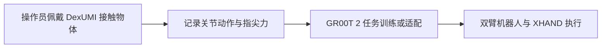

# ROBOTERA XHAND 1 Pro-U｜星动纪元 XHAND 1 Pro-U 灵巧手

## 一句话定义

**星动纪元 XHAND 1 Pro-U 灵巧手**：16 自由度五指手，与 NVIDIA DexUMI 外骨骼示教关节布局对齐；厂商宣布首批 40 台可订购，尚未公开价格。

## 英文缩写速查

| 缩写 | 英文全称 | 简要说明 |
|---|---|---|
| DoF | Degrees of Freedom | 五指手的机械自由度 |
| DexUMI | Dexterous Universal Manipulation Interface | 灵巧操作外骨骼示教接口 |
| GR00T | NVIDIA GR00T | 机器人基础模型体系的项目名称 |

## 为什么重要

用于研究人手直接示教到灵巧机器人手的动作对齐，关节映射和触觉时间同步是决定数据可复用性的重要工程条件。

## 核心信息

| 项目 | 核查来源 |
|---|---|
| 作者或机构 | 星动纪元（ROBOTERA） |
| 原文 | [一手全文/原始新闻稿](https://www.prnewswire.com/news-releases/robotera-launches-xhand-1-pro-u-featured-in-nvidias-gr00t-2-dexumi-demonstration-302940288.html) |
| 代码状态 | 未核实与本研究/设备对应的可运行代码仓库 |
| 核查版本 | 2026-11-16 厂商原始新闻稿 |

## 核心原理

制造商称 XHAND 1 Pro-U 的关节配置与 DexUMI 对齐：操作员佩戴外骨骼并直接与物体交互，记录关节动作和接触力，用于机器人策略后训练；配套演示在双臂机器人上部署 GR00T 2 与 XHAND。公告没有给出可验证的底层 SDK、标定矩阵或固件接口。

## 流程总览

上述流程图是基于原始资料整理的方法主干，不代表已复现作者模型。

## 源码运行时序图

**不适用：** 生产商原始新闻稿未提供可运行的 XHAND 1 Pro-U 驱动 API、SDK 或 DexUMI 映射实现，不能虚构源码调用。

## 工程实践

1. 采购验收需厂商提供自由度和执行器数量区别、关节力矩、带宽、寿命、触觉数据格式与控制接口。
2. 检查 DexUMI 数据到灵巧手关节的映射矩阵、绝对时间戳和接触同步误差。
3. 将新闻稿中的首批 40 台、开始订购与现货交期区分，价格以厂商书面报价为准。

## 实验与评测

原始新闻稿报道 GR00T 2 搭载系统的香蕉酸奶、谷物舀取、化学实验三任务成功率分别为 60%、80%、75%；这是厂商展示的整套系统表现，不是灵巧手零件级性能参数。

## 与其他工作对比

[TouchTwin](./paper-touchtwin-2611-17619.md) 着重研究触觉约束的仿真回放；XHAND 是示教与部署的物理执行设备，不能混淆其传感器、仿真与控制接口。

## 局限与风险

公开发布信息未披露价格、全部技术指标、驱动协议、校准文件及独立第三方复测。

## 关联页面

- [paper touchtwin 2611 17619](./paper-touchtwin-2611-17619.md)
- [paper agentic teacher 2611 17394](./paper-agentic-teacher-2611-17394.md)
- [paper pear 2611 18562](./paper-pear-robot-use-rl.md)
- [掌内操作](../methods/in-hand-reorientation.md)
- [触觉阻抗控制](../methods/tactile-impedance-control.md)
- [contact-manipulation 路线](../../roadmap/depth-contact-manipulation.md)

## 参考来源

- [一手原文核对记录](../../sources/sites/xhand-1-pro-u-robotera.md)

## 推荐继续阅读

- [一手正文](https://www.prnewswire.com/news-releases/robotera-launches-xhand-1-pro-u-featured-in-nvidias-gr00t-2-dexumi-demonstration-302940288.html)
- [作者/扩展资料](https://www.prnewswire.com/news-releases/robotera-launches-xhand-1-pro-u-featured-in-nvidias-gr00t-2-dexumi-demonstration-302940288.html)

