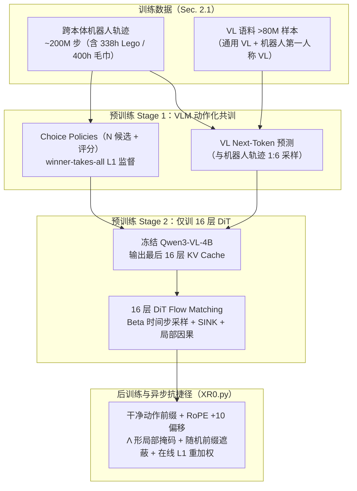
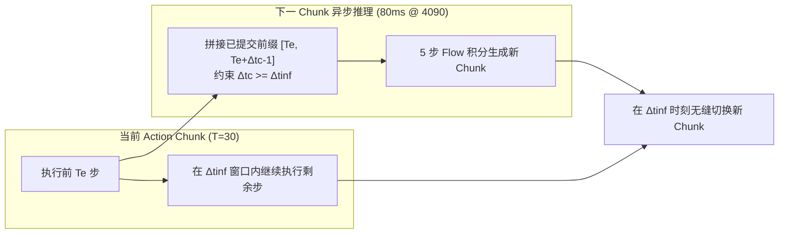
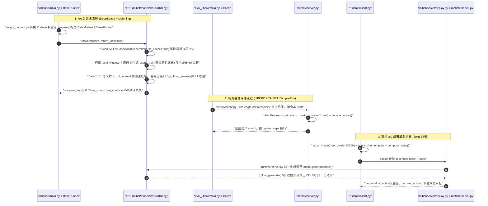

# Xiaomi-Robotics-0

**Xiaomi-Robotics-0**（arXiv:2602.12684v2，2026-02-13 提交、2026-03-25 修订）将 **预训练 VLM（`Qwen3-VL-4B-Instruct`）** 与 **16 层扩散式 Transformer 动作头（DiT）** 组成 **Mixture-of-Transformers（MoT）** 端到端 **VLA**（总参数 **4.7B**）。项目同时解决两件事：一是大规模动作预训练不遗忘通用 VLM 能力，二是在 **非可忽略的推理延迟（80ms）** 下通过 **异步 chunk 执行与防抄前缀后训练** 实现连续流畅的双臂操控；2026-04-27 起已补全 `xr0/` 后训练代码开源。

## 一句话定义

用 **Choice Policies + 1:6 VL 共训** 先保住 `Qwen3-VL-4B` 多模态表征，再冻结 VLM 以 **最后 16 层 KV Cache** 驱动 **16 层 flow-matching DiT** 生成动作块，并在后训练用 **RoPE 偏移、Λ 形局部掩码、前缀随机遮蔽与在线误差自适应重加权** 抑制异步 rollout 时的「抄前缀」时序捷径。

## 英文缩写速查

| 缩写 | 英文全称 | 简要说明 |
|------|----------|----------|
| VLA | Vision-Language-Action | 视觉-语言-动作多模态统一控制策略 |
| VLM | Vision-Language Model | 视觉-语言多模态大模型骨干（本作为 Qwen3-VL-4B-Instruct） |
| MoT | Mixture-of-Transformers | 双塔参数解耦并通过注意力 KV Cache 交互的 Transformer 架构 |
| DiT | Diffusion Transformer | 用于连续动作 flow-matching 去噪的 16 层 Transformer 动作头 |
| RTC | Real-Time Chunking | 以已提交动作前缀条件化下一动作块的异步推理范式 |
| AdaLN | Adaptive Layer Normalization | 将 flow-matching 时间步 $\tau$ 注入 DiT 层的自适应归一化 |
| RoPE | Rotary Position Embedding | 旋转位置编码（本作对噪声动作施加 +10 偏移以区分干净前缀） |

## 为什么重要

- **把「VLA 推理延迟」与「防抄前缀」写入后训练目标**：普通同步执行会让机器人在推理间隙停顿；直接采用 Training RTC 拼接干净前缀又容易让后期 token 复制前缀动作、忽视视觉变化（如抓起多层毛巾后反复原地抖动）。本作给出了一套无需改动推理器架构即可落地的训练期掩码 + 重加权方案。
- **工程化开源闭环完整（模型权重 + 评测服务 + `xr0/` 后训练）**：2026-02 首发预训练/三大仿真微调权重与 TCP 评测框架（`deploy/` + `eval_*/`），2026-04-27 补全基于 Hydra + DeepSpeed + PyTorch Lightning 的 `xr0/` 真机后训练与部署栈，可与通用 I/O 抽象（如 [RIO（Robot I/O）](./robot-io-rio.md)）直接对照。
- **与同实验室 [Xiaomi-Robotics-U0](./xiaomi-robotics-u0.md) 互补**：**4.7B XR-0** 承担 80ms 实时高频控制，**38B 世界模型 U0** 承担结构化场景迁移与 OOD 视觉增广。
- **与 [Xiaomi-Robotics-1](./xiaomi-robotics-1.md) 构成技术谱系**：同沿用 **Qwen3-VL + DiT + Choice Policies** 路线；**XR-0** 验证 **异步 chunk 实时部署与防遗忘配方**，**XR-1** 则扩展至 **>100k 小时 UMI 预训练** 与多任务少样本迁移（少样本基线中包含 XR-0）。
- **可量化验证「VL 共训不掉点」**：实证去掉 VL 共训后 10 项视觉语言基准全部退化至 `0.0`，而按 **1:6** 共训后在 ERQA（**40.8** vs Qwen3-VL 40.0）与 SEED（**78.6** vs 78.8）上几乎零损甚至微增。

## 核心原理

| 模块 / 阶段 | 论文与源码核对要点 |
|---|---|
| **数据配方（Sec. 2.1）** | 机器人轨迹约 **200M** 步（Fig. 2 为 204.9M：含 DROID、MolmoAct 等开源跨本体数据及内部遥操作 **Lego Disassembly 338h + Towel Folding 400h**）；**>80M** VL 样本（Fig. 2 为 82.3M：通用 VL + 腕部/第一人称机器人衍生 VL，含 Grounded SAM / Grounding DINO 1.5 / LLMDet 交叉标注的 grounding、VQA、caption 与 EQA/规划）。 |
| **Pre-training Stage 1** | 用 **Choice Policies** 训练 `Qwen3-VL-4B`：输入 `o_t, l, s_t, [A1..AT], [S]`，同时预测 $N$ 组候选 chunk 与得分，以真值 $L_1$ 监督得分并用 winner-takes-all 反传；与 VL next-token 任务按 **1:6** 混训。 |
| **Pre-training Stage 2** | **冻结 VLM**（输入恢复纯 `o_t, l`，无 `[A]/[S]` token），从头训练 **16 层 DiT**（`dit_hidden_size=1024`, `kv_heads=8`），提取 VLM **最后 16 层 KV Cache** 作为条件；输入序列 `[SINK], s_t, ã_t..ã_{t+T-1}`，时间步 $\tau \sim \text{Beta}(1.5, 1.0)$ 缩放到 `[0, 0.999)` 经 AdaLN 注入；40k steps, batch size 32,768。 |
| **Post-training（异步抗捷径）** | 随机采样前缀长度 $\Delta t_c \in \{0..6\}$ 并置于 DiT 前端（源码 `XR0.py` 在 `async_train=True` 时以 0.5 概率取 `1..min(6, action_length)`）：(1) 噪声动作 RoPE **位置 ID +10 偏移**；(2) **Λ 形局部因果掩码**（源码 `local_window=4` 使远期噪声步仅看最近窗口而非整段前缀）；(3) **前缀随机遮蔽**（`prefix_mask_prob=0.5`，仅保留末尾 `keep_last_k=2` 步连续）；(4) **在线误差自适应重加权**（no-grad 5 步生成整块算 $L_1$ 偏差并裁剪至 `[0.5, 5.0]` 加权 `loss_mse`，`enable_freq=true` 时叠加 `torch.fft.rfft` 频域损失）。 |
| **30Hz 部署与异步拼接** | 所有相机与本体状态按时间戳重采样到 **30Hz** 统一步调；推理端以标准高斯初始化执行 **5 步欧拉积分**；异步 rollout 先执行当前 chunk 前 $T_e$ 步后触发下一次推理，以前缀 $[T_e, T_e + \Delta t_c - 1]$（满足 $\Delta t_c \ge \Delta t_{\text{inf}}$）条件化新 chunk，并在 $\Delta t_{\text{inf}}$ 处无缝衔接（RTX 4090 上实测 $\Delta t_{\text{inf}} = 80\,\text{ms}$）。 |

### 流程总览（两步预训练 + 异步后训练）

### 异步执行时间线

## 评测与对比

### 仿真基准（LIBERO / CALVIN / SimplerEnv，与仓库 `eval_logs/` 一致）

| 基准 | 核心指标 | Xiaomi-Robotics-0 | 代表对照基线 |
|---|---|---|---|
| **LIBERO**（Table 1） | 4 套件平均成功率 | **98.7%**（Spatial 98.8 / Object 100.0 / Goal 98.8 / Long 97.2） | EO-1 **98.2%**、OpenVLA-OFT 97.1%、FLOWER 96.9%、π₀.₅ 96.9%、π₀ 94.2% |
| **CALVIN ABCD→D**（Table 2） | 连续 1–5 项与 Avg. Len. | **4.80**（1–5 步：99.7% / 98.0% / 96.7% / 94.2% / 91.8%） | FLOWER 4.67、UniVLA 4.63、MDT 4.52 |
| **CALVIN ABC→D**（Table 2） | 连续 1–5 项与 Avg. Len. | **4.75**（1–5 步：100.0% / 98.3% / 96.0% / 92.6% / 88.1%） | FLOWER 4.53、UniVLA 4.41、VPP 4.29 |
| **SimplerEnv WidowX**（Table 4） | 4 任务 Overall | **79.2%**（Spoon 95.8 / Carrot 62.5 / Blocks 75.0 / Eggplant 83.3） | EO-1 72.7%、π₀ 69.2%、Magma 44.8% |
| **SimplerEnv Google Robot**（Table 5） | VM / VA Overall | **85.5%**（VM）/ **74.7%**（VA） | EO-1 76.5% / 63.0%、π₀ 71.4% / 54.7% |

### VLM 能力保留对照（Table 3）

| 模型 | ERQA | SEED | POPE | AI2D | MMBench | MME | MMMU |
|---|---|---|---|---|---|---|---|
| π₀ | 0.0 | 0.0 | 0.0 | 0.0 | 0.0 | 0.1 | 0.1 |
| π₀.₅ | 0.0 | 21.5 | 0.0 | 14.4 | 22.1 | 0.0 | 19.9 |
| XR-0 (w/o VL data) | 0.0 | 0.0 | 0.0 | 0.0 | 0.0 | 0.0 | 0.0 |
| **Xiaomi-Robotics-0** | **40.8** | 78.6 | 88.5 | 78.7 | 84.4 | 81.8 | 46.2 |
| Qwen3-VL-4B-Instruct（原始） | 40.0 | 78.8 | 89.7 | 81.6 | 88.7 | 87.1 | 51.7 |

### 真机双臂与消融对照（Sec. 3.2, Fig. 6 & 2026-04-27 更新）

- **Lego Disassembly（LA-5/10/20 与 MA-34 砖块分拣）：** 同步策略（π₀.₅、XR-0 Sync）因瞬时响应最快、成功率微占优；异步 **XR-0 取得最高分拣吞吐量**，明显高于基线 XR-0 (Training RTC) 与 π₀.₅。
- **Towel Folding（两轮 30 分钟连续评测）：** π₀.₅、XR-0 (Sync) 与 XR-0 (Training RTC) 均约为 **1 pcs/min**，**XR-0 达到 1.2 pcs/min**——Training RTC 在抓起多层毛巾时频繁抄前缀陷入循环抖动，而四项防捷径技术消除了此类卡死。
- **高精度真机补充（2026-04-27 后训练开源演示）：** 官网补充展示 20h 遥操作后训练的 **耳机左右槽入盒** 任务（`xr0/configs/data/earphone.yaml`），连续放入 3 副无失败（演示级案例，未提供统计成功率）。

## 结论

**Xiaomi-Robotics-0 是当前工程闭环最完整的开源中等规模（4.7B）flow-matching VLA 之一，在保留 VLM 语义理解的同时把「异步推理—动作衔接—防抄前缀」写进了可复现的后训练代码中。**

- **研究借鉴价值高在「抗时序捷径」配方：** 仅加前缀（Training RTC）会在真机上诱发重复动作死循环，必须配合 RoPE 偏移、Λ 形局部窗口掩码、前缀随机遮蔽与在线 $L_1$ 误差重加权。
- **开箱评测 vs 真机训练走两条代码路径：** 仿真复现直接用 `deploy/server.py` 加载 HuggingFace `AutoModel`；真机微调需进 `xr0/`，用 `tools/weight_convert.py` 转权重后再由 `torchrun tools/train.py` 训练并以 `mibot/server/deploy.py` 提供推理。
- **VLM 能力保留高度依赖 1:6 共训数据：** 仓库开源的是预训练与微调后权重及微调管线，不含 Stage 1 大规模 VL+Robot 混训数据集本身。
- **部署必须开启 30Hz 时间戳同步与 `async_train=true`：** 注意 `xr0/configs/model/XR0.yaml` 默认 `async_train: false`，若直接沿用模板微调不会激活异步前缀训练路径。

## 工程实践

1. **仿真评估与多卡并行架构：** `scripts/deploy.sh` 在 `tmux` 中按 GPU 轮询拉起多个 `deploy/server.py`（TCP 端口 `10086+`，内部 `AutoModel.from_pretrained(..., attn_implementation="flash_attention_2", dtype=torch.bfloat16)`），`eval_libero/main.py`（`replan_steps=10`）、`eval_calvin/main.py`（`replan_steps=10`）与 `eval_simplerenv/main.py`（`replan_steps=4`）通过 `deploy/client.py` 并发调用并聚合结果。
2. **真机 `xr0/` 后训练与服务化：** 先执行 `xr0/tools/weight_convert.py` 将 `XiaomiRobotics/Xiaomi-Robotics-0-Pretrain` 权重加上 `model.` 前缀保存为 `.pt`；再通过 `xr0/scripts/train.sh`（Hydra + DeepSpeed ZeRO-2 + PyTorch Lightning `BaseRunner`）训练；推理时 `xr0/scripts/deploy.sh` 启动 `mibot/server/deploy.py` 读取 `config.py` 与 `last.ckpt/checkpoint/mp_rank_00_model_states.pt`，用训练集 `mean/std` 做归一化/反归一化并由 `runtime/client.py` 拆解双臂动作（默认 `k=10` 触发续块，chunk `(30, 32)`）。
3. **默认配置核对陷阱：** `XR0.py` 默认 `num_steps=5`、`local_window=4`、`flow_sampling="beta"`（`Beta(1.5, 1.0)`）、`prefix_mask_prob=0.5`；但 `xr0/configs/model/XR0.yaml` 里默认 `async_train: false`、`enable_freq: true`、`training_repeat: 4`（每条视觉输入重复采样 4 组噪声时间步与噪音以降低方差、提高训练批效率）。启用异步后训练需命令行覆写 `model.params.model.async_train=true`。

## 源码运行时序图

以下时序图严格对齐 `XiaomiRobotics/Xiaomi-Robotics-0` 仓库实际入口文件与模块（左侧为 `deploy/ + eval_libero/` 仿真评测流，右侧为 `xr0/` 后训练与真机服务流）：

## 局限与风险

- **仿真高分不等于跨本体开箱即用：** 真机高吞吐结果建立在各任务额外 40k–80k 步专属数据微调（以及 338h/400h 遥操作积淀）与 30Hz 精确时间戳对齐之上，迁移至新机械臂仍需完成相机标定、动作掩码重定义与底层安全限幅。
- **异步反应的固有权衡：** 论文实验显式指出在需要瞬时纠偏的高张力接触任务（如 Lego 拆解）上，异步 XR-0 的单步成功率略低于同步变体（`XR-0 Sync` 与 $\pi_{0.5}$），换取的是显著更高的连续作业吞吐量。
- **延迟与算力绑定条件严格：** **80ms** 推理延迟与 **30Hz** 控制律是在 **RTX 4090 + `bfloat16` + `flash_attention_2` + 5 步欧拉积分** 下测得；换用边缘端显卡或缩短步数前需重新测量 $\Delta t_{\text{inf}}$ 并调整 $\Delta t_c$。
- **预训练混合数据集未开源：** 仓库公开了 Pretrain 检查点与 `xr0/` 后训练脚手架，但 204.9M 机器人轨迹与 82.3M 交叉标注 VL 混合语料未一并发布，Stage 1 预训练配方需自备数据复现。

## 关联页面

- [VLA（Vision-Language-Action）](../methods/vla.md) — 方法总览与同类开源路线对照
- [Action Chunking](../methods/action-chunking.md) — chunk 边界、缓冲与异步消费的经典问题语境
- [Diffusion Policy](../methods/diffusion-policy.md) — 连续动作扩散 / flow 与机器人控制结合
- [Teleoperation（遥操作）](../tasks/teleoperation.md) — 房内大规模示教采集的工程参照
- [Manipulation（操作）](../tasks/manipulation.md) — 桌面与可变形物体操作任务语境
- [RIO（Robot I/O）](./robot-io-rio.md) — 跨形态实时 I/O 与异步策略节点的另一种抽象
- [Xiaomi-Robotics-U0](./xiaomi-robotics-u0.md) — 同实验室 **38B 统一具身合成 WM**，作策略训练数据引擎
- [Xiaomi-Robotics-1](./xiaomi-robotics-1.md) — 同实验室 **100k h UMI 预训练** 具身基座 VLA 与 scaling 实证
- [GSR / ParaVLA](./paper-gsr-paravla.md) — LIBERO-Para 上报告本模型 Full Para 76.0 / PRIDE 69.2；GSR+π₀.₅ 的 PRIDE 70.4
- [ViTacPhys](./paper-vitacphys.md) — 同实验室视触觉物理属性估计 + ACT 自适应灵巧抓取（arXiv:2608.21355）
- [UCAG-P](./paper-ucag-p.md) — 小米具身智能 × 澳门大学：同 **Qwen3-VL-4B** 骨干，共享的是 **相机系锚点几何** 而非异步 chunk 部署（arXiv:2608.26058；代码待发布）

## 参考来源

- [Xiaomi-Robotics-0 论文归档（arXiv:2602.12684v2）](../../sources/papers/xiaomi_robotics_0_arxiv_2602_12684.md)
- [Xiaomi-Robotics-0 仓库归档（GitHub）](../../sources/repos/xiaomi-robotics-0.md)
- [Robotics @ Xiaomi 官网列表归档](../../sources/sites/xiaomi-robotics-website.md) — 官方项目单页（`robotics.xiaomi.com/xiaomi-robotics-0.html`）与 2026-04-27 后训练更新核对
- Cai et al., *Xiaomi-Robotics-0: An Open-Sourced Vision-Language-Action Model with Real-Time Execution*, [arXiv:2602.12684](https://arxiv.org/abs/2602.12684)
- [XiaomiRobotics/Xiaomi-Robotics-0（GitHub）](https://github.com/XiaomiRobotics/Xiaomi-Robotics-0)

## 推荐继续阅读

- Black et al., *π₀: A Vision-Language-Action Flow Model for General Robot Control* — flow-matching VLA 相近动作建模脉络
- Kim et al., *OpenVLA: An Open-Source Vision-Language-Action Model* — 跨基准评测与开源生态对照
- [Physical Intelligence openpi](https://github.com/Physical-Intelligence/openpi) — π 系后训练与部署常用参考栈（含 Real-Time Chunking 原始对照实现）
