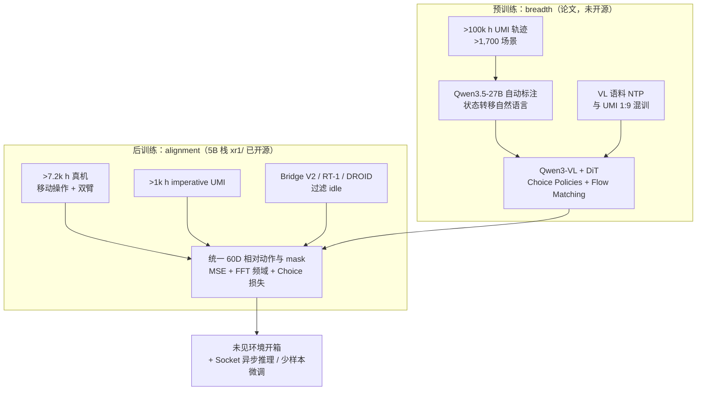
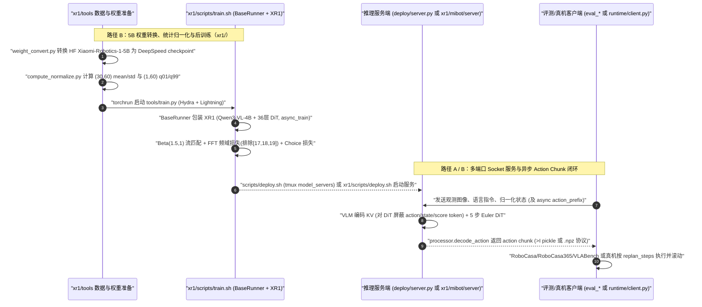

# Xiaomi-Robotics-1

**Xiaomi-Robotics-1**（官网代号 **XR-1**，[arXiv:2607.15330](https://arxiv.org/abs/2607.15330)）是小米机器人实验室 2026 年 7 月发布的 **大规模具身基座 VLA**：用 **embodiment-free UMI 预训练** 打破机器人真机遥操作的数据瓶颈，再用 modest 的 **跨本体后训练** 把「状态转移描述 → 动作」的能力对齐到 **真实机器人本体与自然语言指令**。论文/项目页的核心主张是：机器人策略也能像 LLM/VLM 一样，在 **数据、参数量与算力** 上呈现 **尚未饱和的 scaling law**，且预训练阶段的收益 **直接迁移** 到后训练开箱表现。

## 一句话定义

**在 10 万小时 UMI 真实操作轨迹上预训练 Qwen3-VL + DiT flow-matching VLA，用 VLM 自动标注的状态转移语言作条件，再经跨本体后训练对齐 imperative 指令与真机 embodiment，使未见环境开箱成功率与少样本新任务适配随预训练规模可预测提升。**

## 英文缩写速查

| 缩写 | 英文全称 | 简要说明 |
|------|----------|----------|
| VLA | Vision-Language-Action | 视觉-语言-动作统一策略模型 |
| UMI | Universal Manipulation Interface | 手持夹爪 + 腕部相机的无机器人示范采集范式 |
| VLM | Vision-Language Model | 视觉-语言多模态模型，本工作用于骨干与自动标注 |
| DiT | Diffusion Transformer | 以 Transformer 为骨干的扩散/流匹配动作生成头 |
| MoT | Mixture-of-Transformers | VLM 与 DiT 耦合、共享训练目标的架构族 |
| SOTA | State of the Art | 当前最优水平 |

## 核心信息

| 字段 | 内容 |
|------|------|
| 机构 | 小米机器人实验室（Xiaomi Robotics） |
| **arXiv** | [2607.15330](https://arxiv.org/abs/2607.15330)（v1 2026-07-16 / v2 2026-07-22） |
| **项目页** | <https://robotics.xiaomi.com/xiaomi-robotics-1.html> |
| **源码与权重** | [GitHub（Apache-2.0）](https://github.com/XiaomiRobotics/Xiaomi-Robotics-1) · [HF 合集](https://huggingface.co/collections/XiaomiRobotics/xiaomi-robotics-1) · [ModelScope](https://www.modelscope.cn/collections/XiaomiRobotics/Xiaomi-Robotics-1) |
| **规模变体** | **2.6B / 5.1B / 10.5B**（开源基座权重为 **5B / 5.1B**） |
| **预训练数据** | **>100k h** 真实世界 UMI（**>1,700** 场景） |
| **后训练数据** | **~10k h** 跨本体（**>7.2k h** 自采真机 + imperative UMI + 开源集） |

## 开源状态

核查日：**2026-11-14**（实读 `XiaomiRobotics/Xiaomi-Robotics-1` 仓源码、HF/ModelScope 合集与 README 2026-08-03 更新日志）。

| 产物 | 状态 | 说明 |
|------|------|------|
| GitHub 源码 `XiaomiRobotics/Xiaomi-Robotics-1` | **已开源（Apache-2.0，部分）** | `deploy/` 通用推理服务、`scripts/deploy.sh`、`eval_robocasa/`、`eval_robocasa365/`、`eval_vlabench/`、`xr1/` 5B 后训练与自定义异步部署栈 |
| HF / ModelScope 模型权重 | **已公开 5B 与三基准权重** | `Xiaomi-Robotics-1-5B`、`Xiaomi-Robotics-1-{RoboCasa,RoboCasa365,VLABench}` 与 `xr1_post_train_demo`；RoboDojo 未单列权重 |
| **2.6B / 10.5B 变体与 UMI 预训练** | **未公开** | 仓内 `xr1/` 硬编码 `Qwen/Qwen3-VL-4B-Instruct`（5B 架构）且移除文本 `labels`；>100k h UMI 数据、Qwen3.5-27B 自动标注流水线与 >7.2k h 自采真机集未发布 |

## 为什么重要

- **把机器人数据瓶颈改写成「可 scale 的 UMI 预训练」：** 真机 teleop 慢、贵、任务分布窄；**>100k h** 跨 **>1,700** 场景的 UMI 轨迹 + **两周级 VLM 自动标注**，给出一条与 LLM 预训练同构的 **「先 breadth、后 alignment」** 路线。
- **Scaling 证据链完整：** 预训练验证 **MSE** 随 **UMI 子集 12.5%→100%** 与 **2B→10B** 单调改善；后训练在 **未见环境/物体** 上，更强预训练 checkpoint → **更高开箱成功率**（无 action 预训练 **26%** vs **100% 20k h 预训练 75%** 量级）。
- **与 [Xiaomi-Robotics-0](./xiaomi-robotics-0.md) 形成谱系对照：** 同为 **Qwen3-VL + DiT + Choice Policies**；**XR-0** 主打 **~4.7B 异步 chunk 实时部署**，**XR-1** 主打 **100k h UMI scaling 与移动操作基座**；少样本微调实验中 XR-1 亦对照 **XR-0** 与 **π₀.₅**。
- **与 [Xiaomi-Robotics-U0](./xiaomi-robotics-u0.md) 互补：** **38B 合成 WM** 可增广视觉分布，**XR-1** 负责 **大规模真实接触轨迹上的 action prior**——同实验室「合成 + 真实 scaling」双轨。

## 核心原理

| 模块 | 作用 |
|------|------|
| **VLM 骨干** | **Qwen3-VL** 编码观测与语言；**Choice Policies** 在 VLM 内预测 **K 个候选 action chunk + 分数**，winner-take-all **L1** 选优，加速 DiT 学习。 |
| **DiT 动作头** | 层数对齐 VLM、hidden 更小；条件于 **本体状态 + VLM KV（仅语言/视觉 token，排除 action token）**，**flow matching** 生成 chunk；推理 **5 步 Euler**（Δτ=0.2）。 |
| **预训练数据** | **>100k h** UMI；**Qwen3.5-27B** 对固定长度片段标注 **夹爪/物体状态转移** 自然语言。 |
| **后训练数据** | **~10k h**：**>7,200 h** 移动操作/双臂真机 + **>1k h** imperative 标注 UMI + 过滤 **Bridge V2 / RT-1 / DROID**。 |
| **规模变体** | **2.6B / 5.1B / 10.5B**（VLM **2.1B / 4.4B / 8.8B** + DiT **470M / 604M / 1.5B**）。 |
| **预训练损失** | \(L_{\text{Flow}} + L_{\text{Regression}} + 0.1 L_{\text{NTP}}\)；VL : UMI 采样 **1:9**。 |

## 流程总览（预训练 → 后训练）

## 源码运行时序图

官方仓 `XiaomiRobotics/Xiaomi-Robotics-1` 实际拆为两条可运行路径：**路径 A** 为基于 HF `AutoModel`/`AutoProcessor` 的标准化 Socket 推理与仿真评测栈（`deploy/` + `eval_*/`）；**路径 B** 为 `xr1/` 目录下的 5B 自定义真机后训练与 `.npz` 异步部署栈。**注意**：仓内不含 Stage 1 大规模 UMI 预训练、Qwen3.5 自动标注或 VLM NTP 联合训练实现（`XR1.forward` 直接 `pop("labels")`）。

## 实验与评测

> **口径核对：** 主体以 arXiv:2607.15330v2 正文表与项目页为准；同步记录正文本身与开源评测 README 日志的细微差异。

| 维度 | 论文 / 项目页 | 仓库 / 文本口径差异注记 |
|------|---------------|------------------------|
| **预训练 scaling** | **~20k h** UMI 子集（12.5%→100%）、**2B→10B**，验证 action **MSE** 单调下降（12.5%/25% 后段过拟合，50%/100% 持续下降） | 预训练数据与脚本未开源 |
| **后训练开箱（4 任务）** | 未见环境/物体开箱：5B 随预训练从 **26%**（无预训练）→ **53%**（12.5%）→ **75%**（100%）；全量预训练 **2B 61% → 5B 75% → 10B 79%** | 鞋柜/书包/桌面/沙发四任务 |
| **少样本微调（4 任务）** | **<10 h/任务**（共 36 h）平均 SR **75%** / 进度 **90%** vs **π₀.₅ 40% / 66%**；**<40 h/任务**（共 144 h）**85%** vs **53%** | Phone 70/80、Printer 70/60、Laundry 80/100、Box 80/100（每任务 10 trials） |
| **RoboCasa（Table 2）** | **74.5%** 平均成功率 | `eval_robocasa/README.md` 开源评测日志记录 **74.2%**（10 步 chunk，7D `robocasa_mg`） |
| **RoboCasa365（Table 3）** | **57.4%** 均值（Atomic **80.2%** / Comp.-Seen **57.1%** / Comp.-Unseen **32.1%** vs 2nd ABot-M0.6 46.6%） | 论文 Intro 误印为 **57.6%**；`eval_robocasa365/README.md` 参考 run 为 **57.28%（1432/2500）**（4 帧历史 `@interval 2`，16 步重规划） |
| **VLABench（Table 4）** | **59.1% SR / 70.3 PS / 69.9 IS**（5 tracks，含 50% CoT NTP） | `eval_vlabench/main.py` 默认 `action_chunk_size=10, replan_steps=5` |
| **RoboDojo（Table 5）** | 平均分 **20.07** / 成功率 **13.93%**（无历史帧输入，Memory 排第 2） | README 榜单未单列 RoboDojo HF 权重 |
| **长程真机** | 项目页展示 **>10 min** 房间级 **行李箱打包** 未剪辑视频 | — |

## 工程实践

| 维度 | 源码实测要点 |
|------|--------------|
| **环境与依赖** | `docs/DEPLOYMENT.md` 钉定 `transformers==4.57.1`、`torch==2.8.0`、`flash-attn==2.8.3`；推荐将模型服务与仿真器拆为两个 conda 环境，经 TCP Socket 通信 |
| **统一 60D 张量槽位** | `xr1/docs/data_format.md`：`action_shape=(30,60)`、`state_shape=(1,60)`——左臂 EE 位姿/轴角/夹爪（`0–2, 3–5, 6`）、右臂（`8–10, 11–13, 14`）、腰部（`16`）、底盘速度（`17–19`），缺失维 mask |
| **后训练损失与异步** | `xr1/mibot/models/VLA/XR1.py`：`0.5*loss_mse + freq_coeff*loss_freq + 0.5*loss_l1 + 0.5*loss_score`；FFT `rfft` 频域一致性排除底盘维 `[17,18,19]`；`async_train: true` 时随机采样 `prefix_length ∈ [1..6]` mask 前缀 |
| **双服务 Socket 协议** | `deploy/server.py` 走 `>I` 长度前缀 pickle（服务 HF 权重与 `eval_*`）；`xr1/mibot/server/runtime/` 走 `.npz` 长度前缀 Socket，使用 `q01/q99` 状态归一并支持传入 `action_prefix` |

## 结论

**一句话总判：Xiaomi-Robotics-1 是少见的在「超大规模无本体预训练 → 跨本体对齐 → 真机少样本微调」上同时给出完整 scaling 证据并放出 5B 后训练/评测开源栈的工作，但社区目前能直接复现与微调的仅限于 5B 下游闭环，100k h UMI 预训练本身仍属黑盒。**

1. **工程选型看清「5B 后训练开源、预训练闭源」边界** — `xr1/` + HF `Xiaomi-Robotics-1-5B` 可直接用于自定义真机 5B 微调与异步控制部署，但 `2.6B/10.5B` 权重与 `>100k h` UMI 自动标注预训练管线未在仓内。
2. **复用 `xr1/` 时注意它只训连续头+Choice、不含 VLM 文本监督** — `XR1.forward` 会丢弃 `labels`；若下游需要恢复多模态问答或 CoT 推理能力（如 VLABench 50% CoT 设定），需自行补回 `NTP` 损失。
3. **异步 Chunk + 频域一致损失可直接迁移** — `prefix_length ∈ [1..6]` 前缀条件化搭配排除底盘速度维 `[17,18,19]` 的 `rfft` 频域加权，是真机高频平滑控制的核心工程细节。
4. **引用四基准分数须区分表值与开源复现日志** — RoboCasa365 论文表/摘要为 **57.4%**（Intro 误写 57.6%，开源 script 参考跑分为 **57.28%**），RoboCasa 论文表 **74.5%**（repo 日志 **74.2%**）。

## 与其他工作对比

| 维度 | Xiaomi-Robotics-1（XR-1） | [Xiaomi-Robotics-0](./xiaomi-robotics-0.md) | [Xiaomi-Robotics-U0](./xiaomi-robotics-u0.md) | \(\pi_{0.5}\) / 通才 VLA |
|------|---------------------------|-------------------------------------------|--------------------------------------------|--------------------------|
| **定位** | 100k h UMI 预训练基座 VLA（2.6B/5.1B/10.5B） | ~4.7B 实时异步动作块 VLA | 38B 统一具身合成世界模型 | 跨本体真机/图文混训 VLA |
| **核心配方** | UMI 自动状态转移预训练 → 跨本体指令对齐 | 异步 chunk + Choice + Flow Matching | 结构化场景迁移视觉增广 | 多阶段图文+真机演示混训 |
| **开源边界** | **Apache-2.0（5B 权重 + 后训练/部署/评测）**；预训练未开 | 已开源 `xr0/` 后训练与部署 | 合成 WM 数据引擎侧 | `openpi` 等开源微调生态 |
| **主要关系** | 共享 `Qwen3-VL + DiT + Choice` 与 `mibot` 栈 | XR-1 沿用并在 `xr1/` 扩展其异步/频域训练 | 视觉增广数据引擎 ↔ 真实接触预训练 | 同协议真机少样本直接基线 |

## 局限与风险

- **误区：100k h 等于「全是真机 teleop」。** 预训练主体是 **UMI 无机器人轨迹**；**>7.2k h** 真机集中在 **后训练 alignment**，二者语言条件形式不同（**状态转移 vs imperative**）。
- **误区：仿真 SOTA 自动等于任意硬件即插即用。** 开箱评测强调 **未见环境/物体实例**；新 embodiment 仍需后训练或微调与安全层。
- **开源边界：** 仓内已公开 `5B` 基座/三基准权重与 `xr1/` 后训练部署栈，但 **>100k h UMI 预训练流水线、Qwen3.5-27B 自动标注、>7.2k h 真机集及 2.6B/10.5B 权重未公开**。
- **后训练管线差异：** `xr1/` 硬编码 `Qwen/Qwen3-VL-4B-Instruct` 并在 `XR1.forward` 移除 `labels`（不含 VLM NTP 损失），且依赖特定环境版本（`transformers==4.57.1`、`torch==2.8.0`、`flash-attn==2.8.3`）。
- **数字口径差异：** 论文 Intro 误印 RoboCasa365 为 **57.6%**（正文 Table 3/摘要/项目页均 **57.4%**，`eval_robocasa365/README.md` 参考 run **57.28%**）；RoboCasa 表 **74.5%** vs repo 日志 **74.2%**；RoboDojo 另有 **20.07 score** 与 **13.93% SR** 两种主指标（且无历史观察输入影响记忆维）。

## 关联页面

- [VLA（Vision-Language-Action）](../methods/vla.md) — 方法总览与 scaling 路线对照
- [Teleoperation（遥操作）](../tasks/teleoperation.md) — UMI 无机器人采集与真机示教的后训练衔接
- [Manipulation（操作）](../tasks/manipulation.md) — 桌面/移动操作与少样本灵巧任务语境
- [Loco-Manipulation（移动操作）](../tasks/loco-manipulation.md) — 移动操作基座与房间级长程任务
- [Diffusion Policy](../methods/diffusion-policy.md) — flow matching / DiT 连续动作生成
- [Xiaomi-Robotics-0](./xiaomi-robotics-0.md) — 同族开源 VLA，侧重 **实时异步 chunk 部署**
- [UCAG-P](./paper-ucag-p.md) — 小米具身智能线：相机系锚点几何通才操作（arXiv:2608.26058）
- [Xiaomi-Robotics-U0](./xiaomi-robotics-u0.md) — 同实验室 **38B 具身合成 WM**
- [MiMo-V2.6](./mimo-v2-6.md) — 小米 **MiMo LLM-Core** 通用 Agent 基座（**非** XR-1 VLA 权重；发布说明含 Franka 仿真 demo）
- [RoboDojo](./robodojo.md) — 论文仿真分数所在的统一 sim-and-real 操纵评测与公益榜
- [XPolicyLab](./xpolicylab.md) — 仓内已有 `Xiaomi_Robotics_1` 适配目录；官方上榜开源口

## 参考来源

- [xiaomi_robotics_1_arxiv_2607_15330.md](../../sources/papers/xiaomi_robotics_1_arxiv_2607_15330.md) — arXiv:2607.15330v2 论文归档
- [Xiaomi-Robotics-1 项目页与技术报告归档](../../sources/sites/xiaomi-robotics-1.md)
- [Xiaomi-Robotics-1 官方代码仓归档](../../sources/repos/xiaomi-robotics-1.md)
- 论文：<https://arxiv.org/abs/2607.15330>
- 项目页：<https://robotics.xiaomi.com/xiaomi-robotics-1.html>
- 官方代码仓：<https://github.com/XiaomiRobotics/Xiaomi-Robotics-1>（Apache-2.0）
- 模型合集：[Hugging Face](https://huggingface.co/collections/XiaomiRobotics/xiaomi-robotics-1) · [ModelScope](https://www.modelscope.cn/collections/XiaomiRobotics/Xiaomi-Robotics-1)

## 推荐继续阅读

- Black et al., *π₀.₅: a Vision-Language-Action Model with Open-World Generalization* — XR-1 少样本与仿真对照基线
- Chi et al., *Universal Manipulation Interface: In-The-Wild Robot Teaching Without In-The-Wild Robots* — UMI 采集范式原文
- [Physical Intelligence openpi](https://github.com/Physical-Intelligence/openpi) — π 系微调协议与开源权重生态
- [Xiaomi-Robotics-0 GitHub](https://github.com/XiaomiRobotics/Xiaomi-Robotics-0) — 同组织已可运行 VLA 栈
