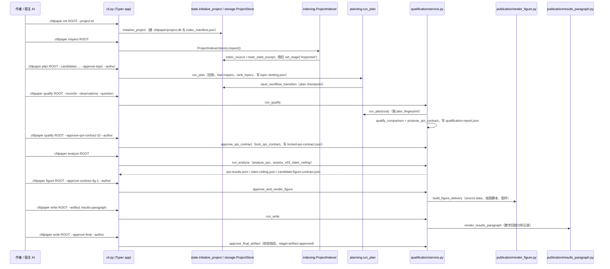

# CFD SciPaper Agent（Xiuyiw/CFD-SCIPaper-Agent）

## 一句话定义

CFD SciPaper Agent（Xiuyiw/CFD-SCIPaper-Agent）是面向 CFD 研究者的作者在环工具，把成熟计算证据整理为可辩护研究方向、可复现图表和可追溯论文文字。

## 英文缩写速查

| 缩写 | 英文全称 | 简要说明 |
|------|----------|----------|
| CFD | Computational Fluid Dynamics | 计算流体力学证据或流程 |
| CAD | Computer-Aided Design | 参数化工程几何设计 |
| AI | Artificial Intelligence | 辅助设计或研究的人工智能能力 |

## 为什么重要

对 CAE 自动化而言，代理能否稳定完成任务，取决于工程步骤是否清楚、工具边界是否明确、结果是否保留可审查证据。面向 CFD 研究者的作者在环工具，把成熟计算证据整理为可辩护研究方向、可复现图表和可追溯论文文字。

## 核心原理

**项目自身范围：** Author-in-the-loop toolkit for CFD research synthesis and reproducible writing.

**工作流：** 从已完成的 CFD 证据出发，由工具辅助提出研究方向、组织图表并生成带来源的文本，作者负责选择和审阅。

## 工程实践

1. 从目标问题识别所需的 Skill、MCP、CLI 或软件接口，不把指导文件当成求解器。
2. 依照仓库 README 检查安装前提、软件/许可证、输入文件和输出证据。
3. 小规模运行并逐项核对几何、网格、边界、求解状态和物理量，再决定是否扩大任务。

文章所述的项目特征：面向 CFD 研究者的作者在环工具，把成熟计算证据整理为可辩护研究方向、可复现图表和可追溯论文文字。

## 局限与风险

不是自动论文生成器；结果依赖真实 CFD 数据与研究者把关，不能把叙述流畅度当作科学有效性。

源码状态核验：该 GitHub 仓库于 2026-10-07 可公开访问。仓库 API 报告许可证为 Apache-2.0。 

## 源码运行时序图

入口：`cfdpaper`（`pyproject.toml` 中 `cfdpaper = "cfdpaper.cli:app"`，Typer CLI；另有可选 `cfdpaper-mcp`），下图为 README 与 `cli.py` 中结构化记录主线 `init → inspect → plan → qualify → analyze → figure → write`。

图依据：Xiuyiw/CFD-SCIPaper-Agent@082a94f，读过 `README.md`、`pyproject.toml`、`docs/architecture/overview.md`、`examples/quickstart/README.md`、`src/cfdpaper/cli.py`、`state.py`、`indexing.py`、`planning.py`、`qualification/service.py`。`research` / `report` / `author` / `portable` / `mcp` 等扩展子命令及 `write --artifact results-section|manuscript` 路线未画。

## 关联页面

- [CAE / CFD 代理工具项目总览](../overview/cae-cfd-agent-skills-landscape.md)
- [SCI Mech Fluid Polishing](./flyingakai-sci-mech-fluid-polishing.md)

## 参考来源

- [公众号文章原始资料归档](../../sources/blogs/wechat_cae_cfd_agent_skills_2026-10-07.md)
- [GitHub 仓库资料归档](../../sources/repos/xiuyiw-cfd-scipaper-agent.md)
- [Xiuyiw/CFD-SCIPaper-Agent 官方仓库](<https://github.com/Xiuyiw/CFD-SCIPaper-Agent>)
- 源码核对（2026-11-02）：Xiuyiw/CFD-SCIPaper-Agent@082a94f，读过 README.md、pyproject.toml、docs/architecture/overview.md、examples/quickstart/README.md、src/cfdpaper/cli.py、state.py、indexing.py、planning.py、qualification/service.py；时序图依据以上文件，未运行代码。

## 推荐继续阅读

- [项目 README](<https://github.com/Xiuyiw/CFD-SCIPaper-Agent/blob/main/README.md>)
