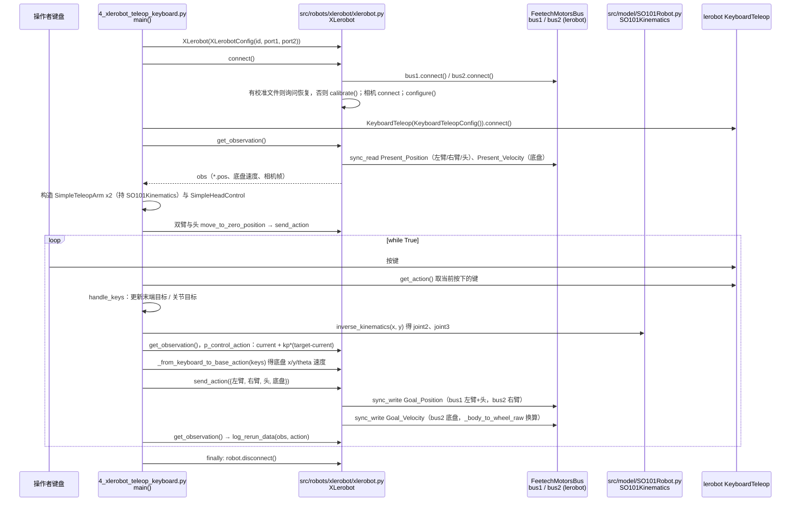

# XLeRobot

**XLeRobot**（[GitHub](https://github.com/Vector-Wangel/XLeRobot)）是 [GitHubStore《19 款能自己造的开源人形机器人》](https://mp.weixin.qq.com/s/UUwUAcKdVrlo-N60Oar3Xg) 的第 18 项，文章标价 约 $660。

## 一句话定义

**XLeRobot 是基于 LeRobot 生态的低成本双臂移动家庭机器人，README 称起步成本 $660，并提供 MuJoCo + 3DGS 网页体验与双轮底盘版本。**

## 英文缩写速查

| 缩写 | 英文全称 | 简要说明 |
|------|----------|----------|
| LeRobot | LeRobot | Hugging Face 开源机器人学习框架 |
| 3DGS | 3D Gaussian Splatting | 三维高斯泼溅 |

## 为什么重要

- 属于文章按成本从低到高排列的「能自己造」清单；横向对比见 [能自己造的开源人形机器人 19 款：按成本与形态排序的阅读坐标](../overview/open-source-buildable-humanoids-19-technology-map.md)。
- 价格为文章标价（约 $660），入库日未核实。

## 核心信息

| 项 | 内容 |
|----|------|
| **链接** | [GitHub](https://github.com/Vector-Wangel/XLeRobot) |
| **许可（核查）** | Apache-2.0（LICENSE 文件） |
| **最近提交** | 2026-10-06 |

## 文章说法核对

- **文章：** 文章称基于 SO-101 机械臂 + 移动底盘，组装时间短、完整开源，适合家用操作、遥操作与 AI 实验。
- **README / 核查：** README 标语「Bringing Embodied AI to Everyone - Cheaper Than an iPhone!」，起步 $660；News 含 2026-01-29 浏览器内 MuJoCo + 3DGS 体验、2025-12-02 发布双轮差速底盘版本；LICENSE 为 Apache-2.0。
- **差异与保留：** **文章归入人形机器人清单，XLeRobot 是双臂移动机器人（非人形）**；SO-101 等硬件细节来自文章，未逐项核对。

## 源码运行时序图

入口：`python software/examples/4_xlerobot_teleop_keyboard.py`（键盘遥操作，3 全向轮底盘版；官方脚本头注释还给出主机侧 `python -m lerobot_robot_xlerobot.xlerobot_host --robot.id=my_xlerobot`，但脚本内注明 zmq/Client 路径当前未接线，只暴露本地有线连接）。仓库另有 VR（`8_xlerobot_teleop_vr.py`）、Xbox、Joy-Con 等同类入口，本图只画键盘版。

图依据：Vector-Wangel/XLeRobot@b017b5e，读过 README.md、software/readme.md、software/plugins/README.md、software/examples/4_xlerobot_teleop_keyboard.py、software/src/robots/xlerobot/xlerobot.py、software/src/model/SO101Robot.py（仅函数签名）。

## 关联页面

- [humanoid-robot](../entities/humanoid-robot.md)
- [open-source-humanoid-hardware](../entities/open-source-humanoid-hardware.md)
- [open-source-buildable-humanoids-19-technology-map](../overview/open-source-buildable-humanoids-19-technology-map.md)

## 参考来源

- [xlerobot.md](../../sources/repos/xlerobot.md)
- [wechat_githubstore_19_buildable_open_source_humanoids_2026-11-02.md](../../sources/blogs/wechat_githubstore_19_buildable_open_source_humanoids_2026-11-02.md)
- [原文（微信公众号）](https://mp.weixin.qq.com/s/UUwUAcKdVrlo-N60Oar3Xg)
- 源码核对（2026-11-02）：Vector-Wangel/XLeRobot@b017b5e，读过 README.md、software/readme.md、software/plugins/README.md、software/examples/4_xlerobot_teleop_keyboard.py、software/src/robots/xlerobot/xlerobot.py、software/src/model/SO101Robot.py（函数签名）；时序图依据以上文件，未运行代码。
