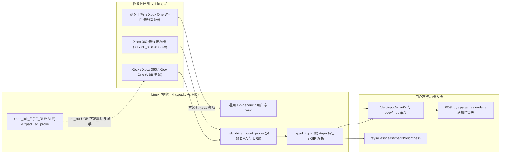
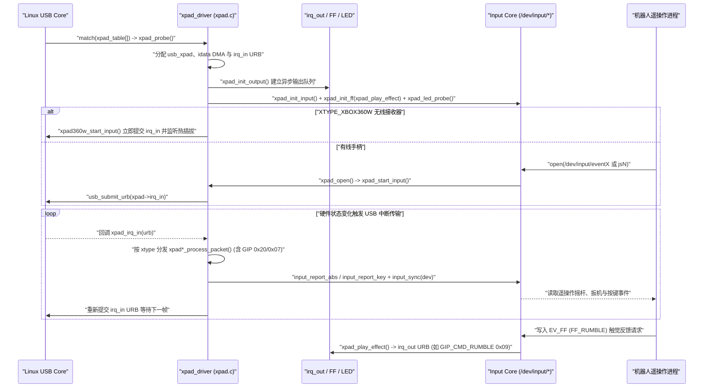

# xpad（Linux Xbox USB 手柄内核驱动）

## 一句话定义

**xpad**（本文对应社区长期维护版 [paroj/xpad](https://github.com/paroj/xpad)）是面向 **Xbox、Xbox 360（含无线接收器）与 Xbox One USB 控制器** 的 Linux 内核态 `usb_driver` 输入驱动：通过 DKMS 编译加载 `xpad.c` 单文件内核模块后，负责处理专有 USB 握手与 GIP（Game Input Protocol）封包解析，向上层机器人遥操作栈统一暴露 `/dev/input/event*`、`/dev/input/js*`、力反馈 `EV_FF` 与 LED sysfs 节点。

## 英文缩写速查

| 缩写 | 英文全称 | 简要说明 |
|---|---|---|
| URB | USB Request Block | Linux 内核 USB 异步数据传输核心结构体（`irq_in` / `irq_out`） |
| HID | Human Interface Device | 通用 USB/蓝牙输入设备协议；蓝牙配对的 Xbox 手柄走 HID 而非 `xpad` |
| GIP | Game Input Protocol | Xbox One 系列 USB 有线通信协议，涵盖按键上报、电源握手与震动指令 |
| DKMS | Dynamic Kernel Module Support | 内核升级时自动重编译第三方内核模块的 Linux 框架 |
| EV_FF | Event Force Feedback | Linux Input 子系统提供的力反馈事件接口（含双马达 `FF_RUMBLE` 效应） |

## 为什么重要

在机器人低成本采数、双足/轮式底盘调试及桌面单臂遥操作中，Xbox 有线手柄往往是部署频率最高的低延迟输入设备。但在实际工程现场（尤其是批量采购的第三方 Xbox 360 兼容手柄或新款手柄），Linux 发行版自带旧内核的内置 `xpad` 常出现**枚举成功却无摇杆事件、未完成厂商初始化握手导致指示灯狂闪、或力反馈通道失效**的问题。

`paroj/xpad` 作为事实上的社区上游缓冲层：

- **提前合并设备 VID/PID 与 Quirks：** 收录大量主线尚未合入的第三方手柄型号（`xpad_device[]`）、Xbox 360 兼容垫初始化补丁与 Guitar Hero Live 保活定时器，避免科研团队反复手工修改内核树。
- **标准化跨栈设备抽象：** 将复杂的 USB 私有协议（XInput / GIP）与无线接收器热插拔收拢到内核态，使上层 Python `evdev`、`pygame`、SDL2、ROS `joy` 或自定义遥操作总线无需关心手柄代际差异即可统一读取摇杆与触发震动提示。

## 核心原理

### 通信路径边界与内核内部架构

基于 `xpad.c` 源码实测分析，驱动核心包含以下四个机制：

1. **四类协议分支与表驱动匹配（`xpad_device[]` / `xpad_table[]`）：** 模块通过 `module_usb_driver(xpad_driver)` 注册；设备插入后由 `xpad_device[]` 匹配厂商与产品 ID，并赋予 `xtype`（`XTYPE_XBOX`、`XTYPE_XBOX360`、`XTYPE_XBOX360W`、`XTYPE_XBOXONE`）、映射位掩码及硬件怪癖标记（如 `QUIRK_GHL_XBOXONE`）。
2. **输入、输出、力反馈与 LED 初始化（`xpad_probe`）：** 分配 `struct usb_xpad`、DMA 一致性接收缓冲 `idata` 与输入中断 URB `irq_in`；依次调用 `xpad_init_output()`（构建 `irq_out` URB 与发送队列）、`xpad_init_input()`（配置绝对轴 `ABS_*` 与按键位并调用 `input_register_device()`）、`xpad_init_ff()`（通过 `input_ff_create_memless(..., xpad_play_effect)` 向用户态暴露 `EV_FF` / `FF_RUMBLE` 左右马达震动接口）以及 `xpad_led_probe()`（创建 `/sys/class/leds/xpad%d` 环形灯模式控制）。
3. **中断 URB 驱动的零轮询上报：** 普通有线手柄在用户态打开设备节点时由 `xpad_open()` 触发 `xpad_start_input()` 提交 `usb_submit_urb(xpad->irq_in, GFP_KERNEL)`；对于 Xbox 360 无线接收器（`XTYPE_XBOX360W`），则直接在 `xpad_probe()` 内调用 `xpad360w_start_input()` 监听连接状态，并在子手柄上下线时调度 `xpad_presence_work` RCU 工作队列动态注册/注销输入设备。
4. **Xbox One GIP 协议与保活：** Xbox One 有线控制器不再使用早期 Xbox 360 简单轮询包，而是采用基于包头的 **GIP** 协议：`GIP_CMD_INPUT (0x20)` 上报轴键、`GIP_CMD_POWER (0x05)` 完成上电使能握手、`GIP_CMD_VIRTUAL_KEY (0x07)` 单独上报 Xbox Guide 键、`GIP_CMD_RUMBLE (0x09)` 下发震动；针对特定控制器（如 Guitar Hero Live Xbox One）另维护 8 秒周期定时器 `ghl_poke_timer` 发送保活命令防止断连。

## 源码运行时序图

以下时序严格对齐仓库 `xpad.c` 源码中的 USB 注册、探测、URB 中断回调与 Linux Input 上报路径：

## 工程实践

1. **DKMS 安装与内核升级自维护：** 若发行版内置 `xpad` 无法识别手头第三方手柄或存在假死，推荐直接按仓库指南通过 DKMS 部署至 `/usr/src/xpad-0.4`，并执行 `dkms install -m xpad -v 0.4` 取代系统默认模块；日后更新只需 `dkms remove` 后重新 `install`。
2. **三件套联调排障：**
   - 查看硬件枚举与内核日志：`dmesg --level=debug --follow` 验证是否由 `xpad` 接管而非错误落回 `hid-generic`。
   - 核验摇杆原始轴号与死区：`jstest /dev/input/js0` 或 `evtest /dev/input/event*`（注意不同手柄平台下 LT/RT 扳机归零区间可能为 `[0, 255]` 或 `[-32768, 32767]`）。
   - 验证力反馈与玩家灯：`fftest /dev/input/by-id/usb-*360*event*` 与写入 `/sys/class/leds/xpad0/brightness`（模式 0–15，可在遥操作中直观指示「已接管/急停」状态）。
3. **分清蓝牙与无线适配器路径：** 蓝牙连接的 Xbox 手柄**不经过 `xpad`**（走内核通用 HID + `xpadneo` 等）；官方 Xbox One USB Wi-Fi 无线适配器同样不归 `xpad` 管理，需要单独安装用户态守护进程 `xow` / `xone`。
4. **防抖与急停开关设计：** 接入双足或高速机械臂遥操作时，应在用户态遥操作节点（如 [RIO](./robot-io-rio.md) 或 ROS 2 `teleop_twist_joy`）叠加死区过滤与**物理死人开关（Deadman Switch，如长按 LB/RB 才允许使能）**，并监听设备断开后的 `ENODEV` 事件立刻归零速度指令。

## 局限与风险

- **覆盖范围严格限于 USB 接口与 360 接收器：** 不负责蓝牙 HID 手柄，也不支持 Xbox One 无线 Wi-Fi 适配器；在混合实验室环境中容易混淆加载失败的原因。
- **无内置高阶过滤与状态恢复：** 内核模块忠实上报原始硬件中断值，摇杆零点漂移（stick drift）、死区映射、非线性曲线均须由上层机器人框架处理。
- **DKMS 与 Secure Boot 签名冲突：** 在开启 UEFI Secure Boot 的工作站上手动安装第三方 DKMS 内核模块时，若未配置 MOK（Machine Owner Key）签名，`modprobe xpad` 会被内核拒绝加载（`Required key not available`）。

## 与其他页面的关联

- 核心任务与方法：[Teleoperation](../tasks/teleoperation.md)、[Manipulation](../tasks/manipulation.md)、[Imitation Learning](../methods/imitation-learning.md)
- 遥操作接入实践与上下游：[Open Duck Mini Runtime](./open-duck-mini-runtime.md)、[RIO (Robot I/O)](./robot-io-rio.md)、[WalkerE3 MuJoCo 手柄仿真](./jackhan-mujoco-walke3-simulation.md)、[Isaac Teleop](./isaac-teleop.md)

## 参考来源

- 仓库与源码深读归档：[xpad.md](../../sources/repos/xpad.md)（通读 `README.md` 与 `xpad.c` 全文件 2617 行核心函数与表定义）
- 官方仓库：<https://github.com/paroj/xpad>
- Xbox One 无线适配器替代方案：`medusalix/xow`（<https://github.com/medusalix/xow>）

## 推荐继续阅读

- 遥操作路线文档：[Teleoperation Depth Roadmap](../../roadmap/depth-teleoperation.md)（Stage 1：输入接口与硬件通道）
- XR 与高自由度遥操作对比：[Isaac Teleop](./isaac-teleop.md)、[ssik](./ssik.md)
