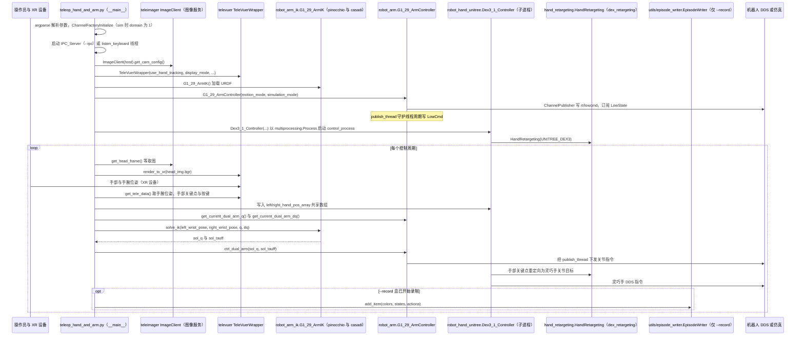

# xr_teleoperate

**xr_teleoperate** 用 XR 设备（Apple Vision Pro、PICO 4 Ultra Enterprise、Meta Quest 3 等）对 Unitree 人形做全身遥操作；v1.5 起支持仿真，并提供 Wiki / DeepWiki 背景知识。

## 一句话定义

官方人形遥操作与采数入口：XR 追踪 → 全身/手臂指令 → DDS 真机或同构仿真，数据可进入 LeRobot / UnifoLM 管线。

## 英文缩写速查

| 缩写 | 英文全称 | 简要说明 |
|------|----------|----------|
| XR | Extended Reality | 扩展现实（含 VR/AR） |
| AVP | Apple Vision Pro | 常用 XR 头显之一 |
| DDS | Data Distribution Service | 与真机/仿真通信 |
| DoF | Degrees of Freedom | 自由度；G1 常标 29DoF |
| IL | Imitation Learning | 下游模仿学习 |
| G1 | Unitree G1 Humanoid | 主目标机型之一 |

## 项目时间边界

官方仓库在 **2024-08-06** 的代码提交已包含实现，本路线将其标为「代码历史起点」；这不证明正式首发或首次公开日，也不表示当日已具备本页介绍的全部现有功能。提交证据见 [原始仓库时间核对](../../sources/repos/xr_teleoperate.md)。

## 为什么重要

- 人形 IL 数据质量高度依赖遥操作；本仓是官方维护的参考实现，而非一次性 demo。
- 与 [`unitree_sim_isaaclab`](./unitree-sim-isaaclab.md) **同 DDS**，可在无真机时采仿真数据。
- 组织枢纽选型路径：`xr_teleoperate` →（可选）仿真采数 → [`unitree_lerobot`](./unitree-lerobot.md)。

## 核心原理

| 能力 | 说明 |
|------|------|
| 机型 | G1（29DoF）等标为 Complete；H1/H1_2 手臂配置见仓库表格与 Wiki |
| 末端 | Dex3-1 等灵巧手组合（视频 demo：G1+Dex3-1） |
| 仿真 | v1.5+；可传 CycloneDDS 网卡名参数 |
| 文档 | 仓库 Wiki + 官方开发者文档「应用开发」章节 |

**周边仓（sources 归档，不单独成 wiki 页，避免重复节点）**：

| 仓 | 角色 |
|----|------|
| `televuer` | XR 视觉与手/手柄接口层 |
| `teleimager` | 多相机（UVC/OpenCV/RealSense）经 ZMQ/WebRTC 发布 |
| `kinect_teleoperate` | Azure Kinect 驱动的 H1/G1 遥操作（并行方案，非 XR 主线） |

## 工程实践

1. 先读 [Unitree 开发者文档](https://support.unitree.com/) 至应用开发章节，再读本仓 [Wiki](https://github.com/unitreerobotics/xr_teleoperate/wiki)。
2. 按 README 接线与 XR 设备配对；真机侧准备急停与调试模式。
3. 需要仿真采数时启动 `unitree_sim_isaaclab`，确认与真机不在同一误控网段。
4. 数据进入 [`unitree_lerobot`](./unitree-lerobot.md) 前核对手型与数据集版本（v2/v3）。

## 局限与风险

- XR 设备与机器人固件组合矩阵复杂，以仓库 Release Note / Wiki 为准。
- 同网 DDS 易误控；仿真与真机必须隔离。
- Kinect 方案与 XR 主线并行，不要在同一部署里混用两套标定假设。

## 源码运行时序图

入口：在 `teleop/` 目录下执行 `python teleop_hand_and_arm.py --input-mode=hand --arm=G1_29 --ee=dex3`（`--sim` 切换仿真，`--record` 录制数据；默认 `--frequency` 为 30 Hz）

图依据：unitreerobotics/xr_teleoperate@817fb00，README.md、teleop/teleop_hand_and_arm.py、teleop/robot_control/robot_arm.py（部分）、teleop/robot_control/robot_arm_ik.py（部分）、teleop/robot_control/robot_hand_unitree.py（部分）、teleop/robot_control/hand_retargeting.py（部分）、.gitmodules。televuer、teleimager 为子模块，未拉取，其内部实现未读，图中仅按调用点画出。

## 关联页面

- [Teleoperation](../tasks/teleoperation.md)
- [unitree_sim_isaaclab](./unitree-sim-isaaclab.md)
- [unitree_lerobot](./unitree-lerobot.md)
- [灵巧手服务](./unitree-dexterous-hand-services.md)
- [Unitree G1](./unitree-g1.md)
- [Unitree](./unitree.md)

## 参考来源

- [sources/repos/xr_teleoperate.md](../../sources/repos/xr_teleoperate.md)
- [sources/repos/teleimager.md](../../sources/repos/teleimager.md)
- [sources/repos/televuer.md](../../sources/repos/televuer.md)
- [sources/repos/kinect_teleoperate.md](../../sources/repos/kinect_teleoperate.md)
- 上游：<https://github.com/unitreerobotics/xr_teleoperate>
- 源码核对（2026-11-02）：unitreerobotics/xr_teleoperate@817fb00，读过 README.md、.gitmodules、teleop/teleop_hand_and_arm.py、teleop/robot_control/robot_arm.py（部分）、robot_arm_ik.py（部分）、robot_hand_unitree.py（部分）、hand_retargeting.py（部分）；时序图依据以上文件，未运行代码。

## 推荐继续阅读

- 仓库 Wiki：<https://github.com/unitreerobotics/xr_teleoperate/wiki>

