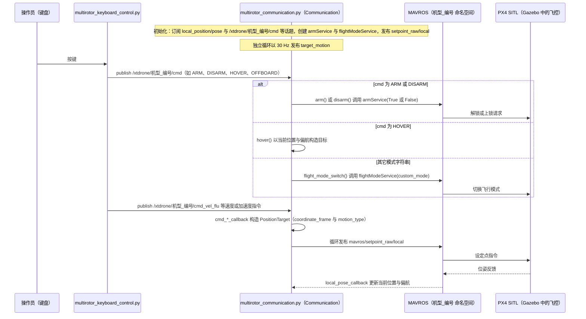

---

type: entity
tags: [repo, simulation, px4, ros, gazebo, uav, education, linux-foundation]
status: complete
updated: 2026-05-27
related:
  - ../overview/multirotor-simulation-planning-control-stack.md
  - ./px4-autopilot.md
  - ./airsim.md
  - ./ego-planner-swarm.md
sources:
  - ../../sources/repos/xtdrone.md
summary: "XTDrone 是基于 PX4 + ROS + Gazebo 的无人机仿真教学平台，提供多机型、视觉 SLAM/检测与编队实验教程，适合中文社区从仿真到真机的全链路入门。"
---

# XTDrone

**XTDrone**（[robin-shaun/XTDrone](https://github.com/robin-shaun/XTDrone)）把 **[PX4](./px4-autopilot.md) SITL**、**ROS** 与 **Gazebo** 组织成可复现的 **教学与实验平台**，覆盖视觉、控制与多机场景。

## 英文缩写速查

| 缩写 | 英文全称 | 简要说明 |
|------|----------|----------|
| SLAM | Simultaneous Localization and Mapping | 同步定位与建图 |
| Sim2Real | Simulation to Real | 把仿真中学到的策略迁移落地真机的工程主线 |

## 为什么重要

- **全链路入门**：从 `roslaunch` 启动仿真到真机 PX4 迁移，文档与社区以中文用户为主。
- **与工业栈一致**：飞控仍是 PX4，而非「玩具仿真器」；算法可向真机延续。
- 与 [AirSim](./airsim.md) 对比：XTDrone 走 **Gazebo 生态**，画质一般但 ROS 集成直接。

## 核心结构/机制

- **仿真**：Gazebo 世界 + iris/typhoon 等机型模型  
- **飞控**：PX4 SITL，MAVROS 通信  
- **实验模块**：目标跟踪、降落、多机编队、强化学习示例等（以仓库当前教程为准）  
- **定位**：常配合 SLAM / 视觉估计包完成自主任务  

## 常见误区或局限

- **误区：XTDrone 是独立飞控** — 飞控核心仍是 PX4；XTDrone 是集成与教程层。
- **局限：Gazebo 版本与 ROS 发行版** — 需按文档锁定 Melodic/Noetic 等组合。
- **局限：视觉画质** — 不适合作为唯一的高保真渲染 Sim2Real 来源。

## 源码运行时序图

入口：ROS 节点 `python3 communication/multirotor_communication.py <机型> <编号>`（如 `iris 0`），与 `python3 control/keyboard/multirotor_keyboard_control.py <机型> <数量> <控制类型>` 配合使用；PX4 SITL 与 Gazebo 的启动方式不在本仓库读取范围内，图从 ROS 节点开始。

图依据：robin-shaun/XTDrone@68c2bc6，communication/multirotor_communication.py（主要部分）、control/keyboard/multirotor_keyboard_control.py（部分）、README.md（仅有项目介绍，运行教程指向外部文档）。

## 参考来源

- [sources/repos/xtdrone.md](../../sources/repos/xtdrone.md)
- [robin-shaun/XTDrone](https://github.com/robin-shaun/XTDrone)
- 源码核对（2026-11-02）：robin-shaun/XTDrone@68c2bc6，读过 README.md、communication/multirotor_communication.py、control/keyboard/multirotor_keyboard_control.py（部分）；时序图依据以上文件，未运行代码。

## 关联页面

- [多旋翼栈总览](../overview/multirotor-simulation-planning-control-stack.md)
- [PX4 Autopilot](./px4-autopilot.md)
- [EGO-Planner Swarm](./ego-planner-swarm.md)

## 推荐继续阅读

- XTDrone 官方文档与配套视频（仓库 README 链接）
