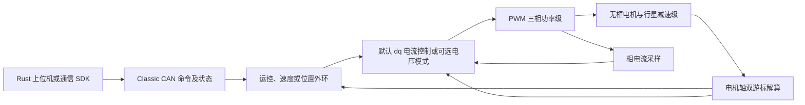
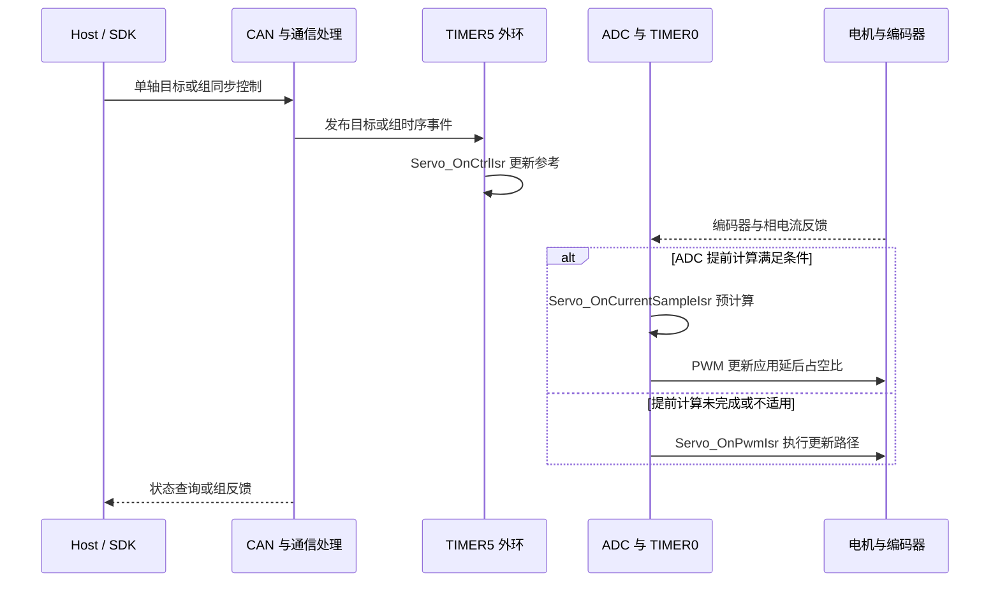

# YHorizon-JM：一体化行星减速关节电机（Integrated Planetary Joint Actuator）

## 一句话定义

**YHorizon-JM** 是一个把无框电机、8:1 行星减速器、双游标编码器和驱动板集成到关节里的开源参考设计；同一仓库给出制造文件、固件、上位机和 Classic CAN 接口。

## 英文缩写速查

| 缩写 | 英文 | 含义 |
| --- | --- | --- |
| FOC | Field-Oriented Control | 磁场定向控制 |
| PWM | Pulse-Width Modulation | 驱动桥占空比更新 |
| ADC | Analog-to-Digital Converter | 采样电流、母线等信号 |
| CAN | Controller Area Network | 此版为 Classic CAN，非 CAN FD |
| BOM | Bill of Materials | 机械件与电控件各有清单 |
| SDK | Software Development Kit | YHorizon-JM 通信库 |

## 为什么重要

不少关节仓库只给减速器 CAD 或单板固件。这个项目提供从机械、电控到控制协议的一条可读链路，适合核查输出轴状态如何被构造、指令如何经过外环进入功率级，以及多个轴如何在 Classic CAN 上启动本地轨迹。它并非已完成认证或独立验收的关节。

## 核心机制与流程

| 层 | 固定版本可核对的范围 |
| --- | --- |
| 模组 | 直径 57 mm、厚 52 mm、约 300 g；WK4310H、14 对极、8:1 行星减速。额定 3 Nm、最大 6 Nm、最高 48 V 是作者口径，不是本文测量 |
| 反馈 | 两个 MT6701 由 30/31 齿游标形成电机多圈读数，再以减速比映射为输出角度；不是独立输出端扭矩传感器 |
| 板与固件 | GD32F303CCT6（112 MHz）、FD6288、20 kHz PWM、4 kHz 外环定时器。固件 1.6 默认电流模式，可配置电压模式；运控、速度、位置模式的参考更新不同 |
| 上位机与总线 | Rust 上位机 0.3.0、通信 SDK 0.1.0；Classic CAN 2.0，1 Mbps。固件协议不是 RS05 或 DM4310；GD32C113 / CAN FD 仍是计划 |

### 固件运行时序

主循环是轮询加中断的实现，不代表 ODrive 式 RTOS 任务排布。配置频率是名义调度速率，不是实测闭环带宽。

### 多轴同步

固件组运动支持 1～16 轴。主机为每轴预装目标、等待就绪，再广播开始和节拍。固件在 4 kHz 外环本地插值五次位置参考及速度前馈，名义节拍 200 Hz，反馈错开时隙；源码在无有效节拍计数达到 120 个外环 tick 时停止组运动（名义约 30 ms），另有状态与跟踪误差检查。它不是每个轴以 4 kHz 在 CAN 上收发，也不等于经测量的同步精度或独立急停。

## 工程实践

- 先检查同一提交的机械与电控 BOM、STEP、原理图和 Gerber，避免按 README 的旧 STEP 名称找文件。还应检查加工公差、齿隙、接口与采购电机的相电阻/电感；默认电流环参数不应直接用于未知电机。
- 固件工具链入口是 CMake preset `gd32f303` 与 `tools/build.sh`，工厂自检另有 preset；上位机走 `host-rs`，不要把旧 `joint_gui.py` 当成本机 UI。部分 README 的 `docs/` 相对链接未在固定版本提交中跟踪。[源码归档](../../sources/repos/yhorizon-jm.md)保留实际文件入口。
- 台架上先隔离运动范围并准备独立急停；验收时区分内容齐全与加工就绪。分别测零点/方向、相电流、输出轴真实力矩、温升、齿隙与多轴抖动，不从作者标称值反推连续负载工况。

## 局限与许可

- 没有独立编译、烧录、复刻、台架或多轴同步实测；代码所示的限幅/超时不是功能安全等级。
- 固定仓库 LICENSE 划分软件 GPL-3.0-only 与机械电控 CERN-OHL-S-2.0，写明遵守义务时可商用，项目页却写禁止商用。本页只记录差异，不认定最终授权；商用或闭源集成前向权利人核对，并留存对应版本与书面条款。

## 关联页面

- [磁场定向控制](../concepts/field-oriented-control.md) · [PID 控制](../methods/pid-control.md)
- [关节执行器参数辨识](../methods/joint-actuator-parameter-identification.md) · [执行器驱动链选型闭环](../queries/actuator-drive-chain-selection-loop.md)
- [ODrive v3 固件](./odrive-v3-firmware-rtos-foc.md)：对比同样的采样和 PWM 约束如何在不同 MCU 和调度结构落实。
- [力矩电机设计纵深 Stage 6](../../roadmap/depth-torque-motor-design.md)：把厂商口径转成可测的模组验收表。

## 参考来源

- [官方仓库与固定提交源码核查](../../sources/repos/yhorizon-jm.md)
- [官方项目页](https://yhorizon.tech/jm/)

## 推荐继续阅读

先并排读 `config.h`、`irq.c`、`servo.c`，明确外环参考与快速功率级更新谁触发谁；再对照 SDK、CAN 协议和 `multi_axis.c`，画出广播节拍、轴内插值和反馈时隙的预算。
