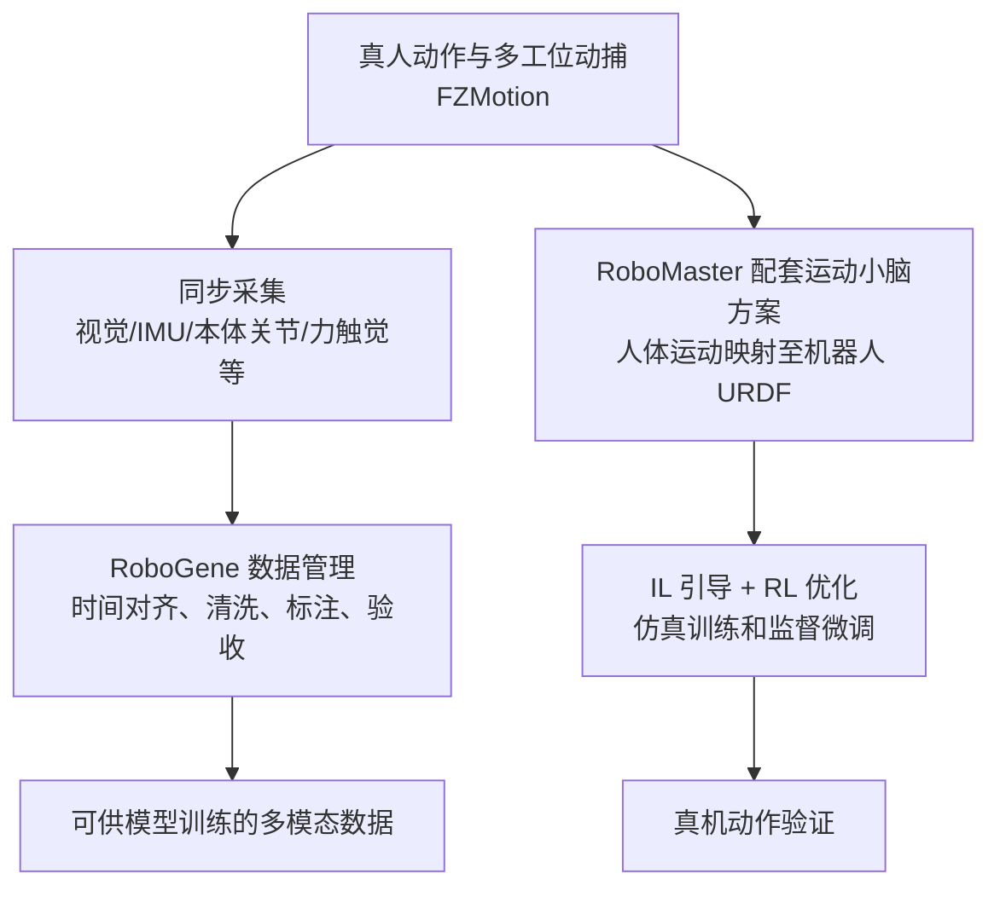

# YMate RoboGene / 元客视界机器人多模态数据采集系统

## 一句话定义

**RoboGene 是元客视界基于 FZMotion 动捕的多模态数据采集、时序对齐、清洗标注与数据管理产品；人体动作转机器人、仿真训练及真机运动验证是同厂商配套 RoboMaster 小脑训练方案的环节，而非 RoboGene 已公开的单体功能。**

## 英文缩写速查

| 缩写 | 英文全称 | 简要说明 |
|---|---|---|
| MoCap | Motion Capture | 人体/机器人长序列运动采集 |
| IMU | Inertial Measurement Unit | 可同步记录的惯性运动数据 |
| URDF | Unified Robot Description Format | 官方小脑方案中用于动作映射的机器人模型 |
| IL | Imitation Learning | 先从真人参考动作引导控制策略 |
| RL | Reinforcement Learning | 仿真中强化训练运动策略 |
| VLA | Vision-Language-Action | 可消费采集得到的多模态数据的下游模型 |

## 为什么重要

- **原始数据并不直接等于训练样本**：人体骨骼、机器人关节、相机和力/触觉要做时间戳对齐、验收、标注，才便于训练与回放。
- **数据管理和运动学习是两条相接但不同的线**：RoboGene 解决采什么、怎么对齐与管理；RoboMaster 解决如何将动作转成机器人可跟踪的策略。
- **为工业级采集场选型提供可核查维度**：多工位同步、可用模态、数据验收和动作导出，比只看宣传演示更有参考价值。

## 核心信息

| 项目 | 官方公开口径 |
|---|---|
| 机构 | 北京元客视界科技有限公司（YMate，凌云光旗下） |
| 定位 | RoboGene 多模态数据采集管理；配套 RoboMaster 机器人运动小脑训练 |
| 数据模态 | 视觉、雷达、人体/机器人骨架与关节、IMU、声音、深度、点云、力/触觉等 |
| 管理环节 | 多工位分发、任务/用户管理、时间戳对齐、清洗、标注、筛选、验收入库 |
| 机器人动作链 | 人体动捕 → URDF 模型重定向 → 轨迹/关节角优化 → IL + RL → 仿真与监督微调 → 真机验证（**RoboMaster** 方案） |
| 产品方声称的性能 | FAIR 产品页称 0.1 mm 位置精度、0.1° 姿态精度、千万条/年与采集成本降低 90%；没有可独立复核的测试基准 |
| 代码与数据 | 官方公开页面未提供可运行源码、权重或开放数据集入口（截至 2026-11-21） |

## 核心原理与流程总览

官方资料可支持以下**厂商方案级**数据流；箭头仅表达公开描述的处理顺序，并非经过源码核实的软件模块调用关系：

> 该图分开了 RoboGene 的**数据管线**与 RoboMaster 的**运动策略训练管线**；两条链共同使用人体动捕输入，但公开资料未提供内部接口契约和训练代码。

## 工程实践

1. **规划采集**：定义采集场所、角色、工位、任务与本体，记录每条轨迹的设备型号、时间戳、成败与标注版本。
2. **同步多模态数据**：记录人/机器人关节及外部视觉、雷达、力触觉；检查实际有效采样率与时间漂移，而非只依赖宣传定位精度。
3. **验收与导出**：按任务筛选缺帧、异常关节/接触、采集失败样本；官方说明支持按预配置导出序列文件（例：pkl）。
4. **运动技能迁移（配套方案）**：用机器人 URDF 将人参考运动重定向为可行关节/根节点参考；在仿真中模仿+强化训练，再到真机评估跌倒、脚滑、重现误差、通过率。
5. **独立量化验收**：测量示教原速与重放时长比、每种障碍连续成功次数、采集到可用轨迹的转化率；这些建议是工程验收项，**非厂商已公布的成绩**。

## 源码运行时序图

**不适用**：本次核对的元客官方方案、官方技术文章和 FAIR 产品页均未提供可运行 RoboGene / RoboMaster 源码入口，无法按真实类名、脚本与运行入口绘制源码调用时序。

## 与其他工作对比

- **[Motion Retargeting](../concepts/motion-retargeting.md)**：是人体骨架到机器人动作的通用技术问题；元客视界提供一套商用动捕、数据管理与小脑训练配套方案，不等于开源重定向算法。
- **[具身数据清洗](../concepts/embodied-data-cleaning.md)**：阐释采集对齐和筛选的通用质量判据，可用于评估 RoboGene 数据是否真正可学。
- **[同名论文 RoboGene](./paper-robogene.md)**（arXiv:2602.16444）：研究「智能体自动生成多样化示教任务」，**与元客视界的 RoboGene 商业数据采集产品无关联**，不能共用论文数据、代码或评测结果。

## 局限与风险

- **演示证据待核实**：社交平台声称「宇树 G1 原速复刻三道障碍」；截至入库时，未找到可复核的该演示官方原视频、试验协议、任务定义和成功率，不能据此判断真机运动控制效果。
- **命名边界**：把「检索、仿真校验、动作复制」全部归因于 RoboGene 没有官方产品架构支撑；官网对小脑训练另使用 RoboMaster 名称。
- **量化指标是厂商宣称**：0.1 mm/0.1°、成本下降 90%、千万条/年没有独立对照协议；部分官网配置示例使用不同精度口径，不能跨场景直接比较。
- **工程复现有限**：没有公开数据结构、完整软件协议或源码；不能直接从网页复现动作重定向、训练和部署。

## 关联页面

- [同名 RoboGene 论文（区分身份）](./paper-robogene.md)
- [动作重定向](../concepts/motion-retargeting.md)
- [遥操作](../tasks/teleoperation.md)
- [VLA 视觉语言动作策略](../methods/vla.md) — 下游训练数据消费者
- [具身数据清洗](../concepts/embodied-data-cleaning.md)
- [具身数据纵深路线](../../roadmap/depth-embodied-data.md)

## 参考来源

- [元客 RoboGene / FZMotion 官方原文核对归档](../../sources/sites/ymate-robogene-fzmotion-primary.md)
- [元客官方解决方案](https://ymate3d.com/solution/202509041222290414.html)
- [元客 IROS 2025 技术介绍](https://ymate3d.com/Content/2025-10-24/1438411010.html)
- [FAIR plus 产品说明](https://fairplus.cn/en/products/100142/p000267/)

## 推荐继续阅读

- [元客视界 2025 IROS 方案详解](https://ymate3d.com/Content/2025-10-24/1438411010.html)
- [具身数据纵深路线：采集到飞轮](../../roadmap/depth-embodied-data.md)
