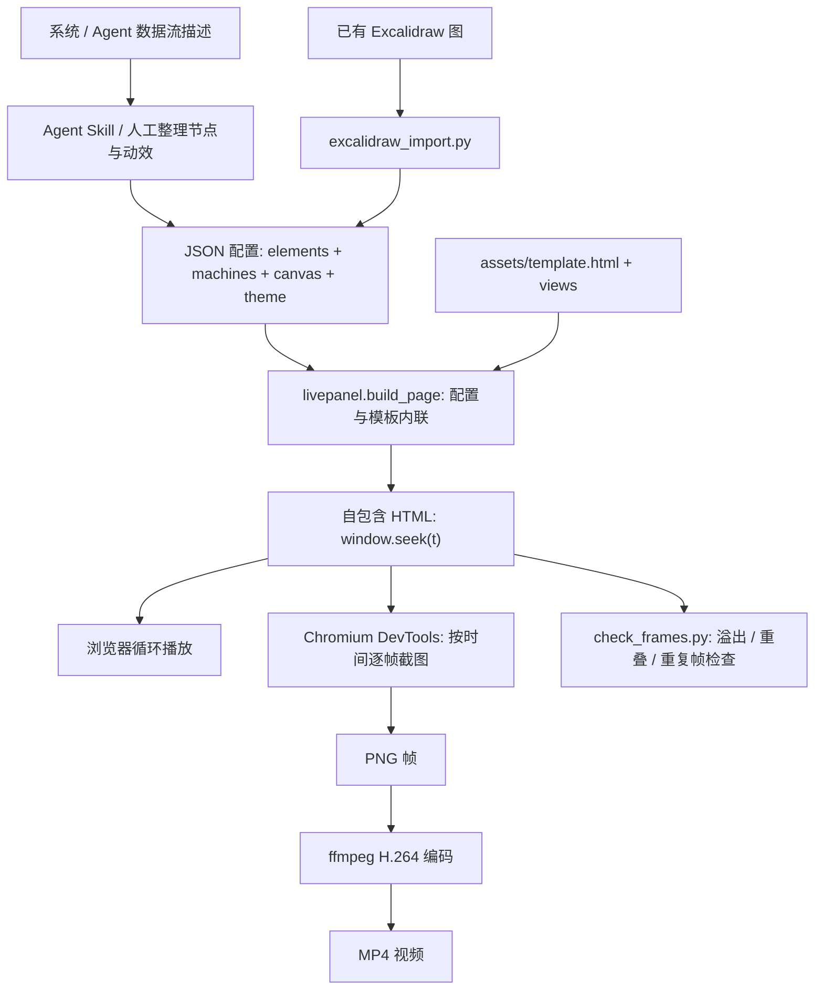
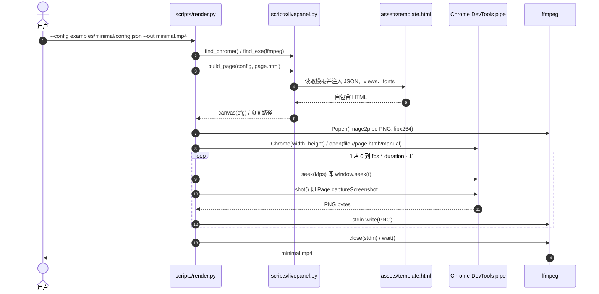

# live-panel-skill: Animated Architecture Diagrams｜用 JSON 生成动态系统架构图

## 一句话定义

**[live-panel-skill](https://github.com/ythx-101/live-panel-skill)** 是 ythx-101 开源的 **Agent Skill + 配置驱动动画渲染器**：用一份 JSON（或由 Excalidraw 导入）定义系统节点、连线和随时间变化的状态，导出 H.264 MP4 或可以循环播放的自包含 HTML 页面，而非自动发现真实系统架构。

## 英文缩写速查

| 缩写 | 英文全称 | 简要说明 |
| --- | --- | --- |
| JSON | JavaScript Object Notation | 架构节点、连线、状态机和版式的配置格式 |
| MP4 | MPEG-4 Part 14 | 输出 H.264 视频的封装格式 |
| HTML | HyperText Markup Language | 自包含、可在浏览器循环运行的架构动图页面 |
| CDP | Chrome DevTools Protocol | Python 通过 Chrome 调试管道逐帧设置时间并截图 |
| CLI | Command-Line Interface | `render.py`、`check_frames.py` 等脚本的运行入口 |
| PNG | Portable Network Graphics | Chromium 截取的逐帧图像，经管道交给 ffmpeg 编码 |

## 为什么重要

- **把静态拓扑变成可演示的运行机制。** 系统中的数据包在连线流动，日志滚动，计数与状态条按统一状态机变化；每帧仍是完整架构图，适合解释机器人训练、策略部署、agent 工具编排的*概念数据流*。
- **图源可版本管理。** 盒子、连线、文案、显示状态与画布参数都保存在 JSON；Agent 可参考 `SKILL.md` 生成配置，再经校验生成传播素材。
- **区分动画与实时系统。** 状态与数值通常是模拟的，不是自动采集 ROS 2、网络、传感器或模型服务指标；这使它适合演示，但不能承担诊断或监控职责。

## 核心原理

| 层 | 官方实现 / 契约 |
| --- | --- |
| 内容层 | `SKILL.md` 指导 Agent 确定节点、连线、信息来源与模拟数字；`examples/*/config.json` 提供配置起点 |
| 配置层 | `canvas`、`theme`、`machines`、`elements` 描述画幅、主题、状态和元素 |
| 视图层 | `terminal-dark`、`light-pastel` 两套主题；自由布局及已实现的 `ring`、`funnel`、`loop`、`excalidraw` 视图 |
| 模板层 | `scripts/livepanel.py::build_page` 读取 JSON，将配置、视图脚本和字体注入 `assets/template.html`，生成自包含页面 |
| 时间层 | 页面暴露 `window.seek(t)`，画面由时间和固定种子确定；无须依赖真实时钟或随机采样 |
| 编码层 | `scripts/render.py` 驱动 Chrome/Chromium 在每个 `i/fps` 时刻截图，再将 PNG 管道送入 ffmpeg 编码 H.264 MP4 |
| 检验层 | `scripts/check_frames.py` 采样页面，检测文字溢出、重叠及可选回放一致性 |

### 流程总览

以下是官方 README、`SKILL.md` 与渲染脚本支持的配置到交付路径；**不代表连接了任何真实在线监控数据**。



### 源码运行时序图

以仓库可执行入口 `python3 scripts/render.py --config examples/minimal/config.json --out minimal.mp4` 为准；标注的函数和外部进程均可在固定版本的 `render.py` 和 `livepanel.py` 中找到。



独立校验入口为 `check_frames.py`：重新 `build_page`，通过 `Chrome.seek(t)` 采样页面 `window.__check()`，开启 `--repeat` 时跳离当前时刻再回放截图，对比可见像素差异；它是**页面排版与确定性检测**，并非 MP4 物理或运行性能测评。

## 工程实践

官方最低要求：**Python 3.8+、Chrome/Chromium、ffmpeg**；基本渲染脚本用 Python 标准库，无需云服务密钥或 pip 依赖。Linux、macOS 可直接运行；Windows 请使用 WSL。

```bash
git clone https://github.com/ythx-101/live-panel-skill.git
cd live-panel-skill
python3 scripts/render.py --config examples/minimal/config.json --out minimal.mp4 --html-out minimal.html
python3 scripts/check_frames.py --config examples/minimal/config.json --out-dir frames --repeat
```

| 需求 | 用法与验证点 |
| --- | --- |
| 机器人策略部署架构动图 | 用 JSON 画出观测获取、推理、命令输出与执行器边界；运动数据和延迟数值如无测量须标 illustrative |
| 调整样式 | `theme.preset` 用 `terminal-dark` 或 `light-pastel`；`canvas.preset` 支持 `4:5`、`3:4`、`1:1` |
| 已有手绘架构 | `python3 scripts/excalidraw_import.py input.excalidraw -o config.json` 后检查箭头绑定和节点归属，再渲染 |
| 自动布局 | `ring` / `funnel` / `loop` / `excalidraw` 可用；`nebula` / `timeline` / `tree` / `kpi` 在上游文档中仍标 planned |
| 视频质量 | 先运行 `check_frames.py --repeat`，人工查看导出的 PNG，再决定是否发布 |
| 署名复刻 | 对引用的原图作者与原始链接在页脚及发布文案中保留署名；示例复刻不等于该视觉设计归本仓库所有 |

## 局限与风险

1. **不是实时监控工具：** 动画数字、日志和状态由配置驱动，不与设备遥测自动同步；不能用作机器人实时故障分析或性能验证。
2. **画幅需重新布局：** JSON 中坐标是绝对像素，宽高比变化不能指望自动重排；文字与字体也会影响碰撞检测。
3. **环境约束：** MP4 依赖 Chrome/Chromium 与 ffmpeg；Windows 原生不支持源码使用的 POSIX DevTools pipe，需 WSL。
4. **能力边界：** 并非所有 README 中列出的 view 都已实现；标 planned 的种类不能当成可运行 API。
5. **来源与许可：** 代码为 MIT；上游部分示例复现其他创作者的视觉作品，二次发布仍应遵守注明原作者与原图链接的要求。
6. **核对边界：** 本页已依据固定提交的官方说明、实际执行脚本和最小 JSON 示例核对；**本次没有执行**视频编码或全套单测，不能把作者的自测记录当作本次测量结果。

## 关联页面

- [Diagrams（Python Diagram-as-Code）](./mingrammer-diagrams.md) — 适合静态云系统架构图；live-panel 擅长持续播放的状态动画
- [Mermaid.js](./mermaid-js.md) — Wiki 中直接显示的文本式静态流程图、时序图
- [Archify](./archify.md) — JSON IR 到可校验架构工件，可比较与 live-panel 的视觉用途差异
- [Diagram Design](./diagram-design.md) — 绘制与审查技术架构图的设计流程

## 参考来源

- [live-panel-skill 官方源码归档（含核对范围）](../../sources/repos/ythx-101-live-panel-skill.md)
- [官方 README](https://github.com/ythx-101/live-panel-skill/blob/d5aa86d8a5729cea2c78f083df672977f168a147/README.md)
- [官方 SKILL.md](https://github.com/ythx-101/live-panel-skill/blob/d5aa86d8a5729cea2c78f083df672977f168a147/SKILL.md)
- [源码：render.py](https://github.com/ythx-101/live-panel-skill/blob/d5aa86d8a5729cea2c78f083df672977f168a147/scripts/render.py)
- [源码：livepanel.py](https://github.com/ythx-101/live-panel-skill/blob/d5aa86d8a5729cea2c78f083df672977f168a147/scripts/livepanel.py)
- [源码：check_frames.py](https://github.com/ythx-101/live-panel-skill/blob/d5aa86d8a5729cea2c78f083df672977f168a147/scripts/check_frames.py)

## 推荐继续阅读

- [配置结构和元素说明](https://github.com/ythx-101/live-panel-skill/blob/d5aa86d8a5729cea2c78f083df672977f168a147/references/config-schema.md)
- [动画节奏规则](https://github.com/ythx-101/live-panel-skill/blob/d5aa86d8a5729cea2c78f083df672977f168a147/references/motion-grammar.md)
- [官方最小示例配置](https://github.com/ythx-101/live-panel-skill/blob/d5aa86d8a5729cea2c78f083df672977f168a147/examples/minimal/config.json)
