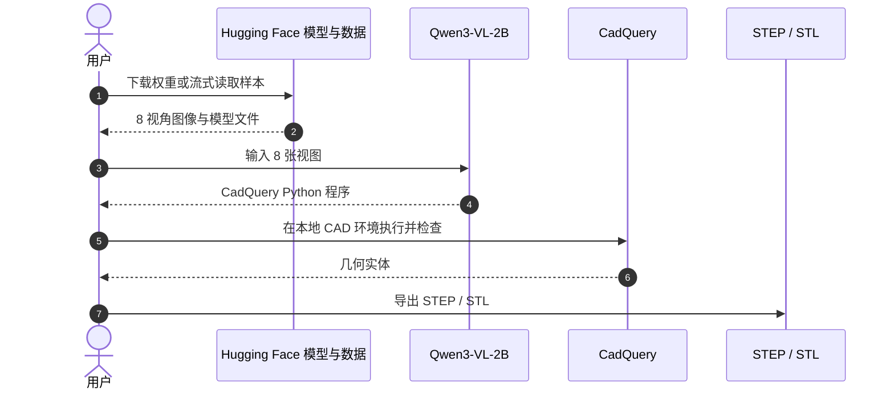

# Zero-to-CAD：从多视角图像到可编辑 CAD 程序

**Zero-to-CAD** 是 Autodesk Research 提出的 CAD 程序合成与重建项目：以带执行反馈的代理流程扩展合成构造序列，并用发布的视觉语言模型将多视角形状图像映射为 CadQuery 程序。

## 英文缩写速查

| 缩写 | 英文全称 | 简要说明 |
|------|----------|----------|
| CAD | Computer-Aided Design | 项目的目标表示，保留参数化构造过程 |
| LLM | Large Language Model | 在 CAD 环境中生成并迭代构造程序 |
| VLM | Vision-Language Model | 配套模型从多视角图像生成 CAD 代码 |
| IoU | Intersection over Union | 模型卡报告的体素几何重叠指标 |
| OOD | Out-of-Distribution | ABC 外部分布评测集，用于观察泛化表现 |

## 为什么重要

常见 3D 数据只保留最终网格或边界表示，难以恢复设计意图和可编辑建模步骤。Zero-to-CAD 将合成重点放在可执行、可读的 CAD 构造程序上，同时提供从图像重建程序的配套模型，为 CAD 生成研究提供数据与一个可下载的基线。

## 方法与资源栈

论文把合成描述为代理搜索：语言模型在 CAD 环境里生成代码，执行后检查几何，再结合工具调用和文档查询继续修正，以获得有效性和操作多样性。发布的模型是基于 Qwen3-VL-2B-Instruct 全量微调版本，接收 8 张 256×256 渲染视图并输出 CadQuery Python。

| 资源 | 内容 | 许可 / 状态 |
|------|------|-------------|
| 合成数据 | 完整集约 1M 条构造序列；模型卡称训练用了 979,633 条样本 | HF 数据卡与论文为准 |
| 精选数据 | 100K 多样性子集；卡片拆分 81,015 / 9,734 / 9,767，共 100,516 条 | Apache-2.0 |
| 配套模型 | Qwen3-VL-2B，多视角图像→可执行 CadQuery | Apache-2.0 |
| 独立生成系统代码 | 本次核查未发现官方 GitHub 仓库链接 | 不据此推断完整数据生成代码已发布 |

## 源码运行时序图

模型卡提供 Transformers 推理示例和生成代码执行、STEP/STL 导出的示例。下面表示可复现的模型消费路径，不代表论文完整的合成数据代理系统已经开源：

## 评测与结果

模型卡报告 Zero-to-CAD 测试集成功率 **82.1%**、mean IoU **0.747**；ABC OOD 集成功率 **61.0%**、mean IoU **0.377**。成功率指生成代码可执行的比例，几何相似度按 64³ 体素 IoU 并在 45° 旋转步长上对齐计算。不同数据集间差距提示：在合成测试分布上的分数不能直接视作真实照片或现场扫描重建能力。

## 工程实践

- 可从 [Zero-To-CAD-100k](https://huggingface.co/datasets/ADSKAILab/Zero-To-CAD-100k) 读取图像、CadQuery 源码和 STEP/STL 导出；总计 100,516 条，适合原型、评测和算力受限的实验。
- 推理时按模型卡输入 8 张 256×256 视图；执行生成代码前先在隔离环境检查，确认几何与依赖后再导出 CAD 文件。
- 若训练需要最大样本覆盖，应考虑完整 1M 数据集；配套模型卡称该模型训练使用的是其中 979,633 条样本，而非仅 100K 子集。
- 复现结果时记录模型 revision、Transformers 版本、图像视角与重建评测脚本；模型卡当前给出的是可运行的加载和推理片段，并非单独的训练仓库。

## 局限与风险

- 训练样本为合成数据；模型卡指出真实照片、噪声输入和不同视角配置尚未验证。
- 当前模型预期 8 张干净多视图输入，只输出 CadQuery；其他 CAD 表示需要后处理。
- 复杂多零件装配可能超出 4,096 token 上下文，发布的结果也不等同于经过制造审查的工程设计。
- Apache-2.0 标签适用于对应 HF 模型与数据仓库；下游仍应核对各文件及依赖的许可、来源和使用条件。

## 结论

Zero-to-CAD 的可复用价值在于把 CAD 构造历史作为合成与重建目标；目前可直接试用的是 HF 模型和数据集，论文完整代理式生成流水线的源码开放范围仍需单独确认。

1. **图像到程序基线：** 模型需要 8 视角渲染输入，适合作为受控条件下的 CAD 重建起点。
2. **几何覆盖：** 100K 子集按视觉特征聚类采样，较完整集小，论文建议用完整集训练大模型。
3. **评测要分布内外：** 合成测试表现较强，ABC OOD 的成功率与 IoU 明显降低，应单独报告真实输入泛化。
4. **开放范围分开读：** 模型与数据标注 Apache-2.0；不要把这推成完整 agentic 合成系统实现也已开源。

## 关联页面

- [文字生成 CAD](../concepts/text-to-cad.md) — CAD 程序生成任务与工程边界。
- [GenCAD-3D](./gencad-3d.md) — 点云 / 网格到 CAD 程序的几何条件生成路线。
- [CAD 1000 Hours](./cad-1000-hours-dataset.md) — 真实桌面 CAD 操作语料，与合成构造序列互补。

## 参考来源

- [Zero-to-CAD 论文归档](../../sources/papers/zero_to_cad_arxiv_2604_24479.md)
- [Zero-to-CAD Qwen3-VL-2B 模型卡](../../sources/models/zero-to-cad-qwen3-vl-2b.md)
- [Zero-to-CAD 100K 数据卡](../../sources/datasets/zero-to-cad-100k.md)

## 推荐继续阅读

- [Zero-to-CAD arXiv 论文](https://arxiv.org/abs/2604.24479) — 方法、数据合成与评测细节。
- [Hugging Face 模型卡](https://huggingface.co/ADSKAILab/Zero-To-CAD-Qwen3-VL-2B) — 加载、推理和模型限制。

- 相关研究：[多部件参数化 CAD 重建](./paper-cadonatello.md)
