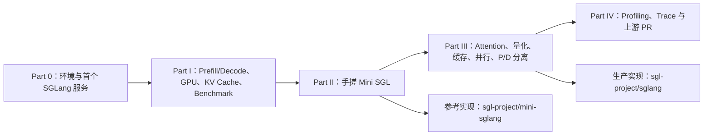
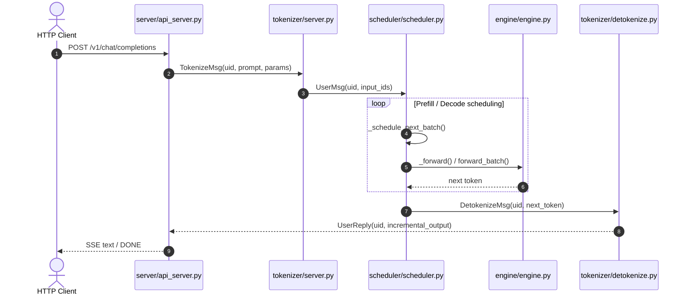

# Zero to SGLang / 从零手搓 SGLang｜LLM 推理系统实战课程

## 一句话定义

Zero to SGLang 是 Datawhale 与 RadixArk 共同推出的双语课程：理解 LLM 推理瓶颈，逐步实现简化引擎，再阅读真实 SGLang 源码，并以 Profiling 与开源 PR 作为工程练习。

## 英文缩写速查

| 缩写 | 英文全称 | 简要说明 |
|---|---|---|
| LLM | Large Language Model | 课程面向的大语言模型推理 |
| KV | Key-Value | Attention 历史键值缓存 |
| GPU | Graphics Processing Unit | 模型前向与采样的计算设备 |
| TTFT | Time to First Token | 首 token 延迟，涉及请求等待和 prefill |
| TPOT | Time per Output Token | 输出 token 平均耗时指标 |
| SSE | Server-Sent Events | HTTP 上的流式文本返回机制 |
| PR | Pull Request | 课程 Part IV 的上游贡献目标 |

## 为什么重要

课程连接“知道 KV Cache / Continuous Batching 的术语”与“能从入口追踪一次请求、定位调度与显存瓶颈”的能力。相较于直接跳入生产级 SGLang 的众多组件，先理解 Mini-SGLang 的请求流水线更容易解释资源约束、尾延迟及性能优化的成本。

## 核心原理

### 课程学习与项目流程总览

下图来自官方 README 的五阶段学习结构，指学习路线而非自动执行的工作流。

### 请求生命周期：课程 Part II 第 2 章

输入是 HTTP 请求与文本，Tokenizer 将其变成 token ids；Scheduler 根据队列、KV Cache 预算和 prefill/decode 状态组 batch；Engine 执行前向与采样，产生下一 token。Detokenizer 保留解码状态，将新增文本经 API Server 以 SSE 返回。请求 uid 串联各环节，结束或取消都必须回收资源。

- **调度不等于前向**：scheduler 负责“这一轮选谁”，engine 负责“怎样计算”；二者可位于同一工作进程。
- **Prefill 不等于 Decode**：前者处理输入上下文，后者迭代生成；优化目标与资源瓶颈不同。
- **缓存不只影响速度**：KV Cache 既是重用历史计算的手段，也是决定并发容量和内存压力的资源。
- **测量须看尾部**：TTFT、TPOT、ITL、Goodput 和分位数分别反映交互与系统服务能力，不能只看平均 tokens/s。

## 源码运行时序图

本课程仓库自身是教学文档；以下是**官方课程 Part II 代码走读所引用的独立上游 `sgl-project/mini-sglang` 参考实现**，并非声称 `zero-to-sglang` 仓库内有同名可执行 Python 包。

**核对依据：** [课程代码走读](https://github.com/datawhalechina/zero-to-sglang/blob/main/course-material/ch/part2/第2章_一个请求的旅程_代码.md) 与 [Mini-SGLang 官方架构](https://github.com/sgl-project/mini-sglang/blob/main/docs/structures.md)。图为单请求主干；多卡通信、异步重叠及中断回收分支被省略。

## 工程实践

1. **先补背景（Part I）**：理解 Attention、KV Cache 内存规模、prefill/decode、Roofline 与评测指标；这部分无需 GPU。
2. **复现服务与读执行路径（Part 0、Part II）**：按官方章节运行适合自己硬件的 SGLang 示例；跟踪 uid、调度队列和 KV Cache 生命周期；多数 Part II 内容可先在 CPU 上学习/调试，完整性能实验建议 GPU。
3. **做单变量优化（Part III）**：选择 Prefix Cache、Continuous Batching 或量化开关，固定模型、prompt/output token 分布、batch、并发及软硬件版本，比较 TTFT、TPOT、吞吐和 P95/P99。
4. **用证据贡献（Part IV）**：收集 profiling trace，给出改动前后对比、正确性验证、复现命令及 PR 测试范围。

**机器人延伸：** 可作为 VLA / WAM 的大模型语义层部署前置；机载低层实时控制还需单独测量感知→决策→动作的端到端最坏时延，不可由服务器吞吐指标替代。

## 局限与风险

- 本项目是**课程文档**；真实可运行引擎位于独立的 [Mini-SGLang](https://github.com/sgl-project/mini-sglang) 与 [SGLang](https://github.com/sgl-project/sglang) 仓库，不能混淆项目身份。
- 官方 README 标注所有中英文正文已于 2026-11-10 完成，但配套视频计划在 2026 年 11 月底陆续完结，当前不应声称视频已齐。
- README 提供 PDF 入口，但 2026-11-18 查得 Releases 暂无发布条目；因此 PDF 的实际可下载性未确认。
- 中文在线站直接抓取未成功；本次依据官方 GitHub 原始 Markdown 与 Mini-SGLang 架构资料核对，**未逐章读完整套课程或实测 GPU 性能**。
- 课程的 CC BY-NC-SA 4.0 许可适用于其内容；本页是独立归纳，不复制原文全文。

## 关联页面

- [SGLang｜生产级 LLM 推理框架](./sglang.md)
- [Mini-SGLang｜教学级在线 Serving 架构](./mini-sglang.md)
- [LLM 推理显存估算](../concepts/llm-inference-vram-estimation.md)

## 参考来源

- [课程原文（核对范围与目录）](../../sources/courses/zero-to-sglang.md)
- [课程仓库与参考实现区别](../../sources/repos/zero-to-sglang.md)
- [课程站、视频与 Releases 状态](../../sources/sites/zero-to-sglang.md)
- [官方课程 GitHub / README_zh](https://github.com/datawhalechina/zero-to-sglang/blob/main/README_zh.md)

## 推荐继续阅读

- [中文在线阅读（官方 README 所列入口）](https://zero-to-sglang.datawhale.cc/ch/)
- [配套学习视频（官方 README 所列入口）](https://www.bilibili.com/video/BV1Dg4w6tExD/)
- [PDF Releases（截至核对日尚无发布）](https://github.com/datawhalechina/zero-to-sglang/releases)
