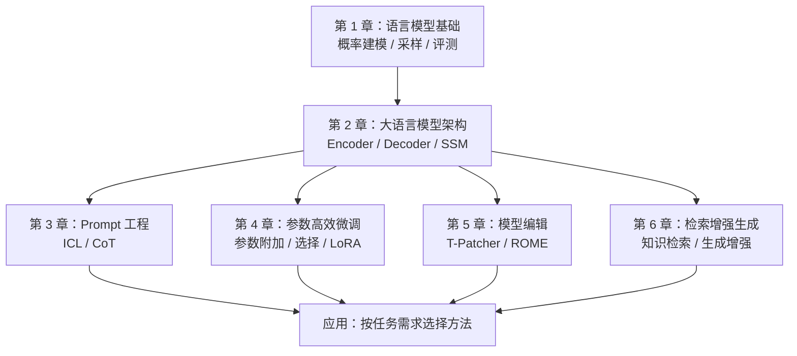

# 大模型基础（Foundations of Large Language Models）

**教材：** 毛玉仁、高云君等著，浙江大学 DAILY Lab。**官方资源：** [ZJU-LLMs/Foundations-of-LLMs](https://github.com/ZJU-LLMs/Foundations-of-LLMs) · [中文完整 PDF](https://github.com/ZJU-LLMs/Foundations-of-LLMs/blob/main/%E3%80%8A%E5%A4%A7%E6%A8%A1%E5%9E%8B%E5%9F%BA%E7%A1%80%E3%80%8B%E6%95%99%E6%9D%90/%E5%A4%A7%E6%A8%A1%E5%9E%8B%E5%9F%BA%E7%A1%80%20%E5%AE%8C%E6%95%B4%E7%89%88.pdf) · [英文 PDF](https://github.com/ZJU-LLMs/Foundations-of-LLMs/blob/main/Foundations_of_LLMs%28English_version%29/Foundation_of_LLMs.pdf)

> **核验状态：** 官方 README 已完整阅读，教材原文已核对目录和六章部分内容；**PDF 全文尚未逐页通读**，故此页保留 draft，不把抽读当作通读。

## 一句话定义

《大模型基础》是一部面向大语言模型学习的开放教材，按“传统语言建模 → 架构 → 任务提示 → 参数适配 → 知识修改 → 外部知识增强”的顺序组织六章内容，并通过配套论文列表补充研究线索。

## 英文缩写速查

| 缩写 | 英文全称 | 简要说明 |
|---|---|---|
| LLM | Large Language Model | 大语言模型 |
| ICL | In-Context Learning | 通过上下文示例引导模型任务表现 |
| CoT | Chain-of-Thought | 思维链提示与分步推理 |
| PEFT | Parameter-Efficient Fine-Tuning | 仅调整少量参数的模型任务适配 |
| LoRA | Low-Rank Adaptation | 低秩参数增量适配 |
| RAG | Retrieval-Augmented Generation | 利用外部检索结果增强生成 |
| SSM | State Space Model | 非 Transformer 序列建模的部分替代架构 |

## 为什么重要

- **系统学习路径：** 同时覆盖训练前的语言建模机制、模型架构选择以及部署前的提示/适配/知识维护方法，适合作为机器人 VLA/VLM 背景知识的前置阅读。
- **明确技术分工：** Prompt 改变输入与任务表达；PEFT 改变可训练参数；模型编辑定位已有知识；RAG 在推理时接入外部信息，它们解决的问题不同。
- **可溯源阅读：** 官方仓库同时提供完整 PDF、分章 PDF 与各章 Paper List；读者应区分教材概述、书中引用的论文结果和代码实现。

## 核心原理：六章学习结构

| 章 | 教材原有主题 | 主要内容 | 建议理解的问题 |
|---|---|---|---|
| 1 | 语言模型基础 | n-grams、RNN、Transformer、采样与评测 | 模型如何表示和预测语言概率？ |
| 2 | 大语言模型架构 | Encoder-only、Encoder–Decoder、Decoder-only、非 Transformer 架构（SSM 等） | 不同主干如何处理输入、生成和长序列？ |
| 3 | Prompt 工程 | 上下文学习、思维链、提示设计、Agent/Text-to-SQL 等应用 | 不更新权重，如何引导模型行为？ |
| 4 | 参数高效微调 | 参数附加、参数选择、低秩适配与实践 | 有限算力下如何进行任务适配？ |
| 5 | 模型编辑 | 编辑方法分类、T-Patcher、ROME 与应用 | 如何修改特定模型知识并控制副作用？ |
| 6 | 检索增强生成 | RAG 架构、知识检索、结果重排、生成增强 | 如何引入外部可更新知识降低信息过时风险？ |

### 方法边界

- **模型架构 vs 任务适配：** 第 2 章讨论模型结构类别，第 4 章讨论既有模型的参数高效适配，不能把 LoRA 当作一种完整 LLM 主架构。
- **模型编辑 vs RAG：** 前者改动模型内部知识表示，后者通过外部检索补充上下文；两者可组合，但不等价。
- **教材 vs 工程实现：** 有六章 PDF 和 Paper List，不代表提供训练、推理或机器人部署的配套实现。

## 流程总览（依据教材目录组织的学习依赖）

这是 **教材主题关系图**，不是作者发布的算法架构图；边表示学习前置知识，**不表示模型数据流或训练执行顺序**。

## 工程实践

| 目标 | 教材对应章节 | 推荐实践与核查点 |
|---|---|---|
| 理解 VLM / VLA 文本骨干 | 第 1–2 章 | 对照 Token、Transformer 注意力、Decoder-only 与非 Transformer 的模型输入/输出 |
| 提示与语言指令设计 | 第 3 章 | 比较 ICL 示例、CoT 提示的任务适用性；不要把思维链收益普适化 |
| 微调领域模型 | 第 4 章 | 区分 Adapter、LoRA 与参数选择；以原始论文/官方实现检验细节 |
| 维护或修正特定知识 | 第 5 章 | 关注编辑成功、局部性、保留性及可能的副作用 |
| 接入项目文档/知识库 | 第 6 章 | 关注检索质量、重排、上下文整合与知识更新时效性 |

## 源码运行时序图

**不适用。** 这是 PDF 教材与相关论文列表的资料型仓库，不是公开训练或推理软件；官方 README 未提供可辨认的执行入口，不编造 `sequenceDiagram`。

## 局限与风险

1. **原文阅读尚未完结：** 已核对官方 README 和教材部分正文，但完整 PDF 的所有推导、表格与图例尚需逐页研读；本页不包含未经核实的实验结论。
2. **时间敏感性：** 仓库声明“月度更新”的意图，不意味着当前版本按月更新；技术进展需以各章 Paper List 和被引用论文的版本为准。
3. **工程复现边界：** 主要是学习材料，不能依赖它直接完成训练、推理或机器人部署。
4. **语言版本：** 英文 PDF 已确认存在，尚未比较其与中文完整 PDF 的章节/修订一致性。
5. **发布日期核查：** 官方仓库创建于 2024-06-30；“2024 年 8 月首次开源”缺乏仓库历史支持。

## 关联页面

- [深度学习基础](../concepts/deep-learning-foundations.md)
- [Transformer](../concepts/transformer.md)
- [LLMs-from-scratch（Raschka）](./llms-from-scratch-raschka.md)
- [MiniMind](./minimind.md)

## 参考来源

- [教材 PDF 与章节核对归档](../../sources/books/zju-foundations-of-llms.md)
- [官方 GitHub README 通读归档](../../sources/repos/zju-foundations-of-llms.md)
- [作者 GitHub 仓库](https://github.com/ZJU-LLMs/Foundations-of-LLMs)
- [浙江大学 DAILY Lab GitHub 组织](https://github.com/ZJU-LLMs)

## 推荐继续阅读

- [官方中文教材 PDF](https://github.com/ZJU-LLMs/Foundations-of-LLMs/blob/main/%E3%80%8A%E5%A4%A7%E6%A8%A1%E5%9E%8B%E5%9F%BA%E7%A1%80%E3%80%8B%E6%95%99%E6%9D%90/%E5%A4%A7%E6%A8%A1%E5%9E%8B%E5%9F%BA%E7%A1%80%20%E5%AE%8C%E6%95%B4%E7%89%88.pdf)
- [官方英文教材 PDF](https://github.com/ZJU-LLMs/Foundations-of-LLMs/blob/main/Foundations_of_LLMs%28English_version%29/Foundation_of_LLMs.pdf)
- [配套经典论文列表](https://github.com/ZJU-LLMs/Foundations-of-LLMs/tree/main/%E5%A4%A7%E6%A8%A1%E5%9E%8B%E7%BB%8F%E5%85%B8%E8%AE%BA%E6%96%87%E5%88%97%E8%A1%A8)
