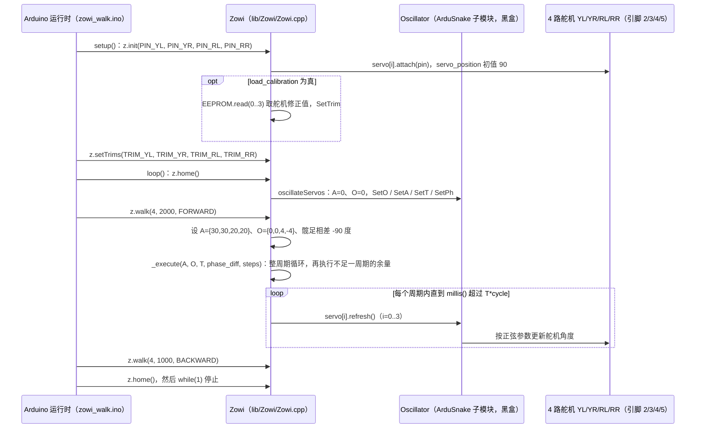

# Zowi

**Zowi**（[GitHub](https://github.com/JavierIH/zowi)，[相关链接](https://github.com/bq/zowiLibs)）是 [GitHubStore《19 款能自己造的开源人形机器人》](https://mp.weixin.qq.com/s/UUwUAcKdVrlo-N60Oar3Xg) 的第 3 项，文章标价 约 €100。

## 一句话定义

**Zowi 是西班牙 bq 公司推出的小型教育双足机器人；JavierIH/zowi 仓库存放 bq Zowi 的源文件，机械件用开源工具 FreeCAD 设计。**

## 英文缩写速查

| 缩写 | 英文全称 | 简要说明 |
|------|----------|----------|
| FreeCAD | FreeCAD | 开源参数化 3D CAD |

## 为什么重要

- 属于文章按成本从低到高排列的「能自己造」清单；横向对比见 [能自己造的开源人形机器人 19 款：按成本与形态排序的阅读坐标](../overview/open-source-buildable-humanoids-19-technology-map.md)。
- 价格为文章标价（约 €100），入库日未核实。

## 核心信息

| 项 | 内容 |
|----|------|
| **链接** | [GitHub](https://github.com/JavierIH/zowi)，[相关链接](https://github.com/bq/zowiLibs) |
| **许可（核查）** | CC BY-SA 4.0（LICENSE 文件） |
| **最近提交** | 2026-10-16 |

## 文章说法核对

- **文章：** 文章称 Zowi 强调可深度改装，支持跳舞、距离检测、声音交互、LED 表情，社区有丰富固件库，官方库为 bq/zowiLibs。
- **README / 核查：** README 称仓库为 bq Zowi 机器人的源文件，用 FreeCAD 设计，任何人可打开、研究、修改并分发；克隆需 `--recursive` 拉取 ArduSnake 子模块；LICENSE 为 CC BY-SA 4.0。bq/zowiLibs 仓库可达（最近提交 2016-02-08）。
- **差异与保留：** 文章的功能清单（跳舞、避障、声音、LED）来自文章，README 前段未逐项列出；JavierIH/zowi 仓库在 JavierIH 账号下，README 称其为 bq Zowi 的源文件（bq/zowiLibs 官方库最近提交 2016-02-08）。

## 源码运行时序图

`firmware/` 是运行在 BQ ZUM BT-328（ATmega328P）上的 Arduino 固件，没有 ROS 或上位机进程。`Oscillator` 类来自 git 子模块 `firmware/external/ArduSnake`（浅克隆中为空，其内部未读），下图把它作为黑盒。

入口：`cd firmware && pio run -e zowi_walk -t upload`（`platformio.ini` 中 `zowi_walk` 环境指向 `lib/Zowi/examples/zowi_walk`），上电后执行 `setup()` 与 `loop()`。

图依据：JavierIH/zowi@2dad901，读过 README.md、firmware/README.md、firmware/platformio.ini、firmware/lib/Zowi/Zowi.cpp（init、setTrims、oscillateServos、home、_execute、walk）、firmware/lib/Zowi/examples/zowi_walk/zowi_walk.ino。

## 关联页面

- [humanoid-robot](../entities/humanoid-robot.md)
- [open-source-humanoid-hardware](../entities/open-source-humanoid-hardware.md)
- [open-source-buildable-humanoids-19-technology-map](../overview/open-source-buildable-humanoids-19-technology-map.md)

## 参考来源

- [zowi.md](../../sources/repos/zowi.md)
- [wechat_githubstore_19_buildable_open_source_humanoids_2026-11-02.md](../../sources/blogs/wechat_githubstore_19_buildable_open_source_humanoids_2026-11-02.md)
- [原文（微信公众号）](https://mp.weixin.qq.com/s/UUwUAcKdVrlo-N60Oar3Xg)
- 源码核对（2026-11-02）：JavierIH/zowi@2dad901，读过 README.md、firmware/README.md、firmware/platformio.ini、firmware/lib/Zowi/Zowi.cpp、firmware/lib/Zowi/examples/zowi_walk/zowi_walk.ino；ArduSnake 子模块（Oscillator）未读；时序图依据以上文件，未运行代码。
