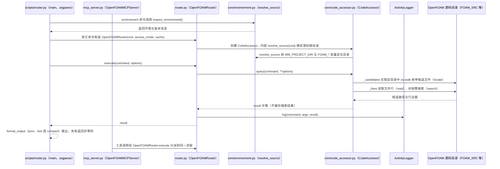

# OpenFOAM Expert Skill（Zyzhan417/OpenFOAM_expert_SKILL）

## 一句话定义

OpenFOAM Expert Skill（Zyzhan417/OpenFOAM_expert_SKILL）是面向源码阅读而非自动跑算例：让代理沿 OpenFOAM 源码定位实现，分析类继承、边界条件、coded 条件、fvModels 与 fvConstraints。

## 英文缩写速查

| 缩写 | 英文全称 | 简要说明 |
|------|----------|----------|
| CFD | Computational Fluid Dynamics | 计算流体力学计算流程 |
| MCP | Model Context Protocol | 让代理发现并调用外部工具的协议 |
| y+ | Dimensionless Wall Distance | 壁面网格分辨率相关的无量纲距离 |

## 为什么重要

对 CAE 自动化而言，代理能否稳定完成任务，取决于工程步骤是否清楚、工具边界是否明确、结果是否保留可审查证据。面向源码阅读而非自动跑算例：让代理沿 OpenFOAM 源码定位实现，分析类继承、边界条件、coded 条件、fvModels 与 fvConstraints；文章所述重点为 Foundation 13、Linux/WSL。

## 核心原理

**项目自身范围：** OpenFOAM source-code expert skill for retrieval and analysis.

**工作流：** 把本地 OpenFOAM 源码树作为被检索对象；代理先只读定位符号和上下游，再给出解释或修改建议。

## 工程实践

1. 从目标问题识别所需的 Skill、MCP、CLI 或软件接口，不把指导文件当成求解器。
2. 依照仓库 README 检查安装前提、软件/许可证、输入文件和输出证据。
3. 小规模运行并逐项核对几何、网格、边界、求解状态和物理量，再决定是否扩大任务。

文章所述的项目特征：面向源码阅读而非自动跑算例：让代理沿 OpenFOAM 源码定位实现，分析类继承、边界条件、coded 条件、fvModels 与 fvConstraints；文章所述重点为 Foundation 13、Linux/WSL。

## 局限与风险

不负责求解器编译/运行；不同发行版与版本的 API 差异需要逐项确认，且源码目录不应被无意修改。

源码状态核验：该 GitHub 仓库于 2026-10-07 可公开访问。仓库 API 报告许可证为 MIT。 

## 源码运行时序图

入口：`python scripts/router.py <命令>`（如 `environment`、`locate`、`search`、`read`，只读取 OpenFOAM 源码，不运行求解器）；MCP 集成入口为 `python mcp_server.py`（stdio，需额外安装 `mcp`）。下图以 CLI 入口为准，并标出 MCP 入口的分派关系。

图依据：Zyzhan417/OpenFOAM_expert_SKILL@940d525，README.md、scripts/router.py（main 与 execute）、scripts/core/code_accessor.py（部分：query、_candidates、_lines）、scripts/core/environment.py（部分：inspect_environment 与 FOAM 变量表）、mcp_server.py（部分）。未运行代码；Acc 与 FS 的具体搜索实现未逐行读完。

## 关联页面

- [CAE / CFD 代理工具项目总览](../overview/cae-cfd-agent-skills-landscape.md)
- [Foam-Agent](./csml-rpi-foam-agent.md)

## 参考来源

- [公众号文章原始资料归档](../../sources/blogs/wechat_cae_cfd_agent_skills_2026-10-07.md)
- [GitHub 仓库资料归档](../../sources/repos/zyzhan417-openfoam-expert-skill.md)
- [Zyzhan417/OpenFOAM_expert_SKILL 官方仓库](<https://github.com/Zyzhan417/OpenFOAM_expert_SKILL>)
- 源码核对（2026-11-02）：Zyzhan417/OpenFOAM_expert_SKILL@940d525，读过 README.md、scripts/router.py、scripts/core/code_accessor.py（部分）、scripts/core/environment.py（部分）、mcp_server.py（部分）；时序图依据以上文件，未运行代码。

## 推荐继续阅读

- [项目 README](<https://github.com/Zyzhan417/OpenFOAM_expert_SKILL/blob/main/README.md>)