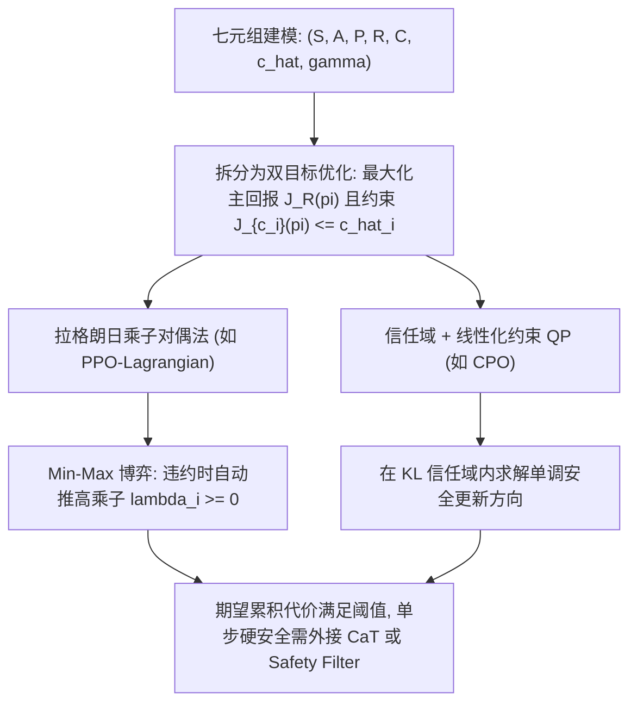

# Constrained MDP (CMDP)

**约束马尔可夫决策过程 (Constrained Markov Decision Process, CMDP)** 是一种在运筹学和强化学习中极其重要的数学形式化框架。当我们在构建真实物理世界的机器人（具身智能）时，单一的“最大化奖励”往往是极其危险的。CMDP 为我们提供了一种具有数学严谨性的方式，以解决在满足一系列预定义硬性物理约束（如防碰撞、关节安全限位、功耗限制）的前提下，寻找全局最优行为策略的问题。

## 一句话定义

**约束马尔可夫决策过程（CMDP）** 在标准 MDP 的累积期望回报最大化基础上引入显式累积代价阈值约束，是安全强化学习将碰撞、超限与过流等硬边界写入优化目标的通用形式化底座。

## 英文缩写速查

| 缩写 | 英文全称 | 简要说明 |
|------|----------|----------|
| MDP | Markov Decision Process | 状态–动作–奖励–转移的标准序贯决策建模框架 |
| CMDP | Constrained Markov Decision Process | 带代价约束的 MDP，安全强化学习的标准形式 |
| Reward | Reward Function | 塑造强化学习策略行为的标量反馈 |
| RL | Reinforcement Learning | 通过与环境交互最大化长期回报来学习策略的范式 |
| PPO | Proximal Policy Optimization | 人形/足式 locomotion 中最常用的 on-policy 策略梯度算法 |
| QP | Quadratic Programming | 将 WBC/控制问题写成二次规划的标准求解形式 |

## 为什么重要

- **摆脱硬编码惩罚权重的试错困境**：Brunke et al.（arXiv:2108.06266v2 § 3.2）指出，把安全约束直接塞进奖励权重需要大量调参且无法跨任务保证边界不越线；CMDP 对主任务期望回报与辅助安全代价函数 $C_i$ 分轨建模，配合拉格朗日乘子或约束策略优化（CPO）动态权衡性能与安全。

## 核心原理（标准 MDP 的局限与 CMDP 的引入）

在标准的马尔可夫决策过程（MDP）中，强化学习的唯一指导信号是一个标量奖励 $R(s, a)$。遇到不想要的行为（如跌倒），常规做法是**奖励塑形 (Reward Shaping)**——赋予一个极大的负奖励。但这在机器人控制上常常失败：权衡不当会导致机器人直接拒绝移动。

CMDP 彻底抛弃了这种“把成本揉进奖励”的软做法。它明确地将“你想追求什么”与“你不能逾越什么”分离开来。

## 严格数学定义

一个 CMDP 在数学上通常由一个扩展的七元组 $(S, A, P, R, C, \hat{c}, \gamma)$ 进行定义：

- $S$：连续或离散的状态空间（State Space）。
- $A$：机器人的动作空间（Action Space）。
- $P(s'|s, a)$：环境的转移概率分布矩阵，描述了动力学系统的物理法则。
- $R(s, a)$：传统任务的**奖励函数（Reward Function）**，引导智能体完成任务。
- $\gamma \in [0, 1)$：折现因子，确保长时域评估值的收敛性。

以上五项构成了标准的 MDP。CMDP 的核心在于最后两项：
- $C = \{c_1, c_2, ..., c_k\}$：**约束代价函数集合（Cost Functions）**。这是一个向量函数族，每个 $c_i: S \times A \to \mathbb{R}_{\geq 0}$ 描述了执行某动作带来的特定物理惩罚（例如 $c_1$ 表示关节超限，$c_2$ 表示能耗过大）。
- $\hat{c} = \{\hat{c}_1, \hat{c}_2, ..., \hat{c}_k\}$：**约束阈值向量（Cost Thresholds）**。它们是预先设计好的、绝对不可跨越的安全底线指标。

### 全局优化目标

在 CMDP 的框架下，智能体的目标不仅是找到一个策略 $\pi(a|s)$，更要求这个策略在长期执行中产生的期望代价值严格被阈值所框定。其核心最优化问题可形式化为如下带有多个不等式约束的凸或非凸优化：

$$
\begin{aligned}
\max_{\pi} \quad & J_R(\pi) = \mathbb{E}_{s_0 \sim \rho_0, \tau \sim \pi} \left[ \sum_{t=0}^{\infty} \gamma^t R(s_t, a_t) \right] \\
\text{subject to} \quad & J_{c_i}(\pi) = \mathbb{E}_{s_0 \sim \rho_0, \tau \sim \pi} \left[ \sum_{t=0}^{\infty} \gamma^t c_i(s_t, a_t) \right] \leq \hat{c}_i, \quad \forall i \in \{1, \dots, k\}
\end{aligned}
$$

## 主流求解框架与算法体系

因为策略 $\pi$ 本身通常是由深层神经网络（DNN）参数化的，直接在这个超高维空间中进行带有不等式约束的最优化是极其困难的。当前 Safe RL（安全强化学习）算法多是从运筹学中汲取灵感：

1. **拉格朗日乘子对偶法（Lagrangian Methods）**：
   这是目前工程落地上最简单也最普遍的方法。通过引入对偶变量向量 $\lambda \geq 0$，将原先带有硬约束的最优化问题，转化为无约束的极小极大（Min-Max）博弈问题：
   $$ \max_{\pi} \min_{\lambda \geq 0} \mathcal{L}(\pi, \lambda) = J_R(\pi) - \sum_{i=1}^k \lambda_i \left( J_{c_i}(\pi) - \hat{c}_i \right) $$
   在训练过程中，当安全约束被突破时（$J_{c_i} > \hat{c}_i$），梯度会自动推高 $\lambda_i$ 的值，迫使策略网络更加关注安全性；反之，若十分安全，则 $\lambda_i$ 下降，让网络去追逐任务奖励。常见的有 PPO-Lagrangian 算法。

2. **信任域与约束二次规划（Trust Region & QP）**：
   例如经典的 **CPO (Constrained Policy Optimization)**。该方法并不采用松弛的惩罚项，而是在每次迭代计算策略梯度时，强制在原策略的一个微小邻域（KL散度信任域）内，通过求解带有线性安全约束的二次规划（QP）问题，计算出严格确保下一步更新依旧合规的最优梯度方向。虽然计算量大，但能提供单调递进的安全保障。

## 在机器人实体中的不可或缺性

为什么波士顿动力、ANYbotics 等顶尖团队越来越重视此类架构？
在仿生机器人领域，硬件极为昂贵且维修周期漫长。我们无法承受机器人在学习期间无数次的跌倒、过载与烧毁。利用 CMDP，研究人员可以为每个电机设定严格的最高温度 $c_{temp}$ 和最大扭矩阈值 $\hat{c}_{torque}$，从而使得神经网络探索出的每一条策略轨迹在数学上都是收敛于安全基线的。

## 工程实践

- **期望约束 ≠ 每步硬安全**：标准 CMDP 限制的是期望累积代价 $\mathbb{E}[\sum \gamma^t c_t] \le d_i$，对单步致命碰撞需额外配合约束即终止（CaT）或外层安全过滤器（Safety Filter）。

## 机制/计算流程图

## 常见误区或局限

- 原生对偶拉格朗日训练初期常伴随安全约束违例（先试错后收敛），不适合直接在真机无保护探索（Brunke et al., arXiv:2108.06266v2 § 3.2）。

## 关联页面
- [Safety Filter](../concepts/safety-filter.md)
- [Reinforcement Learning](../methods/reinforcement-learning.md)
- [Safe RL 方法论](../methods/safe-rl.md)
- [MDP 形式化](./mdp.md)
- [Bellman 方程](./bellman-equation.md)

## 参考来源
- [brunke_safe_learning_robotics_arxiv_2108_06266.md](../../sources/papers/brunke_safe_learning_robotics_arxiv_2108_06266.md) — Brunke et al., *Safe Learning in Robotics* (§ 3.2 Safe RL & CMDP)- Altman, E. (1999). *Constrained Markov Decision Processes*. (奠定了 CMDP 的运筹学根基)
- Achiam, J., Held, D., Tamar, A., & Abbeel, P. (2017). *Constrained Policy Optimization*. (深度学习时代 CMDP 的标杆之作)

## 推荐继续阅读

- [Safe RL](../methods/safe-rl.md) — 拉格朗日、CPO 与约束即终止求解策略
- [Safety Filter](../concepts/safety-filter.md) — 弥补期望约束瞬时违例的后置安全过滤层
