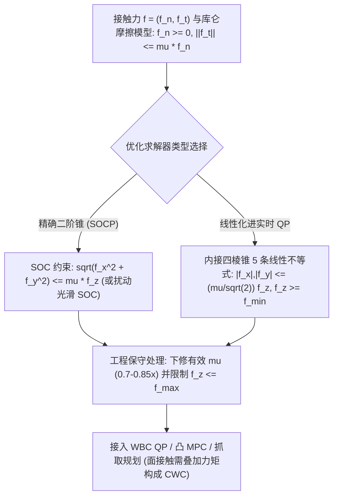

# 摩擦锥 (Friction Cone)

**摩擦锥** 是机器人学中描述接触力物理约束的核心数学模型。它规定了接触力 $\mathbf{f}$ 必须满足的范围，以确保机器人脚部或手部与支撑环境之间不发生滑动。

## 一句话定义

**摩擦锥（Friction Cone）** 用 $f_n \ge 0$ 与 $\|f_t\|_2 \le \mu f_n$ 刻画刚体单边法向接触力在切向不发生相对滑动的物理可行域，是从接触力学通往 WBC / MPC 凸优化约束的核心桥梁。

## 英文缩写速查

| 缩写 | 英文全称 | 简要说明 |
|------|----------|----------|
| WBC | Whole-Body Control | 协调全身关节满足多任务/约束的控制基础设施 |
| QP | Quadratic Programming | 将 WBC/控制问题写成二次规划的标准求解形式 |
| MPC | Model Predictive Control | 滚动时域内优化控制序列的预测控制 |
| CoM | Center of Mass | 质心，平衡与 locomotion 规划的核心状态量 |
| ZMP | Zero Moment Point | 足式平衡判据，地面反力合力矩为零的点 |
| LIP | Linear Inverted Pendulum | 线性倒立摆，质心动力学的常用简化模型 |

## 为什么重要

- **真机打滑的硬边界**：足端或手端一旦越出摩擦锥边界即触发滑移甚至倾覆，因此在 MPC 与瞬时全身 QP 中必须将其显式写为单侧与切向不等式约束（Wensing et al., T-RO 2024 § VI）。
- **决定优化问题求解器类别**：精确三维库仑摩擦锥属于二阶锥（SOCP）约束；内接四棱锥/八棱锥近似则将其线性化为 $C \lambda \le 0$，使瞬时控制降维成微秒级 QP。

## 核心原理（库仑摩擦模型 (Coulomb Friction)）

根据库仑摩擦定律，静态摩擦力 $f_t$（切向）与正向压力 $f_n$（法向）的关系如下：

$$
\| \mathbf{f}_t \| \leq \mu f_n, \quad f_n \geq 0
$$

其中：
- $\mu$ 是静摩擦系数。
- $\mathbf{n}$ 是指向机器人一侧的单位接触法向；$f_n = \mathbf{f} \cdot \mathbf{n}$ 是标量法向力，$\mathbf{f}_n = f_n\mathbf{n}$ 是法向力向量。
- $\mathbf{f}_t = \mathbf{f} - \mathbf{f}_n$ 是切向分量。

这个不等式在三维空间中定义了一个以 $\mathbf{n}$ 为中心轴、顶角为 $2\arctan(\mu)$ 的**圆锥体**。这就是“摩擦锥”名称的由来。

## 二次锥约束 (SOC)

在优化问题中，上述关系可以写成 **二阶锥约束（Second-Order Cone, SOC）** 的形式：

$$
\sqrt{f_x^2 + f_y^2} \leq \mu f_z, \quad f_z \geq 0
$$

虽然 SOC 描述最精确，但通用的 QP（二次规划）求解器（如 OSQP, qpOASES）通常不支持直接处理 SOC 约束。

## 线性化摩擦锥 (Linearized Friction Cone)

为了在实时控制器（如 WBC 或 MPC）中利用高效的 QP 求解器，通常将圆锥体通过其内切或外接的 **多面体（Polyhedral Cone）** 进行线性化逼近。

### 四棱锥近似

最常见的做法是使用四棱锥（4-sided pyramid）来近似圆锥。这意味着在切线 $x$ 和 $y$ 方向上分别满足：

$$
|f_x| \leq \frac{\mu}{\sqrt{2}} f_z, \quad |f_y| \leq \frac{\mu}{\sqrt{2}} f_z, \quad f_z \geq 0
$$

上述 $\mu/\sqrt{2}$ 写法是保守的内接近似；若直接使用 $|f_x|, |f_y| \leq \mu f_z$，则是外接近似，其角点可能超出原始圆锥。需要保证不滑动时应采用内接近似并保留摩擦裕量。

这可以展开为 5 个线性不等式；其中 $f_{min} \geq 0$ 是激活接触时选定的最小法向力，摆动足需停用该接触约束：
1. $f_z \geq f_{min}$
2. $f_x - \frac{\mu}{\sqrt{2}} f_z \leq 0$
3. $-f_x - \frac{\mu}{\sqrt{2}} f_z \leq 0$
4. $f_y - \frac{\mu}{\sqrt{2}} f_z \leq 0$
5. $-f_y - \frac{\mu}{\sqrt{2}} f_z \leq 0$

## 在控制中的应用

1. **WBC 中的 QP 约束**：在求解关节力矩时，必须确保计算出的接触力 $\mathbf{f}$ 位于摩擦锥内。
2. **质心动力学优化**：在规划 CoM 轨迹时，外部合力必须由摩擦锥内的力合成。
3. **抓取规划**：在操纵物体时，指尖力必须位于接触面的摩擦锥内以防止物体滑脱。

## 工程实践

- **多面体线性化 vs 二阶锥折中**：实时 Convex MPC 与 WBIC 常取正四棱锥内接线性近似（$|f_x|\le\frac{\mu}{\sqrt{2}}f_z, |f_y|\le\frac{\mu}{\sqrt{2}}f_z$）以适配 OSQP/qpOASES；MIT *Underactuated Robotics* Ch. 17 引用 Grandia 等提出以扰动二阶锥与光滑障碍罚解决锥顶（$f_n=0$）病态条件数问题。
- **有效摩擦系数保守下修**：工程中通常对标称 $\mu$ 乘以 $0.7\text{--}0.85$ 的安全系数并约束最大垂向反力 $f_z \le f_{\max}$，预留地面局部油污、石子与倾斜角估计误差余量。

## 机制/计算流程图

## 常见误区或局限

- **刚体静/动摩擦切换简化**：标准凸/线性摩擦锥假定最大静摩擦系数等于动摩擦系数且忽略轮胎或足底橡胶形变阻尼。
- **面接触单点等效失真**：大脚掌（flat foot）着地时仅限制合力处于摩擦锥内不足以防止滚转翻倒，必须叠加力矩极限形成完整的 Contact Wrench Cone（CWC）。

## 关联页面
- [仿真物理保真度链路选型指南](../queries/simulation-physics-fidelity.md) — 本页所述物理/仿真要素在保真度链路（建模 ① → 数值 ② → 接触 ③ → 随机化 ④）中的定位
- [Contact Dynamics](../concepts/contact-dynamics.md)
- [Centroidal Dynamics](../concepts/centroidal-dynamics.md)
- [Whole-Body Control](../concepts/whole-body-control.md)
- [ZMP + LIP 形式化](./zmp-lip.md)
- [Contact Wrench Cone（接触力旋量锥）](./contact-wrench-cone.md)
- [WBC 调参指南](../queries/wbc-tuning-guide.md)

## 参考来源
- [contact_dynamics.md](../../sources/papers/contact_dynamics.md) — 接触动力学与 MIT Underactuated Ch. 17 核对档案
- [boyd_cvxbook_qp_socp.md](../../sources/papers/boyd_cvxbook_qp_socp.md) — Boyd & Vandenberghe § 4.4.2 二阶锥规划（SOCP）标准形式
- [wensing_opt_control_tro_arxiv_2211_11644.md](../../sources/papers/wensing_opt_control_tro_arxiv_2211_11644.md) — Wensing et al. T-RO 2024 摩擦锥与 WBC/TO 公式
- Siciliano, B., et al. (2009). *Robotics: Modelling, Planning and Control*.

## 推荐继续阅读

- [Contact Wrench Cone（接触力旋量锥）](./contact-wrench-cone.md) — 扩展到足底面接触与倾斜地面旋量约束
- [Quadratic Programming](./quadratic-programming.md) — 线性化摩擦锥如何在 QP 中求解
- [Contact Dynamics](../concepts/contact-dynamics.md) — 互补问题（LCP/NCP）与柔性接触仿真对比
