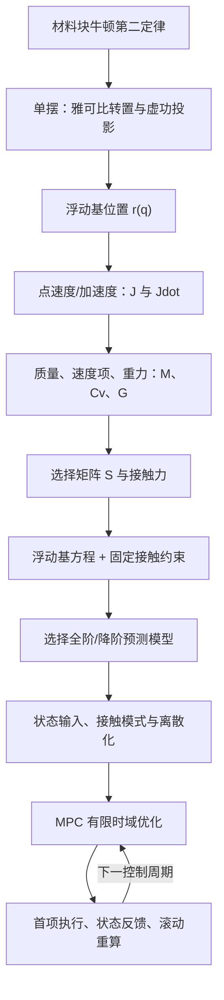

# MPC 预测模型推导（MPC Prediction Model Derivation from Floating-Base Dynamics）

## 一句话定义

**MPC 的预测模型**来自对机器人运动规律的数学表达：先从几何关系与牛顿定律构造浮动基动力学，再按控制任务选取状态、输入、接触近似和离散化方法，得到可供优化器预测未来运动的模型。

## 英文缩写速查

| 缩写 | 英文全称 | 简要说明 |
|------|----------|----------|
| MPC | Model Predictive Control | 滚动时域预测与优化 |
| QP | Quadratic Programming | 线性约束下的二次规划 |
| CoM | Center of Mass | 质心，连杆聚合及降阶模型关键状态 |
| SRBD | Single Rigid Body Dynamics | 将整机近似为单刚体的动力学 |
| WBC | Whole-Body Control | 将上层运动/接触计划落到全身 |
| DoF | Degrees of Freedom | 独立运动自由度 |

## 为什么重要

仅写下 $x_{k+1}=f_d(x_k,u_k)$ 并不能回答 $f_d$ 从何而来。四足机器人有不固定的躯干、多个关节和随支撑状态变化的地面反力。[附件对应原文](../../sources/blogs/wechat_shenlan_mpc_floating_base_derivation_2026-11-16.md)从单摆推到完整结构；需要分清 **全阶动力学方程**、**用于优化的简化预测模型**和**求解器**三个层级。

## 核心原理

### 1. 单摆：从牛顿第二定律到虚功（原文第 4–8 页）

长度为 $l$、末端质点质量为 $m$ 的单摆，以竖直向下为零角：

$$
r(\theta)=\begin{bmatrix}l\sin\theta\\-l\cos\theta\end{bmatrix},
\quad
J(\theta)=\frac{\partial r}{\partial\theta}
=\begin{bmatrix}l\cos\theta\\l\sin\theta\end{bmatrix}.
$$

点加速度 $\ddot r=J\ddot\theta+\dot J\dot\theta$。牛顿方程左乘 $J^\top$，等价于用虚位移 $\delta r=J\delta\theta$ 做虚功投影；沿杆张力的虚功为零，得到：

$$
ml^2\ddot\theta+mgl\sin\theta=\tau.
$$

**雅可比转置将笛卡尔力投影成广义力**，这一操作随后对所有质量块使用。

### 2. 浮动基材料块的雅可比（原文第 9–12 页）

四足有 12 个驱动关节。记配置 $q=(p_B,R_B,\theta)$，18 维广义速度：

$$
v=\begin{bmatrix}\dot p_B\\\omega_B\\\dot\theta\end{bmatrix}\in\mathbb R^{18}.
$$

$\omega_B$ 以世界系表达，不可把旋转矩阵 $R_B$ 的导数逐项当成角速度。第 $a$ 个材料块：

$$
r_a=p_B+R_B\rho_a(\theta),\quad
s_a=R_B\rho_a,\quad K_a=\frac{\partial\rho_a}{\partial\theta}.
$$

用叉乘矩阵 $[s]_\times w=s\times w$，依次求导：

$$
\dot r_a=\dot p_B+\omega_B\times s_a+R_BK_a\dot\theta
=\underbrace{\begin{bmatrix}I_3&-[s_a]_\times&R_BK_a\end{bmatrix}}_{J_a(q)}v,
$$

$$
\ddot r_a=J_a(q)\dot v+\dot J_a(q,v)v.
$$

第一项集中加速度，第二项收集运动导致的速度相关加速度，包含向心、科氏等项。

### 3. 材料块投影求和：M、Cv、G（原文第 13–16 页）

对每块牛顿方程 $m_a\ddot r_a=F_a$ 左乘 $J_a^\top$ 后求和；理想内部连接力的虚功相消：

$$
\underbrace{\sum_a m_aJ_a^\top J_a}_{M(q)}\dot v
+\underbrace{\sum_a m_aJ_a^\top\dot J_a v}_{C(q,v)v}
+\underbrace{\left(-\sum_aJ_a^\top F_a^{grav}\right)}_{G(q)}
=S^\top\tau+\sum_iJ_{c,i}^\top f_{c,i}.
$$

其中 $F_a^{grav}=[0,0,-m_ag]^\top$，$S=[0_{12\times 6}\ I_{12}]$。$S^\top\tau$ 的前 6 项为零：浮动基没有直接驱动电机。**$C$ 的矩阵表达不唯一，$Cv$ 才是本式所需的速度相关动力学项。**

文章还证明材料块求和与按刚体质心、转动惯量聚合等价（原文第 18–23 页）：

$$
M(q)=\sum_b\left(m_bJ_{p,b}^\top J_{p,b}
+J_{\omega,b}^\top I_bJ_{\omega,b}\right).
$$

最后回到单摆检验 $M=ml^2$、$Cv=0$、$G=mgl\sin\theta$（第 24 页）。

### 4. 支撑接触：把约束与受力方程联立（原文第 16–18 页）

支撑脚的反力 $f_c$ 通常不能事先假定为已知。固定支撑时脚点世界系速度和加速度为零：

$$
J_cv=0,\qquad J_c\dot v+\dot J_cv=0.
$$

因此，在给定当前配置、速度、驱动力矩以及固定接触模式时，联合解：

$$
\begin{bmatrix}
M&-J_c^\top\\J_c&0
\end{bmatrix}
\begin{bmatrix}\dot v\\f_c\end{bmatrix}
=
\begin{bmatrix}
S^\top\tau-C(q,v)v-G(q)\\-\dot J_cv
\end{bmatrix}.
$$

这仅适用于相应固定接触假设；足端滑移、冲击切换和摩擦锥约束尚未在本式中解决。

### 5. 如何变为 MPC 的离散预测模型（工程衔接）

**证据边界：** 原文第 2–3 页介绍 MPC 的滚动优化机制，第 4–24 页推导连续时间浮动基动力学；**没有**完整给出四足 MPC 从连续模型到实时可运行离散优化器的工程实现。

继续实现控制器，需要额外完成：

1. **模型层级：** 使用全阶浮动基模型，或选择 [质心动力学](../concepts/centroidal-dynamics.md)、[SRBD](../concepts/srbd-convex-mpc-wbc.md) / LIP 等降阶预测模型。
2. **状态/输入及接触：** 按控制分层选 $x,u$，例如质心状态与接触反力；设定或同时规划支撑模式，并匹配可行性约束。
3. **离散化：** 从 $\dot x=f(x,u)$ 建立 $x_{k+1}=f_d(x_k,u_k)$。示意性的显式 Euler 近似 $x_{k+1}\approx x_k+T_sf(x_k,u_k)$ **不是原文所实现的四足数值方案**。
4. **优化与反馈：** 在预测时域 $p$ 内评估轨迹，控制时域 $m\le p$ 允许独立调整输入；兼顾输出跟踪、控制增量平滑及输入/输出/接触约束，只执行首项，随后更新反馈重求。**线性预测模型及线性约束等条件下**可构造成 QP，不等于全阶非线性动力学总能直接用同一个 QP 求解。

### 推导与闭环流程图

A–G 基于附件原文的公式推导；H–I 是实际 MPC 建模时仍需完成的工程步骤；J–K 是原文所描述的 MPC 机制。

## 工程实践

- **维度检查：** $M$ 为 $18\times18$，点雅可比 $J_a$ 为 $3\times18$，$S^\top\tau$ 为 18 维。固定机身、世界系角速度、接触点顺序的一致约定。
- **残差验证：** 对单摆特例核对动力学各项；检查刚体聚合与材料块写法得到相同的 $M$；检查接触残差 $J_c\dot v+\dot J_cv$。
- **求解与部署：** 另外评估惯量误差、接触估计误差、摩擦、执行器延迟与控制周期内可解性；不要把理想模型的预测直接等同真机性能。
- **源码运行时序图：不适用。** 这篇公众号教学文章未发布与公式对应的可运行 MPC 源码或官方入口，不臆造训练/控制调用链。

## 局限与风险

- 推导采用刚体、理想内部力和固定接触假设，没有完整处理接触切换、打滑、冲击或执行器非理想。
- 全阶动力学**不自动等于**实时可部署的 MPC；需要精度/计算成本权衡。
- $C$ 的矩阵分解并非唯一；不同实现不宜直接逐元素比对。
- 来源是原创教学文章及课程笔记整理，**不是新的控制器研究论文**；未提供可复现的 MPC 真机实验或性能指标。

## 关联页面

- [仿真物理保真度知识链枢纽](../overview/hub-physics-fidelity.md) — 对照接触假设、数值误差与 Sim2Real 物理保真度

- [Model Predictive Control](../methods/model-predictive-control.md) — MPC 优化机制
- [Floating-Base Dynamics](../concepts/floating-base-dynamics.md) — 浮动基动力学总览
- [Robot Jacobian](./robot-jacobian.md) — 雅可比与广义力映射
- [Contact Dynamics](../concepts/contact-dynamics.md) — 足端接触约束
- [Centroidal Dynamics](../concepts/centroidal-dynamics.md) — 降阶预测模型
- [SRBD + 凸 MPC + WBC](../concepts/srbd-convex-mpc-wbc.md) — 工程上常见的单刚体预测模型
- [传统模型控制纵深路线](../../roadmap/depth-classical-control.md) — Stage 0 建模到 Stage 3 MPC

## 参考来源

- [深蓝具身智能公众号原文（2026-11-16）](https://mp.weixin.qq.com/s/xjzk3elSHXGbMHcgSAkDww)，用户提供同题 PDF 共 27 页；[原文通读与核对范围](../../sources/blogs/wechat_shenlan_mpc_floating_base_derivation_2026-11-16.md)
- 原文参考文献列出 ETH Zurich, *Robot Dynamics Lecture Notes* (HS 2017) §2.10、§3.5–3.7；**本次未单独通读该讲义**
- [Li & Nguyen 双足凸 MPC 原文归档](../../sources/papers/force_moment_mpc_biped_reading_arxiv_2104_00065.md) — 对照从简化动力学到 QP 的路线

## 推荐继续阅读

- [微信公众号完整推导](https://mp.weixin.qq.com/s/xjzk3elSHXGbMHcgSAkDww) — 本次公式的直接出处
- [ETH Zurich *Robot Dynamics* HS2017 讲义 PDF](https://ethz.ch/content/dam/ethz/special-interest/mavt/robotics-n-intelligent-systems/rsl-dam/documents/RobotDynamics2017/RD_HS2017script.pdf) — 原文列出的教材
- [SRBD + 凸 MPC + WBC](../concepts/srbd-convex-mpc-wbc.md) — 下一步研究具体的降阶四足预测模型
