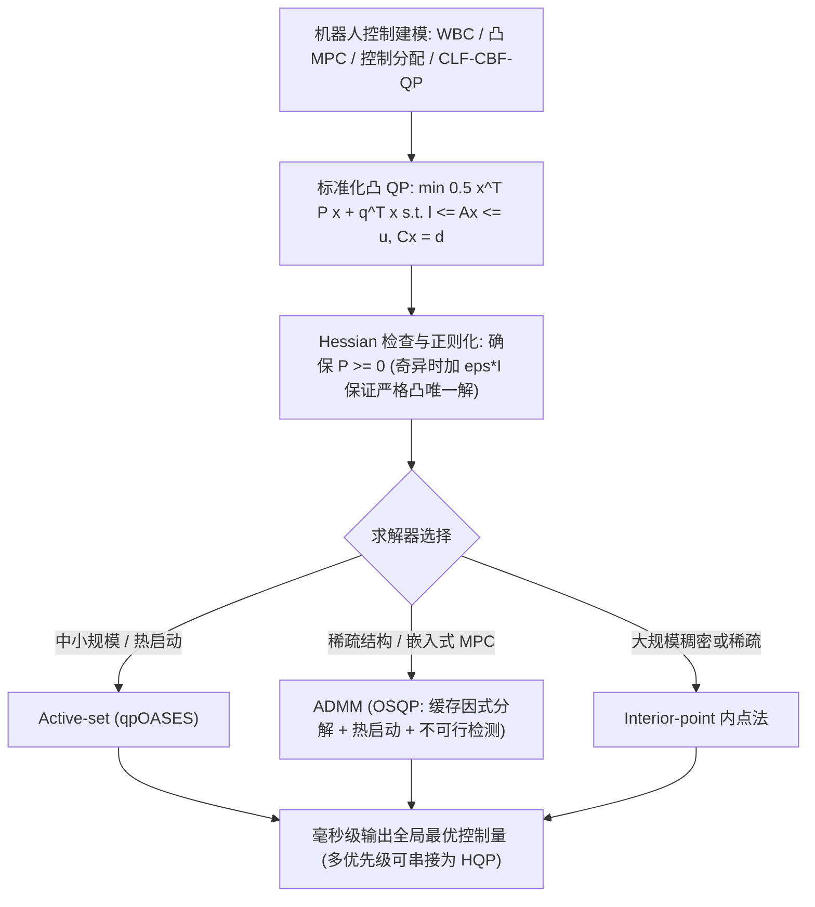

# Quadratic Programming（二次规划）

**二次规划（QP）**：目标为凸二次函数、约束为线性的优化问题；是 WBC、凸 MPC、控制分配与许多 TrajOpt 子步骤的统一数学形式。

## 一句话定义

> $\min \frac12 x^T P x + q^T x$ s.t. $Ax\le b,\ Cx=d$，其中 $P\succeq 0$ —— 机器人控制里「几乎到处都在用」的优化模板。

## 英文缩写速查

| 缩写 | 英文全称 | 简要说明 |
|------|----------|----------|
| QP | Quadratic Programming | 凸二次目标 + 线性约束 |
| HQP | Hierarchical Quadratic Programming | 分层 QP，任务优先级 |
| OSQP | Operator Splitting Quadratic Program | 稀疏 QP ADMM 求解器 |
| MPC | Model Predictive Control | 线性化后常退化为 QP |
| WBC | Whole-Body Control | 任务空间 QP 求关节加速度/力矩 |

## 为什么重要

- **实时性**：中等规模 QP 可在毫秒级求解（OSQP、qpOASES、HPIPM）。
- **可预测性**：凸 QP 全局最优唯一（严格凸时），适合安全关键控制。
- **组合性**：HQP 通过 null-space 投影串多个 QP。

## 核心原理（标准形式与求解思路）

$$\min_x \frac12 x^T P x + q^T x \quad \text{s.t.} \quad l \le Ax \le u,\ Cx = d$$

- $P \in \mathbb{R}^{n\times n}$，$P \succeq 0$（半正定）
- **严格凸 QP**：$P \succ 0$，Hessian 正定，解唯一

## 求解思路（课程 3.3）

| 方法 | 适用 |
|------|------|
| Active-set | 中小规模、热启动（qpOASES） |
| Interior-point | 大规模稠密/稀疏 |
| ADMM（OSQP） | 稀疏结构、嵌入式 MPC |
| 低维专用（Seidel 类） | 2D/3D 约束几何，线性时间 |

## 机器人实例

| 应用 | 决策变量 $x$ | 典型约束 |
|------|-------------|---------|
| WBC | 关节加速度 $\ddot{q}$ 或力矩 $\tau$ | 动力学等式、摩擦锥线性化 |
| 凸 MPC | 状态/输入序列 | 线性化动力学、输入限幅 |
| 控制分配 | 各执行器力/力矩 | $B\tau = w$，饱和 |
| CLF-CBF-QP | 控制修正 $\delta u$ | 线性 CLF/CBF 不等式 |

## 工程实践

- **Hessian 正半定性与正则化**：Boyd & Vandenberghe § 4.4（Eq. 4.34）要求 QP 目标 Hessian $P \in \mathbb{S}_+^n$；当足式 WBC 任务矩阵 $J$ 奇异或松弛变量缺惩罚时，需加微小对角阻尼 $\epsilon I$（确保正定与严格凸唯一解）。
- **ADMM 缓存分解与热启动**：Stellato et al.（OSQP，arXiv:1711.08013v4）在固定 $P, A$ 结构下只做一次准定矩阵因式分解即可在控制周期内热启动迭代，且能直接检测原始/对偶不可行。

## 机制/计算流程图

## 常见误区或局限

- **把 NMPC 当 QP**：非线性动力学 + 非二次代价一般不是 QP，需 SQP 或 iLQR 子问题。
- **Hessian 不定仍用凸 QP 求解器**：需修正为 Gauss-Newton 近似或 Levenberg-Marquardt。
- **忽略热启动**：MPC/WBC 相邻帧结构相似，warm start 可 10× 加速。

## 关联页面

- [KKT Conditions](./kkt-conditions.md)
- [HQP](../concepts/hqp.md)、[TSID](../concepts/tsid.md)
- [MPC](../methods/model-predictive-control.md)
- [MPC Solver Selection](../queries/mpc-solver-selection.md)
- [Control Allocation](../concepts/control-allocation.md)

## 推荐继续阅读

- [WBC Implementation Guide](../queries/wbc-implementation-guide.md)
- Boyd, *Convex Optimization* — QP 与对偶

## 参考来源

- [boyd_cvxbook_qp_socp.md](../../sources/papers/boyd_cvxbook_qp_socp.md) — Boyd & Vandenberghe《Convex Optimization》§ 4.4 QP/SOCP 原文（Eq. 4.34–4.36）
- [whole_body_control.md](../../sources/papers/whole_body_control.md) — OSQP（arXiv:1711.08013v4）/ Wensing T-RO 2024（arXiv:2211.11644）/ Kim WBIC（arXiv:1909.06586）
- [sources/courses/numerical_optimization_foundations_robotics.md](../../sources/courses/numerical_optimization_foundations_robotics.md) — 第 3 章 3.3 严格凸 QP
