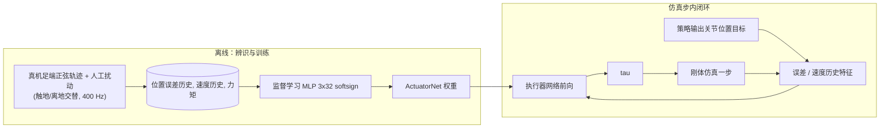

# Actuator Network (执行器网络)

## 一句话定义

**执行器网络 (Actuator Network)** 是用监督学习从真机数据拟合「关节位置误差与速度历史 → 关节力矩」的小型神经网络（Hwangbo et al., Science Robotics 2019，ANYmal），在仿真循环里充当驱动器层，替代理想 PD，以缩小 sim2real 中「动作到力矩」这一段的动力学误差。

## 英文缩写速查

| 缩写 | 英文全称 | 简要说明 |
|------|----------|----------|
| Sim2Real | Simulation to Real | 把仿真中学到的策略迁移落地真机的工程主线 |
| SEA | Series Elastic Actuator | 串联弹性执行器，提供柔顺与力控 |
| MuJoCo | Multi-Joint dynamics with Contact | 接触丰富的刚体物理仿真引擎 |
| Isaac Gym | NVIDIA Isaac Gym | GPU 并行刚体仿真训练环境 |
| PD | Proportional–Derivative | 关节位置/阻抗底层控制，策略输出常为其 setpoint |
| ANYmal | ANYbotics Quadruped | ANYbotics 的四足机器人研究平台 |
| MLP | Multi-Layer Perceptron | 多层感知机，处理本体向量等低维输入 |
| RL | Reinforcement Learning | 通过与环境交互最大化长期回报来学习策略的范式 |
| Locomotion | Robot Locomotion | 足式/人形等无轮移动能力的总称 |
| Isaac Lab | NVIDIA Isaac Lab | 基于 Omniverse 的机器人学习训练框架 |

## 为什么重要

在物理仿真器（如 MuJoCo 或 Isaac Gym）中，默认的关节驱动通常是理想化的 PD 控制：
$$ \tau = K_p (q_{target} - q) + K_d (\dot{q}_{target} - \dot{q}) $$

论文指出（Hwangbo 2019，引言与方法）：真实执行器的动力学含非线性非光滑耗散、级联反馈环与大量不可观测的内部状态；ANYmal 的 SEA 链路依次是位置命令 → PD 得期望力矩 → PID 得期望电流 → FOC 得相电压 → 传动与弹性元件形变产生关节力矩，且有多层硬件与软件带来的延迟。已有的解析 SEA 模型（Gehring et al. 2016）含近百个参数，难以辨识。

**论文的消融证据**：用理想执行器模型（带宽无限、零延迟）或手调解析执行器模型训出的策略，在真机上「一步都走不了」，肢体剧烈抖动；作者调了一周以上解析模型仍不成功，而执行器网络调通不到一天。力矩预测误差：执行器网络验证集 0.740 Nm（力矩测量分辨率 0.2 Nm），理想模型 3.55 Nm；在真实策略产生的测试数据上分别是 0.966 Nm 与 5.74 Nm。

（以下为一般工程常识，非本论文摘录，故标「推测」：反电动势、谐波减速器摩擦、总线延迟等也是同类拟合要吸收的因素。）

## 核心机制

执行器网络不再使用解析公式，而是训练一个小型神经网络来充当驱动器层：

- **输入**：关节位置误差（命令位置减实际位置）与关节速度的**历史**——论文取当前、$t-0.01$ s、$t-0.02$ s 三个时刻；每个关节独立建模（假设执行器之间无耦合）。
- **输出**：该关节的真实驱动力矩 $\tau$。
- **结构**：MLP，3 个隐藏层、每层 32 单元；激活函数在 tanh 与 softsign 间选了 softsign（验证误差几乎相同，约 0.7–0.8 Nm RMS，但 12 个关节评估耗时 12.2 µs 对 31.6 µs）。
- **历史长度**：应显著长于通信延迟与机械响应之和，太稀疏抓不住高频动态，太密则易过拟合且更慢；实际按验证误差调，通常不到一天。
- **训练数据**：真机上用足端正弦轨迹（幅值 5–10 cm、频率 1–25 Hz）经逆运动学驱动，足端不断触地与离地以贴近真实步态，并人工扰动；须覆盖宽频谱，否则训练出的模型会产生不自然振荡；400 Hz 采样，用时不到 4 分钟（12 个同型执行器并行采集），超过一百万样本，约 90% 训练 / 10% 验证。注意这**不是**悬空啁啾激励。

## 流程总览

## 主要技术路线

论文流程四步（Fig. 1）：①辨识刚体参数并估计不确定度（惯性参数来自 CAD，预计约 20% 误差，用 30 个随机化模型训练）；②训练执行器网络；③在混合仿真（刚体 + 执行器网络，约 50 万步/秒）中用 TRPO 训练策略；④直接部署。

后续框架实现（以 Isaac Lab 为例，见 [Implicit / Explicit 执行器建模](../concepts/implicit-explicit-actuator-modeling.md)）：`ActuatorNetMLP` 用位置误差与速度历史预测力矩，输出再被 DC 电机包络截断，需 TorchScript 检查点；`ActuatorNetLSTM` 用循环网络隐状态代替历史缓冲。

## 带来的价值

- **频率对齐**：网络从历史中隐式学出系统传输延迟与响应特性。
- **能耗与精度**：论文策略在同一硬件上速度跟踪误差 0.143 m/s（此前最佳模型方法 0.231 m/s）、平均力矩 8.23 Nm 对 11.7 Nm，最高速 1.5 m/s（较此前纪录高 25%）。这些是整套方法（含 RL）的结果，不是执行器网络单独的贡献。
- **零样本迁移**：策略纯仿真训练，部署无需真机微调；对硬件变化（约 2 kg 配重、换成 3 倍硬度弹簧的新驱动）三个月测试内策略仍工作。

## 工程实践

1. **采集**：覆盖宽频、含接触交替的轨迹；保留一份由真实策略产生的数据做测试，因为分布外误差明显更高（0.966 对 0.740 Nm）。
2. **建模范围**：每个关节独立；若多个执行器耦合（如共用蓄能器的液压），论文提示需要更大的联合网络（论文未验证）。
3. **历史配置**：先按延迟估计，再按验证误差微调；策略观测里也需要稀疏历史（t−0.01 s、t−0.02 s），论文推测其作用是替代足端力传感器检测接触。
4. **仿真集成**：网络评估占混合仿真约一半时间，故保持小网络；框架里用 TorchScript 加载。
5. **随机化仍需要**：论文同时对惯性参数、观测噪声做随机化，执行器网络并不替代域随机化。

## 局限与风险

- 论文自述局限：需要日志、回归、力矩测量等基础设施；对执行器耦合的系统精度存疑；一次训练得到的单个策略只表现单一技能。
- 分布外误差：测试数据上的力矩误差明显高于验证集，说明数据覆盖决定上限。
- 黑箱：不给出可解释参数，换电机或负载需重新采集。后续工作（BAM、PACE、NeuralActuator）试图补可解释性，见下文。

## 与解析摩擦模型（BAM）及 NeuralActuator 的关系

执行器网络用 **黑箱 MLP** 拟合 $(q,\dot q,\text{历史指令})\rightarrow\tau$；[BAM 扩展摩擦](../entities/paper-bam-extended-friction-servo-actuators.md) 则用 **M1–M6 物理参数**（Stribeck、负载相关等）在 MuJoCo 中 **在线更新** 摩擦上界，数据需求为摆锤台架轨迹而非大规模悬空激励。[PACE](../entities/paper-pace-sim2real-legged-robots.md) 在论文中将 ActuatorNet 作为悬空轨迹对齐的 **黑盒对照**，自身用 **$4n+1$ 可解释关节参数 + CMA-ES** 达到更接近真机的相位图。三者可串联：先 BAM/PACE 缩小可解释误差，再对残差训练小型网络。

[NeuralActuator](../entities/paper-neuralactuator-neural-actuation-modeling.md)（arXiv:2607.11734）进一步把 **Transformer + 可微仿真 pose 监督** 用于 **低成本舵机操作臂**：无需直接 $\tau$ 标签即可学 **simulator-equivalent surrogate**，并 **并联** 外力/接触/工况头——与经典 ActuatorNet「只拟合力矩映射」不同，也更贴近 manipulation 上的 **sensorless 力反馈 + BC 下游**。

## 关联页面
- [Implicit / Explicit 执行器建模](../concepts/implicit-explicit-actuator-modeling.md)
- [Sim2Real (仿真到现实迁移)](../concepts/sim2real.md)
- [ANYmal 实体页](../entities/anymal.md) — 广泛使用执行器网络的代表
- [System Identification (系统辨识)](../concepts/system-identification.md)
- [BAM 论文实体](../entities/paper-bam-extended-friction-servo-actuators.md)、[BAM 仓库](../entities/paper-bam-extended-friction-servo-actuators.md)
- [NeuralActuator（可微仿真 + 力感知）](../entities/paper-neuralactuator-neural-actuation-modeling.md) — 低成本操作臂多任务执行器建模
- [PACE（足式系统化 Sim2Real）](../entities/paper-pace-sim2real-legged-robots.md) — 论文对比基线；可解释参数辨识路线
- [NVIDIA Getting Started With Isaac Lab](../entities/nvidia-getting-started-isaac-lab.md) — 课内把 Actuator Network 写成 Real2Sim：冻结网络替换仿真 PID

## 参考来源

- Hwangbo et al. (2019). *Learning Agile and Dynamic Motor Skills for Legged Robots*（Science Robotics）— 提出 **ActuatorNet**：用神经网络从历史关节误差与力矩序列预测真实关节力矩，显著压缩 sim2real 中的执行器动力学误差；正式出版页：[Science Robotics (DOI)](https://www.science.org/doi/10.1126/scirobotics.aau5872)；开放获取预印本：[arXiv:1901.08652](https://arxiv.org/abs/1901.08652)。
- Hwangbo et al. (2018). *Sim-to-Real: Learning Agile Locomotion For Quadruped Robots*（RSS）— 同团队早期 **sim2real + 动力学随机化** 路线，为后续执行器级建模问题提供上下文；会议论文 PDF：[RSS 2018 p10](https://www.roboticsproceedings.org/rss14/p10.pdf)。
- [sources/papers/system_identification.md](../../sources/papers/system_identification.md) — ingest 档案（Hwangbo 2019 ActuatorNet + Gautier–Khalil 1990 最小惯性参数集 / 1992 激励轨迹 + Grandia 2019 在线辨识 + Peng 2018 域随机化辨识等系统辨识合集）。
- [sources/papers/locomotion_rl.md](../../sources/papers/locomotion_rl.md) — 足式 RL 论文索引（ANYmal 等应用背景）。
- Isaac Lab 执行器栈工程参考（理想/隐式 PD、数据驱动力矩路径等）：[`actuator_pd.py`](https://github.com/isaac-sim/IsaacLab/blob/main/source/isaaclab/isaaclab/actuators/actuator_pd.py)。
- [Getting Started With Isaac Lab 课程归档](../../sources/courses/nvidia_getting_started_isaac_lab.md) — 模块 4：指令+关节历史 → 弹簧偏转力矩，冻结后替换 PID

## 推荐继续阅读

- [Learning Agile and Dynamic Motor Skills for Legged Robots（arXiv:1901.08652）](https://arxiv.org/abs/1901.08652) — 本页的一手原文，方法章节有执行器网络的全部训练细节
- [Isaac Lab Actuators 概念页](https://isaac-sim.github.io/IsaacLab/main/source/concepts/actuators.html) — `ActuatorNetMLP / ActuatorNetLSTM` 在框架中的用法与限幅逻辑
