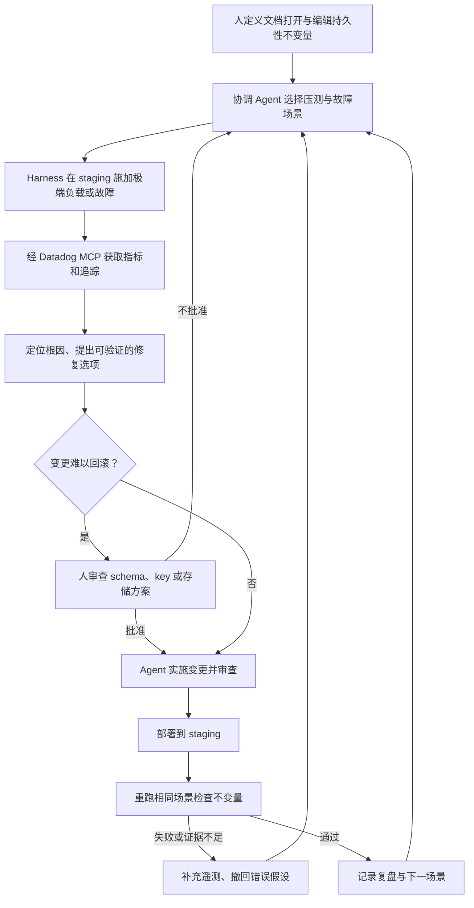

# Agent 驱动的混沌压测闭环 / Agent-Driven Chaos Testing and Repair Loop

## 一句话定义

**Agent 驱动的混沌压测闭环（Chaos Loop）**是让编码 Agent 在预生产环境反复执行「故障注入 / 高负载 → 读取遥测 → 定位根因 → 提议与审查修复 → 部署重测」，以可检验的业务不变量而不是 agent 的自评作为收敛条件。

## 英文缩写速查

| 缩写 | 英文全称 | 简要说明 |
| --- | --- | --- |
| SLO | Service Level Objective | 业务可用性、时延等目标；本文不把作者未给出的正式 SLO 数字补写出来 |
| MCP | Model Context Protocol | Agent 借以读取 Datadog 遥测、团队知识的工具接口 |
| COW | Copy-on-Write | 避免编辑时重复复制文档数据结构的优化方式 |
| GC | Garbage Collection | 自动内存回收；原文认为其增加内存归因的不确定性，但没有做语言 A/B |
| HIL | Human-in-the-Loop | 难以回滚的 schema / key / 存储决定由人审批 |

## 为什么重要

传统压力测试只给出瓶颈，修复往往与测试脱节。Anthropic 工程师 Vivek Nair 在 [2026-11-17 Claude Docs 工程复盘](../../sources/blogs/claude_dev_chaos_loop_docs_launch_2026-11-17.md) 中，让 Claude Code 持续协调 staging、测试 harness、Datadog MCP 和 sub-agent，用每次失败生成下一轮具体修复及验证。这个案例的可迁移价值是**闭环的可观测性、可复测性和风险边界**，不是「把所有生产改动交给 Agent」。

## 核心原理

### 不变量先于压测

作者冻结两项检查条件：长历史文档也要近乎即时打开；服务端已确认的编辑不得丢失。它们不是任选的性能口号，而是每轮故障注入和修复都必须守住的验收约束。文章没有公开固定的毫秒时延 SLO 或零丢失检测脚本，不能凭空量化。

### 流程总览（根据官方工程博客整理）

图是原文的工程过程归纳；**不是**未公开生产源码的运行时序图。作者将难以撤回的数据库变更保留在人类批准环节。

### 原文的关键实例

- 预演包括每天 1000 万文档、2.2 万连接同时重连、热门文档数百观众、实例被杀死和数据库暂时停滞。
- 某大型文档初期内存约 **3 GB**：第一次缩小缓存被遥测反证；继续追踪到每次按键重复复制数据结构，改为 **COW** 后，作者报告约三天降至 **180 MB**。
- 作者表示系统从预计 **500 多个内存优化 pod** 降到约 **50 个**；其用 Rust、精简依赖减少不可控内存来源，但未做 Rust 与 Go 的直接比较。
- 官方报告截至 2026-09-22 **460 万余文档**、约 **20 亿请求仅 60 次 server error**；2026 年 9 月 **629 次生产发布没有回滚**。这些是作者的生产自述，而非独立审计结果。

## 主要方法路线

依官方工程复盘，可将一次可靠性改进划分为五个可复核的阶段：

1. **设定不变量：** 冻结文档可读性、已确认编辑持久性等验收约束，明确哪些失败不可接受。
2. **场景注入：** 在 staging 运行高并发、重连风暴、实例宕机和数据库迟滞测试，保存负载参数与运行版本。
3. **遥测归因：** 通过 Datadog MCP 检查资源占用、查询与追踪，比较候选根因；错误假设由下一轮观测推翻，而非继续叠加补丁。
4. **分级修复：** 对可逆改动实施并审查；涉及 schema、存储或数据布局的高风险决定交由人审批。
5. **相同场景回归：** 部署到 staging 并重放负载，检查不变量和新瓶颈；通过后保存证据并开始下一轮。

该路线是官方博客描述的工程循环，不应理解为已公开的通用测试脚本或无人审批的生产发布流程。

## 工程实践

1. **冻结成功条件：** 给目标服务定义能被脚本验证的时延、正确性、数据持久性和恢复条件；区分真值与代理指标。
2. **为 Agent 开遥测只读接口：** 接入查询名、扫描/返回行数、内存分布、p95/p99 时延、故障事件与部署版本；权限与凭据隔离。
3. **优先 staging 故障注入：** 持续跑超预期流量、断连重试、数据库迟滞、发布时重启。把测试场景及版本记录下来，保证可复测。
4. **逐次保留修复证据：** Agent 先提出互斥假设，低风险改动可以在 staging 试验；保留修复前后指标、失败反例、回滚方式。
5. **高风险必须人工把门：** Schema、数据布局、持久性与真实生产发布由授权人员批准；CI/发布审批不可由压测 Agent 自行覆盖。
6. **机器人软件类比（工程迁移建议，非原文实验）：** 可针对 ROS 2 通信中断、控制进程重启、仿真长周期运行设计故障注入，并记录指令超时、状态机安全转换与恢复时间；不能用软件压测代替真机风险评估。

**与普通测试的差异：** 这里更强调「对持续测到的瓶颈进行修复并再次压测」，其最终效果需要由独立测试结果证明。可与 [Coding Agent 验证闭环](coding-agent-verification-loops.md) 的 E2E、属性与差分测试互补。

## 局限与风险

- 来源是单篇内部工程经验文章；源码、测试 harness、原始日志和成本细表均未公开在文章中，无法独立复现指标。
- 作者提到约 **12.5 万美元**的推理牌价成本；小型服务两周 **3000–10000 美元**只是他根据变更比例做的粗估，**不是实测报价**。
- 长时间闭环依赖模型稳定维护目标。较旧模型有 goal drift 风险；人工审批和可验证不变量仍不可省。
- Rust 与少依赖是该团队为可归因性做的技术选择，不能推导出「有 GC 的语言不适合 Agent 运维」。
- 本文没有可阅读的公开可运行实现；**源码运行时序图不适用**，仅给出经原文核对的概念工作流。
- 将此方法用于安全关键机器人时，应要求隔离环境、可证明或实测的安全状态、限幅/急停与现场审批，避免自动故障注入损坏设备。

## 关联页面

- [Claude Code 动态多 Agent 工作流](claude-code-dynamic-workflows.md) — 动态创建 harness 和组织独立 Agent 的方法。
- [Coding Agent 验证闭环](coding-agent-verification-loops.md) — E2E 与独立校验机制。
- [可观测性：日志、指标与追踪](../concepts/observability-logs-metrics-tracing.md) — 把观察转化为可归因反馈。
- [AI Agent 评测](../concepts/ai-agent-evaluation.md) — 独立标准与真实部署指标的区别。
- [多 Agent 编码管理与认知把关](../concepts/coding-agent-orchestration-and-cognitive-oversight.md) — 人的审核容量和责任。

## 参考来源

- [Vivek Nair — Claude Docs Chaos Loop（官方原文研读归档）](../../sources/blogs/claude_dev_chaos_loop_docs_launch_2026-11-17.md)

## 推荐继续阅读

- [官方工程博客原文：Using a "chaos loop" to harden the Claude Docs launch](https://claude.dev/blog/chaos-loop-claude-docs-launch/)
- [官方关联文章：A harness for every task](https://claude.dev/blog/a-harness-for-every-task-dynamic-workflows-in-claude-code/)
