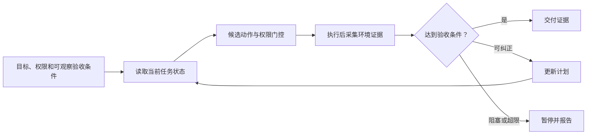

# Agent Planning and Feedback Loops · 智能体规划与反馈执行

## 一句话定义

将任务目标、可执行动作、环境观察和停止条件分开，使智能体能依据可核查事实更新下一步。

## 英文缩写速查

| 缩写 | 英文全称 | 简要说明 |
|---|---|---|
| LLM | Large Language Model | 可提出计划或选择动作 |
| API | Application Programming Interface | 产生可验证的工具输出 |
| FSM | Finite-State Machine | 把转移、暂停和终止显式化 |

## 为什么重要

计划是拟议路径，不是已经完成的记录。维护流程如果顺序可预定，确定性流程通常更易审计；仅在观察结果会改变后续步骤时引入按反馈重规划。

## 主要技术路线（核心机制）

校验区分已达到目标、可纠正失败、阻塞和超限。暂时性只读失败可在限额内重试；证据否定前提则更新计划；无法判定或有高影响副作用时暂停，不把循环当作授权。

## 工程实践

以机器人日志的离线完整性检查为例：先列采集 run，再校验相机时间戳和记录数；如果清单与日志冲突，定位对应 run 后重新校验，不自动填补缺失数据。保存任务版本、关键观察、状态转移理由与终止原因。

## 局限与风险

模型自评可能与执行器错误相关；优先用工件和程序断言。更长上下文或更多尝试不保证改善，要对照固定流程测成功率、平均耗时和停不下来的失败。

## 关联页面

- [智能体工具调用接口](agent-tool-use-interface.md)
- [验证闭环](coding-agent-verification-loops.md)
- [智能体软件工厂 Harness](../concepts/agentic-software-factory-harness.md)

## 参考来源

- [Anthropic：Building effective agents 核读归档](../../sources/sites/method-agent-planning-feedback-primary-20261126.md)
- [原页面关联资料](../../sources/repos/agentic-design-patterns.md)

## 推荐继续阅读

- [Anthropic：Building effective agents](https://www.anthropic.com/research/building-effective-agents)
