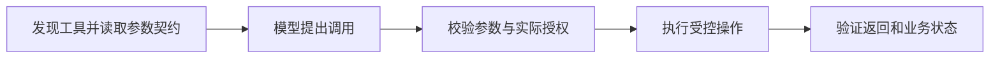

# Agent Tool-use Interface · 智能体工具调用接口

## 一句话定义

定义模型与执行器之间可检查的名称、参数、权限、结果和失败契约。

## 英文缩写速查

| 缩写 | 英文全称 | 简要说明 |
|---|---|---|
| MCP | Model Context Protocol | 定义服务端工具发现与调用 |
| RPC | Remote Procedure Call | 以请求身份将调用与响应关联 |
| API | Application Programming Interface | 执行器供调用方使用的功能边界 |

## 为什么重要

参数合法与获得授权属于不同层；成功响应也未必表示任务所需状态已落地。可校验的返回字段与错误类别让使用方区分请求错误、业务失败和完成。

## 主要技术路线（核心机制）

MCP 的工具列表接口可分页；调用携带工具名和参数。输出同时可能包含供人阅读的内容、供机器校验的结构化结果。将 JSON-RPC 协议错误与结果里标记的执行错误分开统计。

## 工程实践

只读机器人运行记录的示例返回 run_id、输出工件与观测时间；无记录应返回可识别的结果；如果接口涉及状态变更，应在执行前确认对象和动作，并核验真实状态，而不是只依赖成功字串。

## 局限与风险

工具注解不是可靠的授权证明；外部返回是数据而非指令。客户端应限制细粒度超时和副作用，写入结果不确定时先查询状态，不盲目重试。

## 关联页面

- [智能体技能封装](agent-skill-packaging.md)
- [Agent Skill 封装 vs MCP 工具契约 vs CLI/SDK 调用接口](../comparisons/agent-skill-packaging-vs-mcp-cli-tool-interfaces.md)
- [验证闭环](coding-agent-verification-loops.md)
- [智能体软件工厂 Harness](../concepts/agentic-software-factory-harness.md)

## 参考来源

- [Model Context Protocol：Tools（2025-06-18） 核读归档](../../sources/sites/method-agent-tool-use-interface-primary-20261126.md)
- [原页面关联资料](../../sources/blogs/openai_harness_engineering_2026-02-11.md)

## 推荐继续阅读

- [Model Context Protocol：Tools（2025-06-18）](https://modelcontextprotocol.io/specification/2025-06-18/server/tools)
