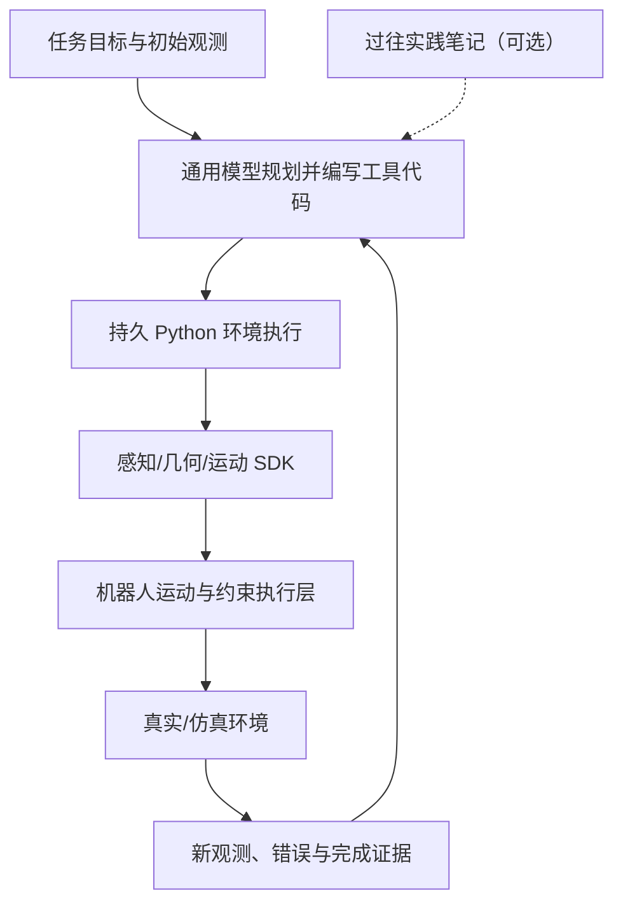

# Agentic Manipulation Policies：可编程的智能体机器人操作策略

## 一句话定义

**智能体操作策略把大模型作为可复查、可修改的上层控制器，通过机器人 SDK 感知、编写并执行工具程序、再观测纠错，而不是让大模型直接替代低层伺服控制。** [Apple AMP1](../entities/paper-apple-amp1.md) 是这一方向的直接实验实例。

## 英文缩写速查

| 缩写 | 英文全称 | 简要说明 |
|------|----------|----------|
| AMP1 | Agentic Manipulation Policy 1 | Apple 的机器人操作 agent 系统 |
| SDK | Software Development Kit | 感知、几何、轨迹、夹爪的可编程接口 |
| VLA | Vision-Language-Action | 直接从视觉语言推断动作的代表方法 |
| RGB-D | Red, Green, Blue and Depth | 机器人融合视觉与深度输入 |
| IK | Inverse Kinematics | 末端轨迹向执行关节目标的求解 |
| API | Application Programming Interface | 大模型/控制服务的工具调用边界 |

## 为什么重要

机器人实际运行需要任务语义理解、三维几何判断、运动可执行性、安全约束和失败恢复。把所有能力塞到一个端到端动作网络中，可能很难调试；把每个操作硬编码，也难覆盖开放任务。agentic 路线让通用模型**决定怎样组合、何时观测、如何修正**，让机器人服务管理可执行的动作。关键研究变量因此从“单一模型是否强”扩展成“模型 × harness × 传感 × 时间预算”。

## 核心原理

| 层 | 需要解决的问题 | AMP1 的实现例子 |
|----|----------------|------------------|
| 任务语义层 | 当前应做什么、做完如何判断 | 模型理解自然语言、根据结果安排下一步 |
| 感知与场景层 | 物体在哪里、坐标系和状态是什么 | SDK 的 RGB-D、标定、点云与可修正场景表示 |
| 可执行计划层 | 动作如何表示和复用 | 持久 Python 程序、可重复调用的函数与文本注释 |
| 机器人安全/控制层 | 轨迹是否可执行、运动如何落地 | IK、末端时间轨迹、夹爪命令、下游机器人服务 |
| 反馈与记忆层 | 未完成/失败后如何修正 | 执行结果后再次观察；AMP1+ 持久笔记 |

### 流程总览

**接口原则：** 大模型输出“代码级、任务级命令”，低层控制器落实关节目标/接触稳定性；观测闭环的时间尺度比电机伺服慢得多。

## 主要技术路线

以**上层任务决策和下层机器人执行的接口**为分类依据，可以区分以下三种已公开的架构：

1. **代码生成型 agent（[Apple AMP1](../entities/paper-apple-amp1.md)）**：模型直接在持久 Python 环境编写程序，调用感知、几何和轨迹 SDK；适合需要现场几何推理、重复观察和可执行代码审查的操作，但决策回路时延高。
2. **固定原语型 agent（[Harness VLA](../entities/paper-harness-vla.md)）**：上层模型选择已定义的解析原语及冻结 VLA 接触原语，利用记忆恢复和重绑定；不是允许模型无限制生成机器人控制 API。
3. **异构技能编排（[RoboHarness](../entities/paper-robo-harness.md)）**：根据任务和执行证据选择不同的 VLA / RL / TAMP 策略，再处理策略之间的状态交接。

三种路线均不同于直接以大模型输出高频力矩。工程选型时应明确 **谁产生动作、动作接口的权限、反馈频率和恢复边界**；与 [行为树 × VLA 编排](../concepts/behavior-tree-vla-orchestration.md) 对照，可进一步区分确定性流程控制与模型主导的动态工具调用。

## 与其他工作对比

| 范式 | 计划生成 | 低层动作 | 能力/时延取舍 |
|------|----------|----------|---------------|
| [AMP1](../entities/paper-apple-amp1.md) | LLM 写 Python 并反复验证 | SDK 运动轨迹/夹爪 | 高表达力、慢推理、易插桩 |
| [Harness VLA](../entities/paper-harness-vla.md) | LLM 调度固定原语 | 冻结 VLA 接触原语 + 解析动作 | 复用已有 VLA，技能接口固定 |
| [RoboHarness](../entities/paper-robo-harness.md) | Agent 路由异构技能 | VLA / RL / TAMP 等 | 多策略协作与交接成本 |
| [端到端 VLA](vla.md) | 网络内部生成动作 | 动作 chunk/位姿/关节目标 | 在线执行可快，依赖示范和训练分布 |

## 实验与证据

Apple 的 RoboLab-120 实验同时变更了模型与 harness，报告 AMP1 + Gemini 4 Argon **85.6%**、AMP1 + Opus 5.5 **82.8%**；这些结果验证的是“模型与接口系统”的整体性能。RoboDojo 的 **26.4%→84.1%** 跨越了零样本到有练习记忆的不同设置；不能写成“同设置下仅换模型涨 57.7 个百分点”。真机实验平均约 **211 秒**用于推理、约 **69 秒**用于机器人执行，揭示高成功率背后的时间成本。

## 结论与选型

1. **优先 agentic：** 复杂但相对慢速、可逐步观测和回滚、对象几何可估计的任务。
2. **优先实时学习策略：** 高频接触稳定、快速动态运动、连续操控和需要固定时延的闭环。
3. **混合路线：** 让 agent 选择目标、调用受保护的伺服/运动规划器，并将成功状态写回可审计记忆。
4. **公平评测：** 锁定基座模型、任务/seed、SDK 能力、传感配置、token/墙钟预算及成功判据后，再讨论 harness 的独立增益。

## 工程实践

- **输入契约：** 定义图像、标定、机器人状态、物体姿态和任务成功/停止条件；不可把相机坐标直接当世界坐标。
- **动作契约：** SDK 仅暴露允许的末端路径、抓取/开合及速度/工作空间等限制；代码执行在隔离环境，禁止模型直接绕过安全层。
- **执行循环：** 观察 → 生成小段动作代码 → 动作可行性检查 → 执行 → 独立成功验证 → 必要时修正。
- **日志与回放：** 记录模型版本、提示词、代码、轨迹、图像、episode 结果、总时延、异常和重试次数。
- **可复现入口：** AMP1 的 `amp eval robolab`、`amp eval capgym`、`amp eval robodojo` 与 `amp practice` 见官方仓和 [项目实体](../entities/paper-apple-amp1.md) 的源码时序图。

## 局限与风险

- **控制周期：** 大模型每轮需要秒级甚至分钟级推理，不能替代 100 Hz 以上的底层位置/速度/力矩控制。
- **信息误差：** 遮挡、标定偏差、视觉/碰撞模型误差会使程序化轨迹同样失败。
- **编程错误与安全：** 生成代码必须在沙箱运行，并由运动层二次限幅、可达性与碰撞约束把关。
- **评价混杂：** 比较不同公司模型的 AGI “强弱”时，若模型、工具、视觉输入、成本预算均不同，不可将系统成绩归因为单一权重。
- **任务覆盖：** 静态桌面操作的高成功率不能外推出复杂动态操作、非刚体接触或开放世界安全部署。

## 关联页面

- [Apple AMP1 论文与实现](../entities/paper-apple-amp1.md)
- [VLA 方法](vla.md)
- [Harness VLA 记忆编排](../entities/paper-harness-vla.md)
- [RoboHarness 异构策略路由](../entities/paper-robo-harness.md)
- [机器人操作任务](../tasks/manipulation.md)
- [行为树 × VLA 编排（概念）](../concepts/behavior-tree-vla-orchestration.md)

## 参考来源

- [Apple 原始论文精读与实验记录](../../sources/papers/apple_amp1_arxiv_2611_09892.md)
- [Apple 官方源代码入口](../../sources/repos/apple-ml-amp.md)
- [Apple 项目页资源](../../sources/sites/apple-aiml-research-ml-amp.md)

## 推荐继续阅读

- [On Agentic Manipulation Policies (arXiv HTML)](https://arxiv.org/html/2611.09892)
- [AMP 官方复现文档](https://github.com/apple-aiml-research/ml-amp/blob/main/docs/reproducing-the-paper.md)
