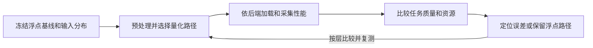

# AI Model Compression and Inference Optimization · AI 模型压缩与推理优化

## 一句话定义

降低模型实存或计算成本，同时在目标运行时对照基线检查任务质量。

## 英文缩写速查

| 缩写 | 英文全称 | 简要说明 |
|---|---|---|
| PTQ | Post-Training Quantization | 训练完成后转换权重或激活精度 |
| QAT | Quantization-Aware Training | 在训练时纳入量化影响 |
| QDQ | Quantize–Dequantize | ONNX 图中以显式量化和反量化节点表达低精度路径 |

## 为什么重要

量化、剪枝、蒸馏和图融合改变的对象不同。模型文件较小不保证设备耗时更低；目标执行后端是否有低精度算子和不必要的设备复制往往决定实际结果。

## 主要技术路线（核心机制）

静态 PTQ 用代表性输入离线定标，动态 PTQ 在线求激活量化参数；用同一批回放样本比较配对张量和端到端质量。若退化集中于少数敏感层，可只保留其浮点精度；两类 PTQ 不达标再评估 QAT。

## 工程实践

用固定分辨率及长尾光照的图像样本比较浮点与 INT8：记录设备、执行后端、批量、p50/p95、峰值内存和对应任务缺陷，若是机器人视觉前端同时查漏检在后续任务中的影响。

## 局限与风险

性能对数据、目标硬件和算子覆盖敏感。离线校准集错配、量化/反量化开销和算子回退可以抵消收益；不可用平均数代替尾延迟或安全任务的分项指标。

## 关联页面

- [模型推理与服务部署](ai-model-serving-inference.md)
- [视觉骨干](../concepts/vision-backbones.md)
- [推理显存估算](../concepts/llm-inference-vram-estimation.md)

## 参考来源

- [ONNX Runtime：Quantize ONNX Models 核读归档](../../sources/sites/method-ai-model-compression-primary-20261126.md)
- [原页面关联资料](../../sources/blogs/wechat_llm_inference_vram_estimation_2026-10-01.md)

## 推荐继续阅读

- [ONNX Runtime：Quantize ONNX Models](https://onnxruntime.ai/docs/performance/model-optimizations/quantization.html)
