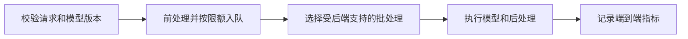

# AI Model Inference and Serving · AI 模型推理与服务部署

## 一句话定义

把模型和前后处理作为受控服务运行，明确接口、并发、队列及延迟预算。

## 英文缩写速查

| 缩写 | 英文全称 | 简要说明 |
|---|---|---|
| SLO | Service Level Objective | 表述例如尾延迟与错误率目标 |
| API | Application Programming Interface | 约束请求字段、结果和错误 |
| CPU | Central Processing Unit | 预处理或后处理可能受其限制 |

## 为什么重要

设备计算延迟不是端到端延迟。线上请求还经历预处理、排队、传输和后处理；若只优化模型内核，可能遗漏队列造成的控制或交互超时。

## 主要技术路线（核心机制）

无状态请求可在最大等待内凑批；跨请求更新状态的序列必须正确路由并隔离。分别观测排队与计算时间，并将最大队列与过期行为纳入配置；请求结束时核对模型版本及输出 schema。

## 工程实践

用单请求建立基线，再用代表性的峰值流量做并发扫描，同时记录吞吐、p95/p99、超时、内存与质量。若视频观测已过期，则由机器人端独立守护拒绝使用该结果，不让远端排队进入高频控制回路。

## 局限与风险

最大吞吐配置未必符合尾延迟目标。网络抖动、批形状不匹配和显存峰值均需单独评估；无法接受超时的实时环应本地独立运行，不能用服务 p50 宣称闭环时序保障。

## 关联页面

- [模型压缩与推理优化](ai-model-compression.md)
- [控制与推理频率解耦](../concepts/control-inference-frequency-decoupling.md)
- [视觉骨干](../concepts/vision-backbones.md)

## 参考来源

- [NVIDIA Triton Inference Server：Batchers 核读归档](../../sources/sites/method-ai-model-serving-inference-primary-20261126.md)
- [原页面关联资料](../../sources/blogs/wechat_llm_inference_vram_estimation_2026-10-01.md)

## 推荐继续阅读

- [NVIDIA Triton Inference Server：Batchers](https://docs.nvidia.com/deeplearning/triton-inference-server/user-guide/docs/user_guide/batcher.html)
