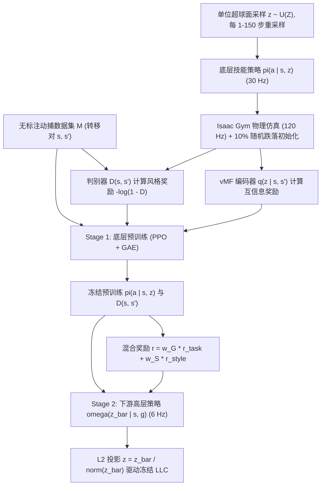
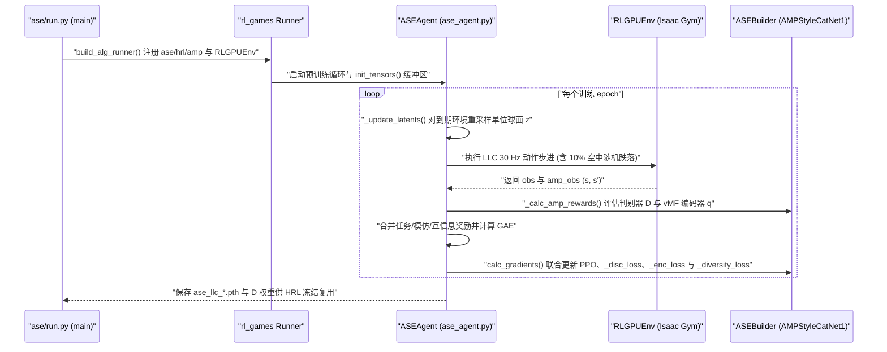

# ASE（Adversarial Skill Embeddings）

## 一句话定义

**ASE（Adversarial Skill Embeddings）** 是 Peng et al. (SIGGRAPH / TOG 2022) 提出的分层物理角色控制框架，将 [AMP](amp-reward.md) 对抗运动模仿与无监督互信息技能发现结合，在无标签、未分段的大规模动作捕捉集上预训练一个条件于 64 维单位超球面潜变量 $z\in Z$ 的通用底层技能策略 $\pi(a\mid s,z)$，供下游高层任务策略 $\omega(\bar{z}\mid s,g)$ 跨任务复用并自动继承跌倒恢复能力。

## 英文缩写速查

| 缩写 | 英文全称 | 简要说明 |
|---|---|---|
| ASE | Adversarial Skill Embeddings | 结合对抗模仿与互信息编码的可复用技能嵌入框架 |
| AMP | Adversarial Motion Priors | 用状态转移判别器 $D(s,s')$ 提供运动风格奖励的方法 |
| vMF | von Mises-Fisher (Distribution) | 定义在单位超球面上的方向概率分布，用于 ASE 技能编码器 |
| LLC / HLC | Low-Level / High-Level Controller | 30 Hz 预训练底层技能策略 $\pi(a\mid s,z)$ 与 6 Hz 高层策略 $\omega(\bar{z}\mid s,g)$ |
| MI | Mutual Information | 互信息 $I(s,s';z\mid\pi)$，用于最大化潜变量对行为转移的辨识度 |
| GAE | Generalized Advantage Estimation | 底层与高层 PPO 训练共享的广义优势估计器 |
| BFM | Behavior Foundation Model | 预训练后可面向多类下游任务零样本或少样本适配的行为基础模型 |

## 为什么重要

在物理仿真人形与复杂角色控制中，单靠从零[强化学习](reinforcement-learning.md)容易产生抽搐、反自然步态，而传统[AMP](amp-reward.md)在每个新任务都要重新保留完整动捕库并联合从头优化策略：

- **无需动作标签与人工分段**：动捕数据集 $M=\{m_i\}$ 只需混合日常行走与格斗等无标注片段，ASE 通过互信息最大化自动将多样运动压缩进连续可插值的超球面技能流形。
- **一次性预训练 + 便携式风格先验**：预训练完成后，底层策略 $\pi(a\mid s,z)$ 与判别器 $D(s,s')$ 均被冻结；新任务只需训练一个低频高层策略 $\omega(\bar{z}\mid s,g)$ 并叠加 $D(s,s')$ 风格项，不再需要加载原始动捕数据。
- **物理[行为基础模型（BFM）](../concepts/behavior-foundation-model.md)早期里程碑**：相比把运动重定向限定在开环追踪的传统管线，ASE 证明了「对抗占用匹配 + 变分互信息下界」可在 37-DoF 复杂角色上涌现出全向起身恢复与技能平滑切换能力，直接启发了后续基于物理的人形全身基础模型。

## 核心原理

### 1. 两阶段训练与混合目标函数

ASE 将策略学习解耦为**无任务底层预训练**与**冻结底层的高层任务迁徙**两步：

1. **底层预训练目标（Peng et al. §4–§5，Eq. 2）**：
   给定未分段动作集合 $M$，底层策略 $\pi(a\mid s,z)$ 既要匹配真实运动转移分布，又要让状态转移反推出对应潜变量 $z$：
   $$\max_\pi \; -D_{\mathrm{JS}}\big(d^\pi(s,s') \,\|\, d^M(s,s')\big) + \beta\, I(s,s'; z \mid \pi)$$
   - **对抗模仿项**：利用带梯度惩罚（$w_{\mathrm{gp}}=5$）的 AMP 判别器 $D(s,s')$ 给出风格奖励 $-\log(1 - D(s_t,s_{t+1}))$；
   - **变分技能发现项**：利用互信息对称性 $I(s,s';z\mid\pi)=H(z)-H(z\mid s,s',\pi)$ 与[变分下界推导](../formalizations/variational-objective.md)，引入编码器 $q(z\mid s,s')$，得到逐步奖励（Eq. 10）：
     $$r_t = -\log\big(1 - D(s_t, s_{t+1})\big) + \beta \log q(z_t \mid s_t, s_{t+1})$$
2. **单位超球面潜空间与 vMF 编码器（§6.1–§6.2）**：
   - 将潜变量约束在 64 维**单位超球面** $Z = \{z\in\mathbb{R}^{64}:\|z\|=1\}$ 上，先验 $p(z)$ 为超球面均匀分布（高斯采样后 L2 归一化），避免无界高斯空间中尾部样本引发的 OOD 失真动作；
   - 编码器 $q(z\mid s,s')\propto \exp(\kappa\,\mu_q(s,s')^\top z)$ 采用 von Mises-Fisher（vMF）分布（论文取 $\kappa=1$），因此对数似然项退化为方向余弦点积 $\kappa\,\mu_q(s,s')^\top z$，既稳定又无需近似无界方差。
3. **响应性、多样性正则与跌倒恢复（§6.4–§6.5）**：
   - **跨技能平滑切换**：每个 episode 内每隔 $[1, 150]$ 步重采样一次新 $z_t$（而非整局固定 $z_0$），迫使 $\pi$ 学会任意时刻响应新指令并完成姿态过渡；
   - **余弦多样性损失**：以系数 $w_{\mathrm{div}}=0.01$ 约束不同潜变量对应的动作分布比例，分母基于余弦距离 $D_z(z_1,z_2)=0.5(1-z_1^\top z_2)$；
   - **随机空中丢落恢复**：预训练时以 10% 概率将角色从随机空中高度与姿态丢落初始化，使底层即使未从动捕中专门收集起身切片，也能自发学会翻滚撑地起身并迁移给所有下游任务。
4. **高层任务迁徙（§7）**：
   - 下游任务冻结 $\pi(a\mid s,z)$ 与 $D(s,s')$。高层策略 $\omega(\bar{z}\mid s,g)=\mathcal{N}(\mu_\omega(s,g),\Sigma_\omega)$ 在**未归一化空间** $\bar{z}\in\bar{Z}$ 上采样（初始化于原点附近以在超球面上均匀探索），执行前投影为 $z=\bar{z}/\|\bar{z}\|$ 并以 6 Hz（每 5 个 30 Hz LLC 步）更新；奖励为 $r_t = w_G r^G + w_S\big(-\log(1-D(s_t,s_{t+1}))\big)$，默认 $w_G=0.9, w_S=0.1$。

### 流程总览

## 主要技术路线

| 对比变体 / 相近路线 | 预训练技能发现 | 超球面归一化与多样性 | 风格保真与模式覆盖（论文实证） | 下游适配与适用范围 |
|---|---|---|---|---|
| **完整 ASE（论文主线）** | AMP + vMF 互信息 $q(z\mid s,s')$ | 64D 单位球面 + 余弦多样性正则 | 5 项任务归一化回报：Reach `0.75`、Speed `0.93`、Steering `0.90`、Location `0.45`、Strike `0.82`；1000 轨迹可达约 10% 技能转换 | 只需训练 6 Hz 高层策略，无需保留原动捕 |
| **No SD（仅 AMP + 随机 $z$，去技能发现）** | 无互信息编码器 | 有单位球面采样 | 技能潜变量被策略忽略，Reach 跌至 `0.33`、Location `0.25`、Strike `0.50` | 说明互信息约束对建立可控潜空间缺一不可 |
| **No Div.（去多样性损失）** | AMP + vMF | 无余弦多样性项 | 下游五项总分接近完整 ASE，但随机切换覆盖度与动捕片段分布均匀度显著下降（Fig. 9–10） | 易陷入少数安全动作循环 |
| **From Scratch（纯任务 RL 从零训练）** | 无 | 无 | Speed(`0.95`)、Location(`0.67`)、Strike(`0.87`) 数值更高，但出现剧烈抽搐与反自然高能耗动作（Fig. 8） | 适合只看单任务数值指标、不要求类人自然度的场景 |
| **纯 [AMP](amp-reward.md)** | 无潜变量（单任务联合训练） | 无 | 风格自然但每新增一个任务都要加载动捕数据并重训全身策略 | 单一特定任务（如平地跑跳或特定踢击） |

## 工程实践

官方仓库 [nv-tlabs/ASE](../../sources/repos/nv-tlabs-ase.md) 基于 NVIDIA Isaac Gym 与 `rl_games` 实现，需注意其 README 首行已标注 **deprecated**、新研究建议转向后继框架 [MimicKit](https://github.com/xbpeng/MimicKit/)，但在复现原版剑盾人形与核对超参数上仍具有完整参考价值：

1. **实验模型与算力口径（§8 & §10.1）**：
   - 角色为 37-DoF 剑盾人形（120 维局部状态、31 维以 3D 指数映射表示球铰的 PD 目标角），低层 $\pi$ 与 $V$ 均采用 `[1024, 1024, 512]` ReLU MLP，判别器 $D$ 与编码器 $q$ 共享主干并分头，高层 $\omega$ 为 `[1024, 512]`；
   - 使用 187 段 Reallusion 非商用动捕（约 30 分钟日常与格斗），在 Isaac Gym 4096 并行环境（120 Hz 物理、30 Hz LLC）下单张 NVIDIA V100 约训练 10 天（超 100 亿仿真步），每轮收集 131,072 样本，PPO + [GAE($\lambda=0.95$)](../formalizations/gae.md)（$\gamma=0.99, \epsilon=0.2, \text{lr}=2\times 10^{-5}$）。
2. **官方源码核心模块对照（`ase/`）**：
   - **调度入口（`ase/run.py`）**：`build_alg_runner()` 向 `rl_games` Runner 注入 `amp`、`ase`、`hrl` 算法工厂，并用 `RLGPUEnv` 透传 `observation_space` 与 `amp_observation_space`，通过 `--task HumanoidAMPGetup` 等启动预训练，用 `HumanoidHeading/Reach/Location/Strike` 启动高层任务。
   - **低层代理（`ASEAgent`，`ase/learning/ase_agent.py`）**：继承自 `AMPAgent`；`init_tensors()` 在经验缓冲中增加 `ase_latents` 与各环境倒计时 `_latent_reset_steps`；`play_steps()` 通过 `_update_latents()` 对到期环境重采样单位向量；`_calc_amp_rewards()` 汇总判别器与编码器点积奖励；`calc_gradients()` 联合优化 PPO 项、`_disc_loss`、vMF 余弦编码损失 `_enc_loss`（含权重衰减与 `autograd.grad` 梯度惩罚）以及 `_diversity_loss`。
   - **网络与推理（`ASEBuilder` / `ASEPlayer`）**：`AMPStyleCatNet1` 将 `ase_latents` 过 `[512, 256]` `tanh` 层得到 `style` 向量再与观测拼接；`eval_enc()` 经 `F.normalize` 投影至超球面；`ASEPlayer.get_action()` 在评估回放时按步数重采样潜变量并以颜色变化可视化当前激活技能。

### 源码运行时序图（`nv-tlabs/ASE` 预训练闭环）

## 局限与风险

- **极端仿真样本门槛**：原文预训练需超 100 亿仿真步（单张 V100 约 10 天），高度依赖 GPU 物理并行加速（Isaac Gym）及稳定的[RL Runner](../concepts/rl-runner.md) 工程栈，难以直接照搬至慢速仿真器或真机在线探索。
- **GAN 式部分 Mode Collapse**：尽管引入了 vMF 互信息与多样性正则，原论文 §11 仍承认在大规模动捕上无法保证 100% 覆盖全部细粒度动作模式，冷门过渡动作容易被高频常用步态吞并。
- **动作抖动与过度剧烈恢复**：为同时满足互信息可辨识与跌倒恢复，部分潜变量区域可能出现高频抖动、速度突变或反自然空翻起身动作；工程上常需额外增加能量正则、关节力矩平滑与低通滤波后处理，并在向实体机器人部署时结合[运动重定向](../concepts/motion-retargeting.md)与 [Sim2Real](../concepts/sim2real.md) 域随机化。
- **仓库生态迁移风险**：`nv-tlabs/ASE` 依赖较早期 Isaac Gym Preview 栈并已官方弃用，新建实验应评估向 `MimicKit` / Isaac Lab 迁移的接口适配成本。

## 与其他页面的关联

- 核心继承与方法族：[AMP](amp-reward.md)、[逆强化学习](inverse-reinforcement-learning.md)、[模仿学习](imitation-learning.md)、[强化学习](reinforcement-learning.md)、[策略优化](policy-optimization.md)
- 数学与概念底座：[变分目标](../formalizations/variational-objective.md)、[GAE](../formalizations/gae.md)、[MDP](../formalizations/mdp.md)、[生成对抗网络](../concepts/generative-adversarial-network.md)、[行为基础模型（BFM）](../concepts/behavior-foundation-model.md)
- 机器人落地与工程支撑：[人形运动控制](../tasks/humanoid-locomotion.md)、[运动重定向](../concepts/motion-retargeting.md)、[Sim2Real](../concepts/sim2real.md)、[RL Runner](../concepts/rl-runner.md)
- 纵深学习路线：[模仿学习纵深路线（Stage 4）](../../roadmap/depth-imitation-learning.md)

## 参考来源

- [ASE (arXiv:2205.01906v2) 原文通读归档](../../sources/papers/ase_arxiv_2205_01906.md) — 通读 §1–§11 与附录 Table 2–3（核对式 (1)–(22)、超球面 vMF、Table 1 消融、500 次外力 100% 恢复统计及原文项目页 `xbpeng.github.io/projects/ASE/`；另注旧 `xbpeng.com` 链接 SSL 异常未读取）。
- [nv-tlabs/ASE 官方仓库源码核对归档](../../sources/repos/nv-tlabs-ase.md) — 实读 `ase/run.py`、`ase_agent.py`、`ase_players.py`、`ase_network_builder.py`、`amp_datasets.py` 及弃用声明。
- [ASE 旧来源条目索引](../../sources/papers/ase.md) — 早期条目映射与项目页连通性备注。
- [BFM 论文清单中的 ASE 索引条目](../../sources/papers/bfm_awesome_ase_arxiv_2205_01906.md) — BFM 谱系收录索引。

## 推荐继续阅读

- **先懂风格判别器底座**：[AMP（Adversarial Motion Priors）](amp-reward.md) — ASE 的模仿奖励与判别器结构直接继承自 AMP。
- **对比无标注操作探索**：[Learning from Play (Play-LMP)](learning-from-play-lmp.md) — 对比「物理仿真中靠 MI 发现技能潜空间」与「桌面操作中用 CVAE 从无任务游乐轨迹学潜计划空间」。
- **理解整体行为基础模型演进**：[行为基础模型（BFM）](../concepts/behavior-foundation-model.md) — 查看 ASE 如何从全身动画/控制走向现代人形通用策略。
