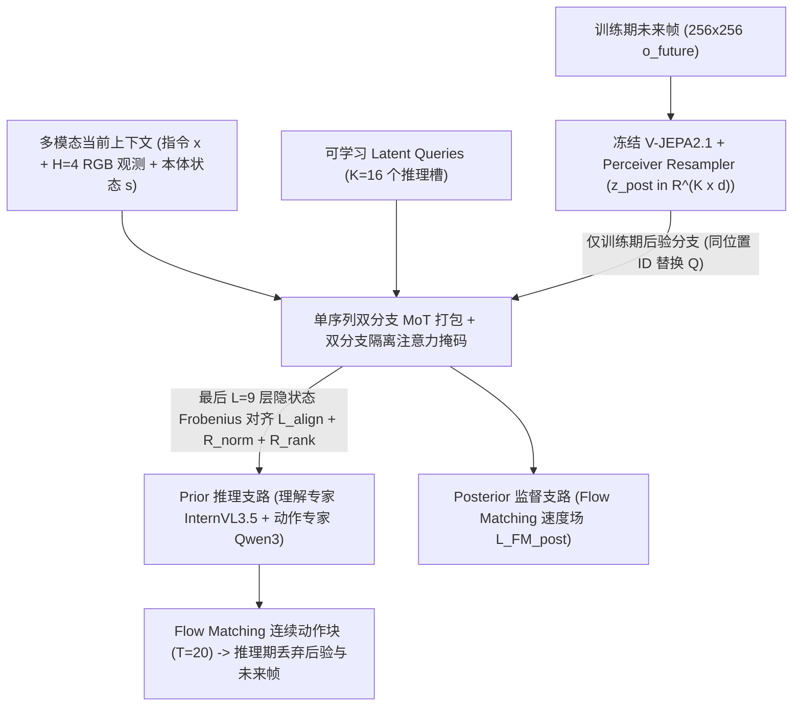

# Being-H0.7：以第一视角视频预训练的隐式世界-动作模型（Latent WAM）

## 一句话定义

Being-H0.7 是智在无界（BeingBeyond）于 2026 年 4 月提出的**隐式世界-动作模型（Latent World-Action Model）**：通过在多模态上下文与动作块之间插入可学习潜空间推理查询（Latent Queries），并在训练期借助仅训练可见的未来观测后验分支对齐隐状态，将未来动力学推演内化为推理期 **3–4 ms/step**、零像素生成的直接动作策略。

## 英文缩写速查

| 缩写 | 英文全称 | 简要说明 |
|------|----------|----------|
| WAM | World-Action Model | 联合未来演化预测与动作生成的具身模型范式 |
| VLA | Vision-Language-Action Model | 直接从多模态观测与指令映射动作的策略模型 |
| MoT | Mixture-of-Transformers | 理解专家与动作专家分离权重、共享注意力的混合架构 |
| UAC | Universal Async Chunking | 客户端锁前缀、按延迟拼接后缀的异步动作分块部署协议 |

## 为什么重要

1. **打破「VLA 捷径」与「显式 WAM 算力瓶颈」的两难**：直接 VLA 因稀疏动作监督易学到视觉捷径而难以泛化动态/接触场景；显式视频生成式 WAM 在测试期需逐帧像素 rollout，既把容量浪费在背景纹理重建上，又难以满足接滚球等毫秒级响应任务。Being-H0.7 提出只在控制相关的紧致潜空间预测未来演化。
2. **大规模第一视角人类视频直接赋能多构型真机**：延续 `Being-H0 -> Being-H0.5 -> Being-H0.7` 路线并沿用 UniHand 2.0 统一序列接口，使大规模无真机标签的第一视角人手交互视频能与机器人轨迹统一预训练并跨平台部署。

## 核心原理

1. **潜空间推理接口（Latent Reasoning Space）**：将 $K=16$ 个可学习潜向量 $Q \in \mathbb{R}^{K \times d}$ 插入上下文与含噪动作块之间，构成增广序列 $S = [x; o_{-H:0}; s; Q; a_{0:T}]$（观测视界 $H=4$、动作块长度 $T=20$），逐层交互汇聚接触状态、物体运动学与子目标进度。
2. **双分支单序列打包（Dual-Branch MoT Packing）**：
   - 基于 Being-H0.5 的 MoT 骨干（`InternVL3.5` 作为 Understanding Expert，`Qwen3` 作为 Action Expert），视觉上下文与未来观测均以纯 RGB 经 `V-JEPA2.1` 编码（上下文编码器可训练、后验未来帧用 `256×256` 编码经 Perceiver 聚合为 $K$ 个未来嵌入 $z^{\text{post}}$）；
   - 将 **Prior Branch**（接 $Q$，训练与推理共行）与 **Posterior Branch**（同位置替换为 $z^{\text{post}}$，共享前置上下文 $c$ 与位置 ID）打包在同一序列中并行前向传播，通过 **Dual-Branch Attention Mask** 禁止 Prior/Posterior 直接互看，仅通过最后 $L=9$ 层隐状态 Frobenius 损失耦合：
     $$\mathcal{L}_{\text{align}} = \frac{1}{L}\sum_{\ell=1}^{L}\frac{1}{|h_\ell|}\left\|h_\ell^{\text{prior}} - h_\ell^{\text{post}}\right\|_F^2$$
3. **防坍塌正则化与训练目标**：为避免对齐优化坍塌为幅值趋零或方向退化，加入下界范数正则 $R_{\text{norm}}(h)=[\text{ReLU}(\tau-\|h\|_2)]^2$ 与基于随机投影 Gram 矩阵特征值分布的负谱熵多样性正则 $R_{\text{rank}}(H)=\sum_i p_i \log p_i$；总预训练目标为 $\mathcal{L} = \mathcal{L}_{\text{FM}}^{\text{prior}} + \mathcal{L}_{\text{FM}}^{\text{post}} + w_{\text{align}}\mathcal{L}_{\text{align}} + w_{\text{norm}}R_{\text{norm}} + w_{\text{rank}}R_{\text{rank}}$（$w_{\text{align}}=10^{-3}, w_{\text{norm}}=w_{\text{rank}}=10^{-4}$）。下游微调仅保留动作流匹配与对齐损失，全局等效 batch size 约 128 轨迹块。

## 工程实践

- **基准与真机评测（纯 RGB 输入）**：
  - 六项仿真基准表现（3B 规模）：LIBERO **99.2%**、LIBERO-plus 零样本 **82.1%** / 微调 **84.8%**、RoboCasa-50 **62.1%**、GR1 **49.2%**、RoboTwin 2.0 **90.2%（Easy）/ 89.6%（Hard，域随机化仅跌 0.6%）**、CALVIN **4.67（ABCD→D）/ 4.48（ABC→D）**；
  - 真实世界部署覆盖三类平台统一配 **Linkerbot O6（6 DoF）灵巧手**：PND Adam-U（31 DoF @ 20 Hz）、Unitree G1（26 DoF 上肢接口 @ 10 Hz + **50 Hz 预训练 AMO 全身控制后端**互补下肢平衡）、Franka FR3（13 DoF @ 20 Hz），在 12 项双盲真机任务（每项 20 次）构成的能力套件（Dynamic Scene / Physical Reasoning / Motion Reasoning / Long Horizon / Generalization）中全部领先 Being-H0.5、$\pi_{0.5}$ 与 Fast-WAM。
- **实时异步部署（UAC）**：沿用并工程化验证了 Universal Async Chunking——控制线程按固定控制频从已承诺前缀弹出动作，异步推理线程在缓冲区余量低于阈值时拉取新帧预测后缀并在估计推理延时之后拼接替换，**绝不覆写已承诺前缀**，最终在真机基础设施上达到 **3–4 ms/step** 平均步长延迟（对比常规显式 WAM/同步分块显著降低抖动）。
- **开源状态核查**：**源码运行时序图：不适用**（截至 2026-11-21，官方集成仓库 [Being-H](https://github.com/BeingBeyond/Being-H) commit `27ec67b` 下 `Being-H07/` 目录仅含 `README.md` 论文导览与引用，尚未释出 Being-H0.7 训练/推理源码与权重）。

## 局限与风险

1. **纯 RGB 无触觉/深度模态局限**：全部实验仅基于 RGB 图像输入，未直接融合分布式触觉阵列（需依赖后续如 [TTP](../entities/cn-os-ttp.md) 引入的 351 维触觉先验以应对严重视觉遮挡）。
2. **静态末端平台与全身耦合依赖外部 WBC**：在 Unitree G1 上 Being-H0.7 本身仅输出 26-DoF 上肢+手部命令，下肢重心稳定依赖预训练 AMO 底层控制器以 50 Hz 独立接管。
3. **代码与预训练语料尚未开放验证**：当前公开仓库仅释放论文说明，第三方尚无法直接复现其 UniHand 2.0 + V-JEPA2.1 联合训练流程。

## 主要技术路线

| 范式路线 | 未来表征与耦合方式 | 推理开销 | 典型定位（相对 Being-H0.7） |
|---|---|---|---|
| **直接 VLA**（如 Being-H0 / Being-H0.5 / $\pi_{0.5}$） | 直接上下文 → 动作生成，无显式未来对齐槽 | 低 | 易受稀疏动作监督诱导学得视觉捷径 |
| **显式视频式 WAM**（生成未来像素后再导动作） | 逐帧像素 / 视频 rollout 监督世界演化 | 高（难满足接球等毫秒控制） | 算力大量消耗在背景像素重构而非控制相关动态 |
| **隐式潜空间 WAM**（Being-H0.7） | $K=16$ Latent Queries + 训练期冻结 V-JEPA2.1 后验对齐 | 3–4 ms/step（推理丢弃后验） | 把未来动力学推演内化到紧致隐状态并保留 Flow Matching 实时输出 |

## 关联页面

- 概念与形式化基础：[World-Action Models（世界-动作模型）](../concepts/world-action-models.md)、[Probability Flow（概率流）](../formalizations/probability-flow.md)
- 独立论文实体页：[Being-H0.7: A Latent World-Action Model from Egocentric Videos](../entities/paper-rcl-2605-00078-being-h0-7-a-latent-world-action-model-from-egoc.md)
- 所属机构实体：[智在无界（BeingBeyond）](../entities/beingbeyond.md)
- 前代基座模型：[Being-H：基于大规模人类视频的人形通用 VLA 系列](../entities/cn-os-being-h.md) 与 [Being-H0](../entities/paper-notebook-being-h0-vision-language-action-pretraining-from.md)
- 同系列隐动作路线：[JALA：面向野外视频的联合对齐隐动作 VLA 预训练](../entities/cn-os-jala.md) 与 [Rethink_VLA](../entities/cn-os-rethink-vla.md)

## 参考来源

- 一手论文：`arXiv:2605.00078v1` 全文归档（[being_h07.md](../../sources/papers/being_h07.md)）
- 代码仓库核查：`BeingBeyond/Being-H @ 27ec67b`（`Being-H07/README.md`）
- 行业横向综述：[具身智能实验室：WAM 世界-动作模型五条技术路径](../../sources/blogs/wechat_embodied_ai_lab_wam_motion_control_five_paths.md)

## 继续阅读

- [Being-H0.7 官方博客主页](https://research.beingbeyond.com/being-h07)
- [arXiv:2605.00078 论文全文](https://arxiv.org/abs/2605.00078)
- [BeingBeyond/Being-H GitHub 仓库](https://github.com/BeingBeyond/Being-H)
