# Claude Code 动态多 Agent 工作流 / Dynamic Workflows and Task-Specific Harnesses in Claude Code

## 一句话定义

**动态工作流（Dynamic Workflows）**让 Claude Code 针对当前任务即时编写 JavaScript 编排脚本，用独立子 Agent、并行扇出与阶段式流水线完成复杂任务；它优化的是 **harness / 协作方式**，不是更换或训练基础模型。

## 英文缩写速查

| 缩写 | 英文全称 | 简要说明 |
| --- | --- | --- |
| JS | JavaScript | 官方文章所述动态 workflow 使用的脚本语言 |
| LLM | Large Language Model | 承担规划、执行和独立审查的语言模型 |
| PR | Pull Request | 代码迁移与审查场景中的可独立验收单元 |
| SDK | Software Development Kit | 静态编排可使用 Claude Agent SDK，文章将其与动态工作流对照 |
| WIP | Work in Progress | 并行任务数需要受协调、审查和集成容量限制 |

## 为什么重要

官方文章 [A harness for every task](../../sources/blogs/claude_dev_dynamic_workflows_2026-06-02.md) 指出，单会话把规划、执行、审查都装进同一上下文，长任务容易出现 **agentic laziness（提前宣告完成）**、**self-preferential bias（偏爱自己产出）** 和 **goal drift（反复压缩上下文后的目标漂移）**。独立子 Agent 的上下文与职责边界可降低这些风险，但必须为并行与多模型审查支付协调和 token 成本。

## 核心原理

### 工作流构件与静态编排的区别

| 构件 | 原文说明 | 工程关注点 |
| --- | --- | --- |
| `agent(prompt, opts)` | 创建子 Agent，可按 schema 返回结构化结果 | 任务责任、选择模型、worktree/remote 隔离 |
| `parallel()` | 并行启动多个 Agent 并在全部完成后汇总 | 任务互不污染，合流点保持确定性 |
| `pipeline()` | 对输入依次应用多个步骤 | 检查与修改不要混入同一不可追踪步骤 |
| JavaScript | 标准 JSON、Math、Array 可组合数据 | 让确定性编排承担循环、排序和终止规则 |

文章指出可以使用 `ultracode` 触发动态流程，或直接要求创建 workflow；可保存为 `~/.claude/workflows` 下的脚本，也可以放入 Skill 中复用。以上是**文章发布时的产品行为**，实际参数及可用性应以当前 Claude Code 文档为准。

### 流程总览（根据官方文章整理）

```mermaid
flowchart TD
    A["用户提供高价值复杂任务与验收标准"] --> B["Claude 选择并编写任务专用 JS harness"]
    B --> C{"任务结构"}
    C -->|不同子问题| D["classify-and-act / 并行扇出"]
    C -->|逐阶段处理| E["pipeline 串联阶段"]
    C -->|不确定需继续| F["loop until done"]
    D --> G["独立子 Agent 处理任务切片"]
    E --> G
    F --> G
    G --> H["单独 verifier 或反对者核对结果"]
    H -->|不合格| I["按 rubric 反馈与再次执行"]
    I --> G
    H -->|合格| J["结构化汇总并检查全量覆盖"]
    J --> K["输出含证据和未解决风险的结果"]
```

**这不是 Claude Code 内部执行器源码时序图。** 原文给出了工作流 JS 构件与模式，却没有发布可供本文逐函数追踪的专用仓库代码。

### 六种模式怎么选

1. **Classify-and-act：** 先识别问题种类再路由不同工具 / Agent，例如按错误类型分派修复方式。
2. **Fan-out-and-synthesize：** 先把问题拆成互不干扰的块，全部结果到齐再归并，避免部分任务被遗漏。
3. **Adversarial verification：** 让独立 Agent 按明确 rubric 质疑生成结果；不要让写作者自己当唯一评委。
4. **Generate-and-filter：** 大量候选先生成，按规则去重、过滤。
5. **Tournament：** 对难以直接评分的大批候选做成对比较，逐轮晋级。
6. **Loop until done：** 对未知工作量的问题，以可检查的停止条件而非固定轮次决定是否继续。

## 工程实践

**适合：** 大范围重构、逐项证据审核、深度研究、复杂根因分析、批量工单分类或需要独立反证的 Agent eval。文章展示了「逐 claim 提取→各自核验→可选来源审计→汇总」的模式；也指出处理不可信工单时，**只读隔离区**先提炼受限摘要，再将动作交给具备权限的 Agent。

**不适合：** 小修小补、单 Agent 已能稳定完成且无需分布式上下文的任务。更多 Agent 可能消耗更多 token，并带来合并冲突与协调负担。

一个可操作的使用次序：

1. 写清完成条件、任务全集、验收 rubric、可用工具和 token 上限。
2. 优先把可以确定性实现的循环、计数、去重与合流留在 JS 编排层。
3. 需要独立判断时再启用不同 Agent，并对并发写入使用隔离 worktree。
4. 每次合流检查覆盖率与拒绝项；失败进入有上限的重试，不能无限消耗预算。
5. 能反复执行的流程再与 `/loop`、`/goal` 搭配，并版本化保存 workflow；这不是默认适合所有任务的必要步骤。

**机器人研发迁移建议（非原文已验证实验）：** 可以按 URDF/观测接口/奖励函数/仿真复现/控制频率与安全约束分工核查，但任何 agent 产出的控制改动仍需经过 [Coding Agent 验证闭环](coding-agent-verification-loops.md)、仿真和真机分层审批。

## 局限与风险

- 本文是 Claude Code 的产品与工程方法介绍，**没有**公开一个跨任务 benchmark 证明动态编排普遍优于单 Agent；原文反而提示额外 token 和协调成本。
- 分裂上下文可以减少同一 Agent 的自我偏好，但不能自动保证评审独立、验证标准真实或事实完整。
- 工作流 JS 虽可动态生成，也需要最小权限、输入隔离、预算上限与确定性的 stop condition；不可信输入不能直接获高权限。
- 文章提供构件和实例，不提供其内部调度器的可运行源码；**源码运行时序图不适用**。
- 不应把自适应 harness 误写成模型权重级递归自我改进；它是工程编排层能力。

## 关联页面

- [Agent 驱动的混沌压测与修复闭环](agent-driven-chaos-testing-loop.md) — 动态 harness 参与持续压测的一种工程化案例。
- [Coding Agent 验证闭环](coding-agent-verification-loops.md) — 如何独立验收子 Agent 交付。
- [多 Agent 编码管理与认知把关](../concepts/coding-agent-orchestration-and-cognitive-oversight.md) — 人负责目标、风险与审阅瓶颈。
- [AI Agent 评测](../concepts/ai-agent-evaluation.md) — 验证器和 rubric 不能由执行者随意篡改。
- [Agentic Coding 时代的软件工程基础](../concepts/agentic-coding-software-fundamentals.md) — 架构和部署约束先于并行执行。

## 参考来源

- [Thariq Shihipar、Sid Bidasaria — 动态 Workflow 官方博客原文研读归档](../../sources/blogs/claude_dev_dynamic_workflows_2026-06-02.md)

## 推荐继续阅读

- [官方原文：A harness for every task](https://claude.dev/blog/a-harness-for-every-task-dynamic-workflows-in-claude-code/)
- [官方文档：Claude Code](https://code.claude.com/docs/en/overview)
