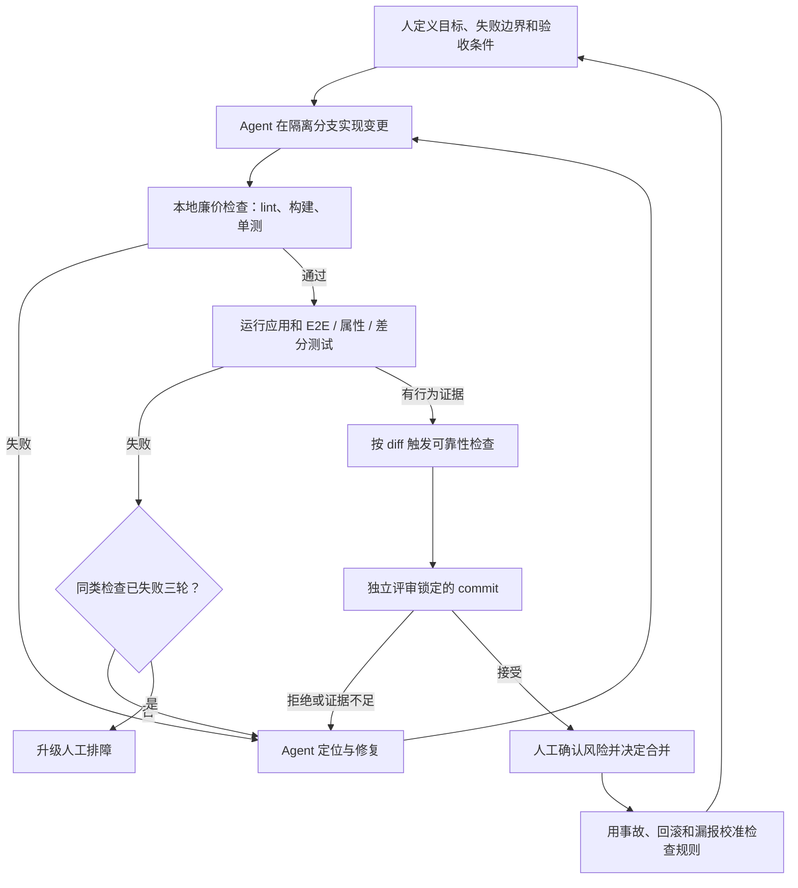

# Coding Agent 验证闭环 / Evidence-Based Verification Loops for Coding Agents

## 一句话定义

**Coding Agent 验证闭环**是将「实现 → 运行真实系统 → 获取可复核的测试与行为证据 → 修复 / 升级人工 → 独立审查」固化为持续反馈链，而非仅靠 agent 宣称工作已完成。

## 英文缩写速查

| 缩写 | 英文全称 | 简要说明 |
| --- | --- | --- |
| E2E | End-to-End | 跨组件执行真实用户路径，获取失败步骤、截图和 trace |
| CI | Continuous Integration | 在提交和 PR 上运行可重复的构建及质量门禁 |
| PR | Pull Request | 将变更、审查结果和可复核证据绑定在一起 |
| CDP | Chrome DevTools Protocol | 浏览器自动化验证 Web 应用行为的接口 |
| QA | Quality Assurance | 从使用者视角核对功能、异常流程及交付条件 |
| TDD | Test-Driven Development | 用测试反馈驱动实现，与 E2E 等验证互补 |

## 为什么重要

Addy Osmani 在 [Claude Code 团队验证实践（2026-11-16）](../../sources/blogs/claude_dev_verification_addy_osmani_2026-11-16.md) 中指出：当多个 coding agent 并行编写代码时，真正限制委托规模的是**人工验收能力与验证器是否可靠**。作者称 Claude Code 团队约 90% 的代码由 Claude 编写并审阅；其内部结构化文件生成测试中，额外的独立 grader 最多提高约 10 个百分点任务成功率。这些是**团队自述和特定内部实验**，并非所有编码任务的普适统计。

本页聚焦「**怎样验证**」；[多 Agent 编码管理与认知把关](../concepts/coding-agent-orchestration-and-cognitive-oversight.md) 聚焦「如何分工、谁负责最后判断」，两页不互相替代。

### 从验证向前延伸：先让错误难以发生

[Lauren Tan 的 Coding Agent 信任金字塔](../concepts/agentic-coding-trust-pyramid.md)（AI Engineer CODE 2026）把本页的“验证”放入更完整的链路：先通过良好 API、架构边界和 lint 消除重复错误，再让 agent 在真实应用中运行验证，最后扩展自动合并与软件工厂。演讲中个人约 3,000、团队约 11,000 个生产 PR 及约 0.5% 回滚率均是团队自述，不应替代本仓库的实际质量指标。

## 核心原理

### 三种互补的验证方式

| 测试 | 对应证据 | 适合场景 | 容易忽略的边界 |
| --- | --- | --- | --- |
| E2E 端到端 | 实际操作路径、截图、trace、失败步骤 | UI、API、模拟器或可启动的整体服务 | 慢、环境依赖、flaky；必须能稳定启动 |
| Property-based 属性测试 | 自动生成输入下的不变量、幂等、往返、等价断言 | 序列化、数据转换、控制逻辑中的纯函数 | 测试属性本身要正确，不能只测常规样例 |
| Differential 差分测试 | 旧版与新版对同一输入的输出差异 | 重构、迁移、优化前后行为保持 | 对空白等非语义差异归一化；预先登记允许变化 |

**优先级：** 原文推荐有条件时优先投资 E2E，因为它覆盖真实用户路径，但并不主张删除单元测试。属性测试用于自动搜寻反例；差分测试用于在规格已漂移时利用旧行为作为参照。三类验证对**不同失败模式**提供互补证据。

### 流程总览（据官方文章整理）

这是**文章所述工作流的概念抽象**，不是从 Claude Code 内部源码逆向得出的调用图。原文建议将能启动、驱动、检查应用的 smoke test 写入仓库 `.claude/skills/verify`，优先验证运行中的变更，再打开 PR。

### 验证器本身也必须被验证

1. **所有者维护检查：** 由真正负责模块的人定义会阻止自己合并的检查；原文称其可靠性清单有 **39 项**，按 diff 触发通常 **3–10 项**。
2. **禁止自改考卷：** 评审规则文件（如 REVIEW.md）从 base/default branch 读取，避免被评审的 PR 改写自己的评分标准；评审锁定具体 commit，后续 push 必须重新核对。
3. **少量但连贯的多轮审查：** 让同一主要 reviewer 继承上轮失败信息和上下文，而非简单叠加更多昂贵 reviewer。
4. **门禁先观察再强制：** off → observe（记录误拦截）→ enforce（阻止提交），并为例外保留说明路径；不能拿未经校准的门禁直接大范围卡住开发。
5. **用真正事故校准：** 回放历史 bug、回滚、已稳定合并的变更；分别测原始发现、验证后、最终评审的召回与误报，观察高优先级缺陷是否被抓到。
6. **把漏报变成规则：** 从人类评审 / revert 中提取重复出现、能从 diff 识别的模式；先尝试反证，再由人确认。对 flaky 测试定位根因，而不是无限 retry 或随意 sleep。

## 主要方法路线

1. **定义验收证据：** 人先写预期行为、负面场景和失败的升级条件，确定哪部分可交给 agent。
2. **低成本本地门禁：** 在打开 PR 前执行可复现的格式检查、构建、单元与接口测试，并记录结果。
3. **真实系统验证：** 驱动 Web / 模拟器 / API / ROS 2 服务执行关键 E2E 路径；对不变量补属性测试，对保持行为的迁移补差分测试。
4. **独立确认并复盘：** 以锁定的 commit 做代码审查，检查源自默认分支；失败三轮未解决则人工介入，合并后用事故、回滚和漏报校准下一轮规则。

以上路线是对原文验证实践的归纳，不是 Claude Code 已发布的可执行流水线脚本。

## 工程实践：机器人研发与知识库

| 层级 | 可执行验证 | 该层不能代替的证据 |
| --- | --- | --- |
| PR 静态检查 | 格式、lint、类型检查、链接、Mermaid 语法 | 页面内容事实正确，或程序真实可运行 |
| 软件 E2E | ROS 2 节点启动、消息链路、超时与故障重现、可检查的日志 | 仿真动力学或真机安全 |
| 属性测试 | 编码解码往返、数据 schema 不变量、幂等导入、接口边界 | 硬件时序与物理安全 |
| 差分测试 | 同输入复跑旧/新运动学模块或解析器，核对有意义差异 | 旧实现本身是否满足产品意图 |
| 仿真/真机验收 | 回归 rollout、控制频率、限位和异常停机、审批记录 | 不能因少数任务通过就证明所有场景安全 |

**对 Robotics_Notebooks 的落地：** 提交前执行 `make ci-preflight`，同时核对原文归档、独立知识页、链接及 Mermaid；PR 中必须区分实际执行的检查结果与未执行项。对控制软件，增加基于实际 ROS 2 / 仿真运行的 E2E、时间戳和失败追踪证据，而非用“测试全绿”替代真机上机许可。

一个最小可实施顺序是：明确验收条件 → 给 agent 配可重复的 `verify` 步骤 → 先跑本地便宜检查 → 对关键路径跑真实 E2E → 必要时运行属性/差分回归 → 独立 reviewer 以固定 commit 审核 → 人决定合并 → 回滚复盘写回规则。

## 源码运行时序图

**不适用。** 本次来源是 Claude Code 团队的工程经验博客，未发布与本文一一对应的可执行实现及源码入口；因此只绘制上面的、经原文核对的**验证工作流**，不冒充源代码运行时调用分析。

## 局限与风险

- **经验不能等于实验复现：** 原文 90%、10 个百分点、39 项规则及失败三轮转人工等是作者在特定团队 / 实验语境中的报告；本页没有重新运行这些实验。
- **用旧版作 oracle 的限制：** differential tests 能发现非预期差异，不能证明旧版没有 bug；有意改变行为时需单独审查。
- **验证门禁存在误报/漏报：** 检查规则由模型产生时，尤其要隔离被评审变更、加入稳定样本和历史事故。
- **安全关键任务必须另验：** 机器人控制需覆盖实际时延、接触、限位、通信失效与现场安全评审，软件 E2E 不是物理安全证明。

## 与风险分级评审的衔接

**验证回答“实际运行是否有证据支持正确”，评审回答“剩余风险是否允许合并”。** 两者在 Claude Code 团队的工程文章中是前后关联的门禁，但通过 E2E 不等于通过安全审查，也不等于无需人工批准。风险分级、审查器校准与回滚的具体分工见 [Coding Agent 验证 vs 代码评审](../comparisons/coding-agent-verification-vs-code-review.md)。

### 从功能验收延伸到人类体验偏好

[3D GameDev Arena（arXiv:2611.24073）](../entities/paper-3d-gamedev-arena.md) 将从零构建浏览器游戏的功能规则、代理试玩和人类盲选分成三层；说明功能测试通过与真正的用户体验偏好不能等同。该研究**不是机器人现场安全测试**。

## 关联页面

- [Agent 工程小书](../entities/little-book-agent-engineering.md)：从工具拒绝、停止条件到终态评分的最小教学例子。

- [oh-my-pi（OMP）](../entities/oh-my-pi.md) — 终端 Coding Agent 将 LSP/DAP、子代理与开发工具合入执行运行时；生成代码后的测试与独立验收仍按本页执行。

- [Coding Agent 验证与代码评审分工](../comparisons/coding-agent-verification-vs-code-review.md) — 对照行为证据与审查、审批、发布门禁。

- [多 Agent 编码管理与认知把关](../concepts/coding-agent-orchestration-and-cognitive-oversight.md) — 分工、评审容量和人类责任边界。
- [Agentic Coding 时代的软件工程基础](../concepts/agentic-coding-software-fundamentals.md) — 设计与运行环境的取舍知识。
- [AI Agent 评测](../concepts/ai-agent-evaluation.md) — 为什么评分器和测试本身也需校准。
- [测试驱动开发](../concepts/test-driven-development.md) — 测试先行和实现反馈闭环。
- [Open Code Review](../entities/open-code-review.md) — 具体的 diff 级独立评审工具。
- [真机策略 Autoresearch Harness](../queries/real-robot-policy-autoresearch-harness.md) — 机器人试验的反馈与验收机制。

## 参考来源

- [Lauren Tan：All Code Is Slop (Except Mine)（官方视频与字幕归档）](../../sources/videos/lauren-tan-all-code-is-slop-2026.md)

- [Claude Code 团队如何看待验证（2026-11-16，官方原文归档）](../../sources/blogs/claude_dev_verification_addy_osmani_2026-11-16.md)

## 推荐继续阅读

- [Addy Osmani — How the Claude Code team thinks about verification](https://claude.dev/blog/how-the-claude-code-team-thinks-about-verification/)
- [Claude Code team — How the Claude Code team does code review](https://claude.dev/blog/solving-code-review-at-anthropic/)
- [Claude Code 官方最佳实践](https://code.claude.com/docs/en/best-practices)
