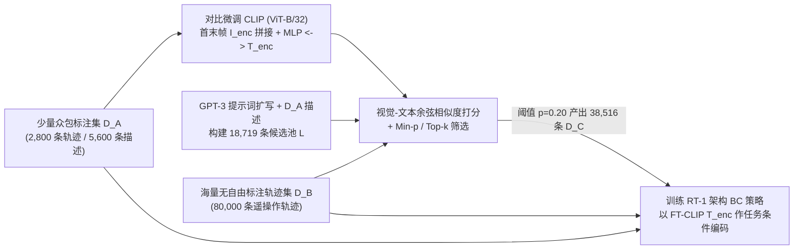

# DIAL（指令增强）

## 一句话定义

**DIAL（Data-driven Instruction Augmentation for Language-conditioned control）**（Xiao et al., RSS 2023 / arXiv:2211.11736）先在仅约 3.5% 的少量众包标注轨迹上微调 CLIP 双塔匹配模型（首末帧融合特征 $\leftrightarrow$ 自然语言），再用微调后的 VLM 为大规模无详细标注离线轨迹自动检索并筛选视觉自洽的事后指令，从而用低成本扩展语言条件行为克隆策略的语义与空间泛化能力。

## 英文缩写速查

| 缩写 | 英文全称 | 简要说明 |
|------|----------|----------|
| DIAL | Data-driven Instruction Augmentation for Language-conditioned control | 数据驱动的语言条件控制指令增强框架 |
| VLM / CLIP | Vision-Language Model / Contrastive Language-Image Pretraining | 视觉–语言预训练模型；DIAL 使用 ViT-B/32 CLIP 微调后做图文轨迹重标与任务编码 |
| BC | Behavior Cloning | 行为克隆；DIAL 下游使用 RT-1 架构的语言条件 BC 策略 |
| InfoNCE / FT-CLIP | Information Noise-Contrastive Estimation / Fine-Tuned CLIP | 对称对比交叉熵损失与领域微调后的 CLIP 模型（同时充当重标器与策略语言编码器） |

## 为什么重要

1. **用 3.5% 众包标注撬动 80k 级轨迹的语言密度**：机器人遥操作常只记录 `pick coke can` 这类模板标签（$D_B$ 80,000 条覆盖 551 条命令），直接学出的策略缺少「桌子左侧」「红苹果」「移开孤立物」等空间/改写概念；DIAL 仅需 2,800 条轨迹的双份众包描述（5,600 对 $D_A$）即可自动把语义迁移到全量 $D_B$。
2. **证明「视觉接地」对指令增强缺一不可**：在 60 条完全未见指令的 >1,300 次真机测评中，不看图像的文本增强基线——高斯噪声（33.8%）、词级同义替换（27.5%）、纯 GPT-3 改写（30.0%）——全部劣于不增强基线 `None`（42.5%），而结合视觉一致性的 DIAL（Min-$p=0.20$）达到 **60.0%**（Spatial 68.0%、Rephrased 66.7%、Semantic 30.8%）。
3. **重标器与策略表征的双向协同**：领域微调后的 `FT-CLIP` 不仅提高重标准确率，把其文本编码器直接替换 RT-1 原用的通用句编码器（USE）后，即使在同一数据集上也能稳定提升下游策略在未见指令上的表现。

## 核心原理

DIAL 的核心假设是：**同一条物理轨迹往往同时示范了多种可被事后命名的行为意图**（例如抓取左边的可乐罐同时也是「抓左侧物体」「清理桌面第一步」）。

1. **轨迹首末帧对比微调（Sec. III-A）：** 对 $D_A$ 中每条轨迹提取首帧 $s_0^n$ 与末帧 $s_T^n$，经 CLIP 图像编码器 $I_{\text{enc}}$ 后拼接并送入 200 隐维单层 MLP $f_\theta$ 得到归一化轨迹向量 $z_{s^n} \in \mathbb{R}^{512}$；与文本编码 $z_{l^n} = T_{\text{enc}}(l^n)$ 在 batch=64 上最小化对称对比交叉熵（InfoNCE）。论文验证**冻结原生 CLIP** 或 **从随机初始化从头训 CLIP** 均无法胜任机器人场景重标。
2. **候选池构建与置信度过滤（Sec. III-B & IV-B）：** 将 $D_A$ 人工标签（9,393 条）与 GPT-3 刻意允许「场景/空间幻觉」的改写提示词产出（9,336 条）合并去重为 18,719 条候选池 $\mathcal{L}$；用微调 CLIP 计算每条轨迹与所有候选的相似度并对比 **Top-$k$**（固定每轨保留 $k$ 条）与 **Min-$p$**（经 CLIP 温度 $\alpha$ 做 softmax 后仅保留 $P(\tilde{l}^m = l \mid s_0^m, s_T^m) \ge p$ 的高置信标签）。
3. **FT-CLIP 统一作下游条件编码（Sec. III-C & Appendix A.3）：** 在增强集 $[D_A, D_B, D_C]$ 上训练图像历史到离散动作 token 的 RT-1 策略（动作离散化背景见 [动作分词](../formalizations/vla-tokenization.md)），并把语言条件分支由 USE 替换为同一微调后的 $T_{\text{enc}}$。

## 主要技术路线

- **视觉接地事后重标记（本方法）：** 与 [HER（Hindsight Experience Replay）](./her.md) 在目标条件 RL 中用轨迹实际终点替换目标状态同构，DIAL 把事后重标记推向无模拟状态标签的真实世界自然语言空间，服务于 [Foundation Policy](../concepts/foundation-policy.md) 所需的广泛语义覆盖。
- **纯语言增广 vs 跨模态检索过滤：** 与直接在文本域做同义词/LLM 改写不同，DIAL 允许 GPT-3 先大胆生成候选空间与任务变体（Listing 1），再交给 **图文匹配打分** 裁决「这条增强指令是否真的与当前画面初末变化相符」。
- **与通用策略主线衔接：** 沿 [BC-Z](./bc-z.md) → [Robotics Transformer（RT 系列）](./robotics-transformer-rt-series.md) 演进时，DIAL 说明在策略架构不变的情况下，仅通过 VLM 对已有海量遥操作/Play 数据重标即可明显拔高泛化上限。

## 工程实践

- **Top-$k$ vs Min-$p$ 精度/规模折中（Table IV）：** 人工抽检显示 CLIP 排名第 20 位的预测事实准确率已跌至 20.0%；强行取 Top-$k$（如 $k=10$ 得 80 万样本，准确率降至 57.0%）反而把下游策略拉低到 35.0%。实测 **Min-$p = 0.20$**（生成 38,516 条重标样本、人工核验准确率 68.8%）取得最优策略成功率 **60.0%**，在噪声容忍与语义覆盖间最平衡。
- **无人工众包（仅 $D_B + D_C$）与无结构命令（仅 $D_A + D_C$）边界：** 在只有少量众包数据、完全拿掉 $D_B$ 551 条原始结构指令的场景下，仅用 $D_A + D_C$ 仍能跑出 **47.5%**（超过 `RT-1 + IL` 合并原标签的 42.5%），特别适用于机器人无结构 Play 数据管线。
- **开源状态：** 官方仓库与模型权重、80k 厨房遥操作数据集均 **未开源**（`instructionaugmentation.github.io` 仅公开论文与轨迹视频）。

## 局限与风险

- **仅编码首末两帧 $(s_0, s_T)$：** 无法区分需要中间过程约束的指令（例如「绕过杯子后把苹果放过去」或复杂多步序列），也容易把对称物体/交互顺序弄反（Appendix Fig. 9 失败案例）。
- **无法凭空创造底层未示范过的运动技能：** 若底层轨迹库中完全没有某类动作原语（如全新工具使用技巧），仅仅增加语言描述标签不能让 BC 策略学出对应运动控制。
- **静态候选检索池瓶颈：** 重标标签只能从预设的 18,719 条 $\mathcal{L}$ 中选出（实测在 $p=0.20$ 下选中 3,675 条独特指令，86.3% 仍偏回众包分布），难以生成完全自由的新长尾描述；且同名项目（如 2026 年的 DIAL 隐式世界模型或 DIAL-MPC）属于不同技术路线，阅读与引用时需以 `arXiv:2211.11736` 明确区分。

## 关联页面

- [Foundation Policy](../concepts/foundation-policy.md)
- [动作分词（VLA Tokenization）](../formalizations/vla-tokenization.md)
- [Robotics Transformer（RT 系列）](./robotics-transformer-rt-series.md)
- [BC-Z](./bc-z.md)
- [模仿学习（Imitation Learning）](./imitation-learning.md)
- [HER（事后经验回放）](./her.md)
- [InfoNCE 几何理论](../entities/paper-infonce-geometry.md)

## 参考来源

- [DIAL 论文全文与项目页核对归档（RSS 2023 / arXiv:2211.11736v3）](../../sources/papers/dial_instruction_augmentation_arxiv_2211_11736.md)（主要原文：通读全文 Sec. I–VI、Appendix A–H 与 `instructionaugmentation.github.io`）
- [Ted Xiao 具身智能三时代一手索引](../../sources/blogs/ted_xiao_embodied_three_eras_primary_refs.md)

## 推荐继续阅读

- Xiao et al., *Robotic Skill Acquisition via Instruction Augmentation with Vision-Language Models*（RSS 2023, <https://arxiv.org/abs/2211.11736>）
- 项目官网与轨迹演示视频：<https://instructionaugmentation.github.io/> · <https://youtu.be/lbaqjJJMAFg>
- 前驱策略与数据基座：[RT-1 / Robotics Transformer](./robotics-transformer-rt-series.md) · [BC-Z](./bc-z.md)
