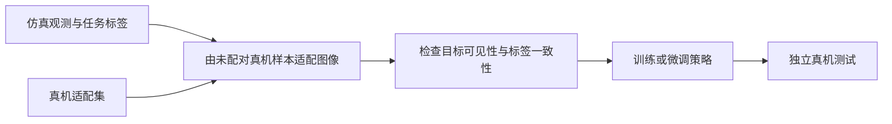

# Sim-to-Real Domain Adaptation · Sim2Real 域适应

## 一句话定义

用目标域信息减小源域与目标域的观测或特征偏差，并在独立真机集合检验任务是否获益。

## 英文缩写速查

| 缩写 | 英文全称 | 说明 |
|---|---|---|
| DA | Domain Adaptation | 用目标域数据适配分布差异 |
| DR | Domain Randomization | 改变源域采样范围，不等于拟合目标分布 |
| GAN | Generative Adversarial Network | 可用于学习图像外观映射 |
| FCL | Focal Consistency Loss | RetinaGAN 中的检测一致性损失 |

## 为什么重要

视觉策略可能只在合成纹理上工作；但让画面看上去更真实不代表标签还有效。例如生成器抹掉小物体时，训练样本中的抓取目标和渲染图已经矛盾。

## 主要技术路线（核心机制）

源域含可控仿真与任务标签；适配用目标域样本拟合观测或表征，但不让目标测试数据进入训练。RetinaGAN 以 CycleGAN 为基础，再用预训练检测器在翻译前后约束目标框和分类预测的一致性；焦点加权降低大量背景锚点对损失的主导。其生成图像用于训练策略，不等于策略运行时必须调用生成器。

## 工程实践

1. 用同一任务与动作接口对比「仿真直迁／源域随机化／利用目标域适配」；分别列出使用过的真机轨迹、图像、任务标签和检测器训练资料。
2. 在固定场景上比对映射前后目标框、遮挡与空间关系；在独立真机集合回报任务成功率和失败类别。别把肉眼风格相似或检测分数当作策略收益。
3. 若错误来自执行器延迟或接触参数，切换到 [Sim2Real 迁移工作流](sim2real-transfer-workflow.md) 的动力学与接口诊断，不继续调图像。

## 局限与风险

一致性只能检查检测器会识别的内容；漏检、小目标和新域移位仍可能使适配更差。论文中推物复用适配器的结果限于视觉域相近的设定；不是所有新环境都不需真机资料。

## 关联页面

- [Sim2Real](../concepts/sim2real.md)
- [域随机化](../concepts/domain-randomization.md)
- [CycleGAN 与视觉迁移](cyclegan-sim2real.md)
- [迁移工作流](sim2real-transfer-workflow.md)

## 参考来源

- [RetinaGAN 一手资料归档](../../sources/papers/retinagan_reading_arxiv_2011_03148.md)

## 推荐继续阅读

- [RetinaGAN 原文](https://arxiv.org/html/2011.03148v2)
