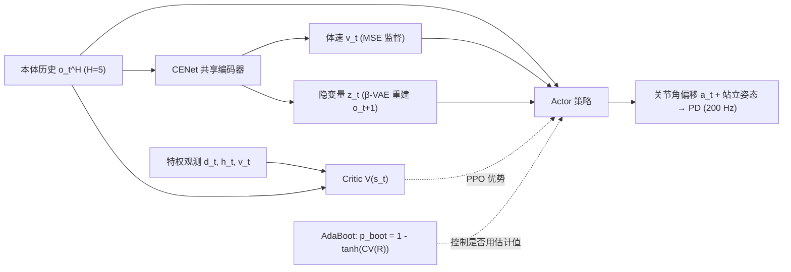

# DreamWaQ：盲走一阶段鲁棒行走

**DreamWaQ**（*Learning Robust Quadrupedal Locomotion With Implicit Terrain Imagination*，ICRA 2023，[arXiv:2301.10602](https://arxiv.org/abs/2301.10602)）提出 **CENet（Context Estimation Network）**：仅用本体历史估计隐式地形上下文与体速，配合特权 critic 的**单阶段** PPO，实现**无外感知**四足鲁棒行走。RoboParty 飞书 Know-How 条目「DreamWaq盲走一阶段鲁棒行走训练算法」对应该基线（扩展见 [DreamWaQ++](../entities/dreamwaq-plus.md)）。

## 一句话定义

把「地形想象」放进本体编码器，让盲走策略在部署时不依赖深度/激光，靠历史本体推断可站可走的隐含上下文。

## 英文缩写速查

| 缩写 | 英文全称 | 简要说明 |
|------|----------|----------|
| DreamWaQ | Dream Walking for Quadrupedal Robots | 隐式地形想象盲走框架 |
| AdaBoot | Adaptive Bootstrapping | 按回报变异系数自适应调节估计器自举概率 |
| β-VAE | β-Variational Auto-Encoder | CENet 的隐变量重建分支 |
| POMDP | Partially Observable Markov Decision Process | 论文对问题的建模方式 |
| CENet | Context Estimation Network | 本体历史 → 地形上下文 + 速度估计 |
| RL | Reinforcement Learning | 单阶段 PPO |
| PPO | Proximal Policy Optimization | 论文采用的策略优化算法 |
| Sim2Real | Simulation to Real | 域随机 + 非对称 AC 常见组合 |
| PIE | Parkour with Implicit-Explicit Learning | 加深度显式估计的姊妹路线 |
| WBC | Whole-Body Control | 模型基线，与 RL 盲走对照 |

## 为什么重要

- **传感器成本**：无深度/点云时的默认强基线，适合低成本平台。
- **谱系位置**：DreamWaQ → DreamWaQ++（点云）→ PIE（深度显式+隐式）构成飞书感知 loco 三线。
- **与特权训练叙事一致**：训练期 critic 可见地形，actor 仅本体 + CENet 输出。

## 核心原理

1. **非对称 Actor–Critic：** actor 输入为过去 $H=5$ 帧本体观测 $o_t=[\omega_t,g_t,c_t,\theta_t,\dot\theta_t,a_{t-1}]$（角速度、重力方向、速度指令、关节角/角速度、上一动作）加 CENet 输出的体速 $v_t$ 与隐变量 $z_t$；critic 额外看到扰动力 $d_t$ 与高度图 $h_t$，策略被迫从本体历史"想象"这些特权量。无需教师–学生两阶段。
2. **CENet：** 共享编码器 + 两个头：体速估计头（MSE，监督来自仿真真值）与 β-VAE 头（重建**下一帧**观测 $o_{t+1}$，KL 先验为标准正态）；$L_{CE}=L_{est}+L_{VAE}$，与策略同步训练、推理同步运行。
3. **AdaBoot：** 训练策略时以概率 $p_{boot}=1-\tanh(CV(R))$ 使用估计值（$CV$ 为 $m$ 个域随机化环境回报的变异系数），早期回报离散大时少自举。
4. **动作与奖励：** 12 维动作为相对站立姿态的关节角偏移，PD 跟踪；奖励沿用 Rudin 等人的速度跟踪 + 稳定项，并新增**功率分布**项（惩罚各电机功率方差以防个别电机过热）。
5. **课程：** 10 级地形难度（坡度 0°–22°，含平滑/粗糙/离散/楼梯）+ 低速网格自适应课程。

## 实验要点（论文原文）

- 对比 Baseline / AdaptationNet / EstimatorNet / DreamWaQ（±AdaBoot）：学习曲线上 DreamWaQ 持续最优，且接近拥有高度图的 oracle 策略。
- 推扰鲁棒性：DreamWaQ w/ AdaBoot 最大推速 1.121±0.164 m/s、存活率 95.23±1.61%；w/o AdaBoot 1.015 / 90.71%；EstimatorNet 0.871 / 80.92%；AdaptationNet 0.714 / 82.37%；Baseline 0.511 / 20.51%。
- 实机：Unitree A1，室外 430 m 庭院与 465 m 山坡（爬升约 22 m）单次长距离行走，零样本 sim-to-real。

## 主要技术路线

| 路线 | 代表链接 | 说明 |
|------|----------|------|
| 盲走基线 | [Privileged Training](../concepts/privileged-training.md) | CENet + 非对称 AC |
| 多模态扩展 | [DreamWaQ++](../entities/dreamwaq-plus.md) | 点云外感知 |
| 单阶段视觉 | [PIE](./pie-perceptive-locomotion.md) | 隐式–显式估计 |

## 工程实践

- 论文训练设置：Isaac Gym、4096 并行环境、1000 iter，PPO clip 0.2 / GAE 0.95 / γ 0.99 / lr 1e-3；策略 50 Hz，PD（Kp=28, Kd=0.7）200 Hz。
- 在 Isaac Gym / Legged Gym 生态复现时，对齐 **历史帧长、控制频率、域随机** 与 critic 特权观测列表。
- 评估时区分 **平地盲走** vs **楼梯/缺口**：后者通常需 [DreamWaQ++](../entities/dreamwaq-plus.md) 或 [PIE](./pie-perceptive-locomotion.md)。

## 工程实践

## 飞书 Know-How 补充

- 飞书全文结论：**鲁棒行走任务中，估计质心速度提升最大**，可仅速度估计也获显著增益（高度图/地形次之）；用于**模仿跟踪**时提升不如行走明显。
- 一阶段曾受限于 **SEA 关节弹性** 与 QDD 直驱成熟度；硬件进步后 gap 缩小。
- 作者团队 2023 将 DreamWaQ 扩展至人形鲁棒行走（IROS 2024 文；B 站演示链见全文）。

## 局限与风险

- **无前瞻**：障碍需接触后才能调整，极限楼梯/沟槽弱于显式感知方法。
- **隐式表征难解释**：CENet 失效时调试成本高，需记录 $\mathbf{z}$ 分布与 OOD 场景。
- **四足论文**：人形双足/contact 切换更复杂，迁移非平凡。

## HMI 开源主表入口

下列两项均收录于具身智能研究室 [开源项目主表](https://github.com/RealXiaoze/humanoid-motion-intelligence/blob/main/%E8%AE%BA%E6%96%87%E4%B8%8E%E9%A1%B9%E7%9B%AE/%E5%BC%80%E6%BA%90%E9%A1%B9%E7%9B%AE%E4%B8%BB%E8%A1%A8.md)；**本库统一收敛到本方法页**，不另建平行实体，也不挂到 [DreamWaQ++](../entities/dreamwaq-plus.md)（++ 是点云多模态扩展，不是盲走社区实现）：

| 主表条目 | 链接 | 备注 |
|----------|------|------|
| DreamWaQ（社区实现） | <https://github.com/Manaro-Alpha/DreamWaQ> | 社区盲走复现入口 |
| Legged Lab DWAQ（Unitree G1） | <https://gitee.com/chaomingsanhua/legged_lab> | G1：本体+VAE 潜变量 + PPO 关节位置；缺 AdaBoot/实机链路 |

覆盖核对见 [HMI 开源项目主表覆盖索引](../queries/hmi-opensource-projects-coverage.md)。

## 结论

**DreamWaQ 以单阶段非对称 AC + 共享编码器 CENet，在仅本体下取得接近 oracle 的鲁棒行走，是盲走基线。**

- 必须同时监督体速与重建下一帧：消融显示 CENet 在踩空楼梯时体速估计明显优于纯显式 EstimatorNet。
- AdaBoot 在推扰测试中把存活率从 90.71% 提到 95.23%，复现时别省略。
- 对比 Baseline 存活率仅 20.51%，说明地形隐式估计对鲁棒性贡献很大。
- 局限是无前瞻，需外感知扩展（DreamWaQ++、PIE）。
- 官方源码：论文未给出仓库，本页未读源码，故不含源码运行时序图（社区/G1 实现见上表，非官方）。

## 关联页面

- [DreamWaQ++](../entities/dreamwaq-plus.md) — 多模态点云扩展（T-RO 2026）
- [PIE 感知行走](./pie-perceptive-locomotion.md)
- [P³](../entities/paper-p3.md) — VAE 潜变量喂 PPO 时，单样本概率比会误 clip；矩匹配 + LSFT 是优化补丁而非新 CENet
- [Privileged Training](../concepts/privileged-training.md)
- [Know-How 技术地图](../overview/humanoid-motion-control-know-how-technology-map.md)

## 参考来源

- [DreamWaQ 论文 arXiv:2301.10602v2 通读归档](../../sources/papers/dreamwaq_arxiv_2301_10602.md)
- [Legged Lab DWAQ 仓库归档](../../sources/repos/legged-lab-dwaq.md)
- [dreamwaq_arxiv_2301_10602.md](../../sources/papers/dreamwaq_arxiv_2301_10602.md)
- [privileged_training.md](../../sources/papers/privileged_training.md)
- [humanoid_motion_control_know_how.md](../../sources/papers/humanoid_motion_control_know_how.md)
- [P³ 论文摘录（arXiv:2607.25541）](../../sources/papers/p3_arxiv_2607_25541.md)

## 推荐继续阅读

- [arXiv:2301.10602](https://arxiv.org/abs/2301.10602)
- [DreamWaQ++ 项目页](https://dreamwaqpp.github.io/)
