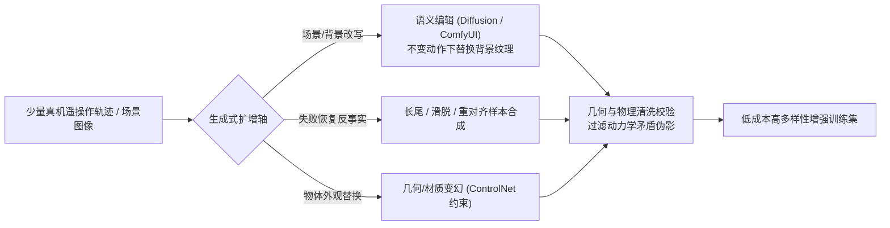

# Generative Data Augmentation (生成式数据增强)

## 一句话定义

在具身智能训练中，**生成式数据增强** 是解决“长尾效应 (Long-tail Distribution)”的关键。虽然我们可以轻易采集到成千上万条成功的“拿杯子”演示，但“杯子滑落”、“手部剧烈抖动”或“光影极端暗淡”等失败或罕见场景的数据却极难获取。

## 英文缩写速查

| 缩写 | 英文全称 | 简要说明 |
|------|----------|----------|
| AI | Artificial Intelligence | 人工智能 |

## 核心机制：AI 驱动的样本扩充

生成式增强不再仅仅是简单的裁剪或翻转图像，而是利用生成式大模型在语义和物理层面改写数据。

### 主要技术路线

1. **场景编辑 (Semantic Editing)**：
   利用视频/图像编辑模型（如 Stable Video Diffusion、[Qwen-Image-2.1](../entities/qwen-image-2-1.md)），将原始背景中的“实验室”替换为“厨房”、“办公室”或“户外草地”，或在机器人工作区 **插物体 / 换背景 / 生成 RGBA 主体层**。这极大地提升了策略的视觉泛化能力。
2. **长尾合成 (Counterfactual Synthesis)**：
   针对特定的失败模式进行合成。例如，通过修改轨迹参数并使用生成模型，渲染出机器人“抓取失败”并触发“重新对齐”动作的虚拟轨迹。
3. **物体变幻 (Object Swapping)**：
   在保持抓取动作不变的前提下，将手中的“马克杯”生成式替换为“易拉罐”、“玻璃杯”或“不规则容器”，训练模型对不同材质和几何形状的适应性。
4. **文字密集图像生成**：
   [MOSS-Image](../entities/moss-image.md) 可用自然语言或 JSON 布局提示生成包含文字与指定空间构图的图像，适合信息图等视觉素材。它是 2D 文生图模型，不负责编辑机器人轨迹，也不保证图像满足物理约束；用于机器人合成数据前需独立验证场景真实性和物理语义。

## 为什么重要

在具身智能训练中，长尾失败场景（滑脱、遮挡、极端光照）真机采集成本极高；生成式增强能以低成本合成语义与视觉多样化样本，补齐长尾分布。

- **打破 10x 数据瓶颈**：获取真实机器人演示的成本是每小时数百美金。生成式增强允许我们以计算成本（每小时数美金）将 100 条真实轨迹扩增为 10,000 条高质量的多样化样本。
- **提升边缘案例安全性**：通过大量合成“接近失败”的数据，模型可以学会更稳健的闭环纠错（Recovery）策略，而不是一旦发生微小偏移就陷入崩溃。

## 局限性与风控

- **物理伪影**：如果生成的视频中物体运动违反牛顿定律，模型可能会学到错误的物理直觉。
- **模式崩坏 (Mode Collapse)**：过度依赖生成的增强样本可能导致模型对真实世界细节的钝化。

## 主要路线
- **控制扩散 (ControlNet)**：通过机器人位姿骨架（Skeleton）约束扩散模型的生成过程，确保视频动作与物理指令对齐。工程上常用 [ComfyUI](../entities/comfyui.md) 把 ControlNet / inpaint / 背景替换编成 **可版本化节点图**（工作流 JSON），而不是一次性 Web UI；它只保证像素管线可复现，**不保证**接触动力学。
- **潜空间插值**：在世界模型的潜空间内进行特征混合，生成介于两个已知样本之间的中间状态。

## 工程实践

- **节点图固化工作流**：使用 [ComfyUI](../entities/comfyui.md) 将 ControlNet / Inpaint / 背景替换编排为可版本化的 workflow JSON，保证像素级增强管线可复现。
- **叠加物理清洗**：生成样本入库前必须经过与真机数据相同的几何/动作对齐校验，防止视觉合理但动作不可行的样本污染策略。

## 关联页面
- [具身数据清洗 (Data Cleaning)](../concepts/embodied-data-cleaning.md)
- [Generative World Models](../methods/generative-world-models.md)
- [演示数据采集指南](../queries/demo-data-collection-guide.md)
- [ComfyUI](../entities/comfyui.md) — 节点图式图像/视频合成运行时，适合把增强管线固化成 workflow JSON
- [MOSS-Image](../entities/moss-image.md) — 文字密集、布局可控的 2D 文生图模型
- [扩散模型](../concepts/diffusion-model.md) — 生成底座

## 参考来源
- Yu, T., et al. (2023). *Scaling Robot Learning with Semantically Imagined Experience*.
- [Google DeepMind ROSS 项目摘要](../../sources/papers/diffusion_and_gen.md)。

## 推荐继续阅读

- [具身数据清洗](../concepts/embodied-data-cleaning.md) — 合成样本入库前的质量把关
- [具身数据纵深路线](../../roadmap/depth-embodied-data.md) — Stage 4 扩增与合成在全管线中的位置
