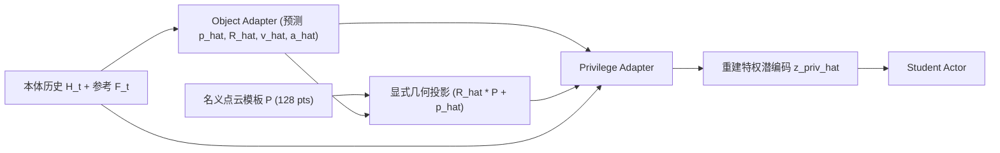

# HAIC: 动力学感知世界模型控制

**HAIC**（*Humanoid Agile Object Interaction Control via Dynamics-Aware World Model*）是面向 **欠驱动物体（underactuated objects）** 的人形全身控制方法：它不依赖机载视觉或外部动捕追踪对象，而是利用本体感知历史与参考动作预测对象高阶动力学状态，再显式投影到名义几何先验上重建特权潜表征，指导学生策略在视觉盲区中保持稳定接触与平衡。

## 一句话定义

HAIC 是一种「动力学预测 + 显式几何投影 + 非对称学生微调」的控制方法，使无外部物体状态估计器的双足/人形策略也能操控滑板、手推车等带独立动力学与非完整约束的对象。

## 英文缩写速查

| 缩写 | 英文全称 | 简要说明 |
|------|----------|----------|
| HAIC | Humanoid Agile Object Interaction Control | 面向欠驱动物体的人形交互控制方法 |
| WM | World Model | 此处指预测物体动力学与特权编码的适配模块 |
| HOI | Humanoid-Object Interaction | 人形机器人与物体/地形耦合交互任务 |
| EMA | Exponential Moving Average | 微调期稳定世界模型推理的滑动平均副本 |
| Sim2Sim | Simulation to Simulation | Isaac Sim 训练策略至 MuJoCo 迁移验证 |
| RL | Reinforcement Learning | 通过非对称 Critic 与 PPO 优化长程接触策略 |

## 为什么重要

- **填补「非刚性附着对象」的控制空白**：传统全身跟踪默认对象状态已知或与手腕刚性绑定；一旦面对滑板惯性漂移或轮式小车非完整约束，纯本体隐式编码很难精确响应瞬间反作用力。
- **用物理动力学和几何先验解耦合**：相比端到端像素世界模型，预测 6D 位姿、速度与加速度并刚体变换到 128 点静态模板点云 \(\mathcal{P}\)，维度低、推理仅 `0.17 ms` 且自带三维碰撞约束。
- **解决 Teacher-Student 蒸馏的分布偏移**：两阶段训练中的非对称微调让世界模型直接贴合 Student 真实探索分布更新，无需在第二阶段引入高成本或不可得真机动作标签。

## 核心机制

方法由两个紧耦合机制构成：
1. **Dynamics-Aware World Model 预测管线**：
   - `object_adapt` 从 `[obs_, command_]`（及历史递归预测）输出物体相对状态 \(\hat{s}_t^{obj} = (\hat{p}_t, \hat{R}_t, \hat{v}_t^{lin}, \hat{v}_t^{ang}, \hat{a}_t^{lin}, \hat{a}_t^{ang})\)。
   - `TransformObject` 将标准化物体/额外地形点云模板 \(\mathcal{P}\) 投影到机器人根系下，生成 \(\mathcal{P}_t^{dyn}\)。
   - `adapt_module` 将 \((\hat{s}_t^{obj}, \mathcal{P}_t^{dyn}, s_t^{prop}, s_t^{ref})\) 映射至 `256` 维潜特征 \(\hat{z}_t^{priv}\)，对齐特权教师编码器的 `priv_feature`。
2. **两阶段训练与非对称微调（`PPOHAIC`）**：
   - **第一阶段联合预训练（`ppo_haic_train`）**：Teacher Actor 与 Privilege Encoder 利用特权信息通过 PPO 快速学成基础动作；同时并发训练 `object_adapt`、`adapt_module` 与 `actor_adapt` 蒸馏头。
   - **第二阶段非对称微调（`ppo_haic_finetune`）**：切换到 Student 策略（由 EMA 权重 `object_adapt_ema`、`adapt_ema` 驱动）采样环境；Actor 端接受来自保留特权状态的 Critic 提供的 PPO 优势更新，World Model 同步针对学生 rollout 轨迹微调并执行 `0.04` 系数软更新。

## 主要技术路线

| 模块 | 在管线中的角色 | 实际输入与输出（对齐 `PPOHAIC` 实现） |
|------|----------------|--------------------------------------|
| **Teacher / Privilege Encoder** | 特权状态编码与冷启动专家 | 输入 `priv_`、`object_`、`object_trans`；输出 `256` 维 `priv_feature` 与参考专家动作 |
| **Object Adapter** | 实时对象动力学预测器 | MLP（`[256, 256]`），从 `[obs_, command_]` 预测对象相对位姿、速度与加速度 |
| **Explicit Geometric Projection** | 空间接地动态占据 | `TransformObject` 用预测或真值位姿对 128 点静态模板 \(\mathcal{P}\) 做刚体变换 |
| **Privilege Adapter** | 可部署特权重建器 | MLP 或 `GRUModule`，对齐 Teacher 侧 `priv_feature`，微调期配合 EMA 稳定推理 |
| **Asymmetric Actor-Critic** | 跨阶段策略优化器 | `actor_adapt` 只看可部署观测；`critic` 保留仿真特权真值执行多奖励组 PPO |

## 工程实践

- **多对象与地形统一扩展**：同一世界模型机制在 YAML 中支持同时接入 `object_` 与 `extra_object_`，从而无需修改主干架构即可覆盖「装箱 + 推/拉车」与「抱箱 + 坡梯地形」。
- **EMA 与 OOD 双重稳定**：训练端用 `soft_copy_(0.04)` 平滑世界模型权重波动防止策略震荡；部署导出端（`scripts/play.py`）在外层挂载 `ObsOODDetector`（默认 `sigma=5.0`），控制频率 `50 Hz`、机载时延 `0.17 ms`。
- **代码复用入口**：完整实现位于 [ldt29/HAIC](https://github.com/ldt29/HAIC) 的 `active_adaptation/learning/ppo/ppo_haic.py`（提供 `ppo_haic_train` / `ppo_haic_finetune` 等 5 种 Hydra 配置），MuJoCo Sim2Sim 对接 [Cybercal/HOIC-baseline](https://github.com/Cybercal/HOIC-baseline)。

### Survey 坐标（策展索引）

- 在「具身智能研究室 · 42 篇 humanoid RL 运动控制长文」中编号 **38/42**，所属系统栈层：**05 接触 · 柔顺 · 安全恢复**。

## 常见误区与局限

- **误区：把点云投影理解成实时 RGB-D / LiDAR 重建**：方法中的点云 \(\mathcal{P}\) 是离线固定的标准物体模板（128 点），靠本体预测出的物体位姿做变换，不消费真实深度相机流；因此要求任务对象拥有预定义网格或几何尺度不至于剧烈形变。
- **误区：认为第二阶段微调不需要仿真特权信息**：微调仅去除了推理端对外部状态与 Teacher 动作的依赖，训练端 Critic 仍然必须读取仿真特权真值（`priv_` + `object_`）以提供低方差价值估计。
- **适用边界**：方法擅长刚体和铰接载具的强动态交互，但在跨阶段极长程组合（如 `Pull Cart w/ Box` 真机 40% 成功率）下仍受限于误差累积；对液体、绳索软体或完全未建模的未知几何物体不直接适用。

## 关联页面

- [HAIC 论文实体](../entities/paper-haic.md) — 论文详细实验指标、消融对照与源码运行时序图
- [Model-Based RL](./model-based-rl.md) — 世界模型在控制回路中充当隐式/显式动力学表征
- [Privileged Training（特权信息训练）](../concepts/privileged-training.md) — Teacher-Student 蒸馏与非对称 Critic 的理论基础
- [Sim2Real](../concepts/sim2real.md) — 域随机化、动作延迟建模与 MuJoCo Sim2Sim 验证链
- [AMP Reward](./amp-reward.md) — 运动先验与参考动作跟踪奖励设计对照
- [Loco-Manip 接触分类 05：VLA 与世界模型调用](../overview/loco-manip-contact-category-05-vla-world-models.md)
- [人形 RL 身体系统栈](../overview/humanoid-rl-motion-control-body-system-stack.md)

## 参考来源

- [haic_arxiv_2602_11758_reading.md](../../sources/papers/haic_arxiv_2602_11758_reading.md) — `arXiv:2602.11758v2` 原文全文通读归档
- [ldt29_haic.md](../../sources/repos/ldt29_haic.md) — 官方代码 `ldt29/HAIC` 源码与配置核查归档
- [motion_control_projects.md](../../sources/papers/motion_control_projects.md)
- [humanoid_rl_stack_38_haic_humanoid_agile_object_interaction_control_v.md](../../sources/papers/humanoid_rl_stack_38_haic_humanoid_agile_object_interaction_control_v.md)
- [humanoid_rl_stack_42_catalog.md](../../sources/papers/humanoid_rl_stack_42_catalog.md)
- [wechat_embodied_ai_lab_humanoid_rl_motion_survey.md](../../sources/blogs/wechat_embodied_ai_lab_humanoid_rl_motion_survey.md)
- [wechat_embodied_ai_lab_loco_manip_contact_survey.md](../../sources/blogs/wechat_embodied_ai_lab_loco_manip_contact_survey.md)
- [wechat_humanoid_rl_42_survey_2026-05-26.md](../../sources/raw/wechat_humanoid_rl_42_survey_2026-05-26.md)

## 推荐继续阅读

- [HAIC 官方项目页](https://haic-humanoid.github.io/)
- [HAIC GitHub (`ldt29/HAIC`)](https://github.com/ldt29/HAIC)
- [Robot_Learning_Paper_Notebooks：HAIC 深读笔记](https://imchong.github.io/Robot_Learning_Paper_Notebooks/papers/04_Loco-Manipulation_and_WBC/HAIC__Humanoid_Agile_Object_Interaction_Control_via_Dynamics-Aware_World_Model/HAIC__Humanoid_Agile_Object_Interaction_Control_via_Dynamics-Aware_World_Model.html)
