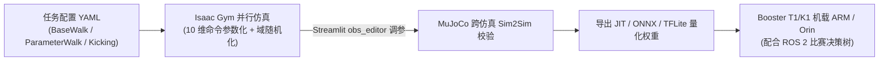

---

type: method
tags: [rl, isaac-gym, booster-t1, soccer, locomotion, booster]
status: complete
updated: 2026-11-22
related:
  - ../tasks/humanoid-soccer.md
  - ../entities/booster-robocup-demo.md
  - ./reinforcement-learning.md
  - ../entities/isaac-gym-isaac-lab.md
sources:
  - ../../sources/repos/htwk_gym.md
summary: "htwk-gym 是由 HTWK Leipzig 开发的人形机器人足球 RL 框架，专注于 Booster T1/K1 平台的参数化步行与踢球技能训练。"
original: ../../sources/repos/htwk_gym.md
---

# htwk-gym

**htwk-gym** 是一个开源的强化学习（RL）框架，专门针对人形机器人足球（Humanoid Soccer）竞赛设计。该框架由 RoboCup 强队 HTWK Leipzig 维护，在 **Booster T1/K1** 平台上经过了广泛的验证。

## 核心组件

### 1. 参数化步行 (Parameterized Walking)
htwk-gym 并不训练单一的行走策略，而是训练一个**参数化控制器**。
- **控制输入**：步频、脚部偏航角、身体姿态参数。
- **优势**：允许上层决策系统（如 ROS 2 状态机）根据球场局势动态调整行走风格，实现灵巧的变向和截球。

### 2. 足球专项任务环境
- **`T1/Kicking`**：包含球感知奖励、碰撞惩罚以及目标速度引导，用于训练精准的踢球动作。
- **`T1/Walking`**：侧重于高速平滑移动。

### 3. 多端导出与部署 (Deployment Pipeline)
- **PyTorch JIT**：用于仿真评估和高性能 PC 部署。
- **TFLite 量化**：通过 [TensorFlow](../entities/tensorflow.md) Lite / LiteRT 将策略量化，使其能够运行在 Booster 机器人内部的嵌入式 ARM/NVIDIA Orin 模块上。

## 核心原理

采用 NVIDIA Isaac Gym 大规模 GPU 并行仿真，围绕 Booster T1/K1 建立涵盖基础速度跟踪（`BaseWalk`）、10 维命令参数化步行（`ParameterWalk`）及带特权状态（20 维特权 + 44 维观测）的目标感知踢球（`Kicking`）任务空间；配合课程与领域随机化压实平衡与摩擦边界，最后在 MuJoCo 物理引擎做独立交叉检验并导出 JIT/TFLite 推理权重。

## 主要技术路线

| 模块 | 实现方案 | 优势 |
|------|---------|------|
| **运动控制** | 参数化步态策略 (Parameterized Gait) | 允许上层逻辑动态调节速度与步频 |
| **训练环境** | Isaac Gym 并行仿真 | 极高的样本采集效率，缩短训练时间 |
| **Sim-to-Real** | 领域随机化 + 跨仿真验证 (MuJoCo) | 提高策略在真实不平整草地上的鲁棒性 |
| **部署优化** | TFLite 量化导出 | 适配机器人端侧 ARM/Orin 算力平台 |

## 技术细节

- **基础引擎**：使用 NVIDIA **Isaac Gym** 实现大规模并行训练，可在数分钟内完成基础步态学习。
- **跨仿真验证**：支持将训练好的模型在 **MuJoCo** 环境中进行独立验证，以减少 Sim-to-Real 的鸿沟。
- **Streamlit 调试工具**：提供了一个名为 `obs_editor` 的 Web 界面，开发者可以实时拉动滑块调整训练参数或观察策略表现。

## 工程实践

- **任务配置选择**：基于 `envs/T1/Base_Walk.yaml`、`Parameter_Walk.yaml`、`Kicking.yaml` 与对应 K1 配置快速切换；通过预置 `obs_editor` Web 界面直观调试观测缩放与命令范围。
- **嵌入式导出**：使用定量 TFLite/ONNX 管道面向 Booster 机载 ARM/NVIDIA Orin 模块压缩推理耗散，训练前应核对 K1 较低质心调整后的动力学限位。

## 在项目中的角色

htwk-gym 作为底层“技能工厂”，为 [Booster RoboCup Demo](../entities/booster-robocup-demo.md) 提供高性能的原子技能（如 `RLVisionKick`）。

## 局限与风险

- **仿真器生态绑定 Isaac Gym**：底层仿真仍强依赖已停止特性迭代的 NVIDIA Isaac Gym；在真机不平草皮和真实高速冲撞对抗中的效果仍依赖高层决策状态机与真实视觉输入质量。

## 一句话定义

**htwk-gym**：RoboCup 知名强队 HTWK Leipzig 在 Booster Gym 基础上扩展的开源 Isaac Gym 人形足球强化学习框架，专门为 Booster T1/K1 平台训练高维参数化全向行走、闭环踢球策略，并支持经 MuJoCo 跨仿真验证与 PyTorch JIT / ONNX / TFLite 量化导出部署。

## 英文缩写速查

| 缩写 | 英文全称 | 简要说明 |
|------|----------|----------|
| RL | Reinforcement Learning | 通过与环境交互最大化长期回报来学习策略的范式 |
| ROS 2 | Robot Operating System 2 | 机器人系统集成与通信的常用中间件 |
| Isaac Gym | NVIDIA Isaac Gym | GPU 并行刚体仿真训练环境 |
| Sim2Real | Simulation to Real | 把仿真中学到的策略迁移落地真机的工程主线 |
| MuJoCo | Multi-Joint dynamics with Contact | 接触丰富的刚体物理仿真引擎 |
| Isaac Lab | NVIDIA Isaac Lab | 基于 Omniverse 的机器人学习训练框架 |

## 为什么重要

- **参数化步态解耦了上层行为树与底层稳定性**：不训练死板的单一前向走路，而是将步频、偏航角、躯干倾角和足端偏移全部参数化为 10 维命令空间（54 维观测），让决策层可以按场况平滑调步调腿。
- **实战检验完整训练到嵌入式部署工具链**：除基础 Isaac Gym 训练与域随机化之外，集成 MuJoCo sim2sim 校验、Streamlit 实时滑块调试工具（`obs_editor`）与多格式嵌入式导出。

## 参考来源

- [NaoHTWK/htwk-gym 源码仓库](../../sources/repos/htwk_gym.md)
- HTWK Leipzig RoboCup Team Documentation

## 推荐继续阅读

- 官方仓库：<https://github.com/NaoHTWK/htwk-gym>
- 实机集成方案：[Booster Robotics RoboCup Demo](../entities/booster-robocup-demo.md)

## 关联页面

- [Humanoid Soccer](../tasks/humanoid-soccer.md)
- [Reinforcement Learning](./reinforcement-learning.md)
- [Sim2Real](../concepts/sim2real.md)
- [Domain Randomization](../concepts/domain-randomization.md)
- [Booster Robotics RoboCup Demo](../entities/booster-robocup-demo.md)
- [Isaac Gym / Isaac Lab](../entities/isaac-gym-isaac-lab.md)
