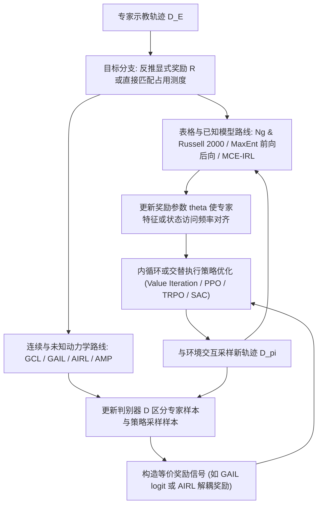
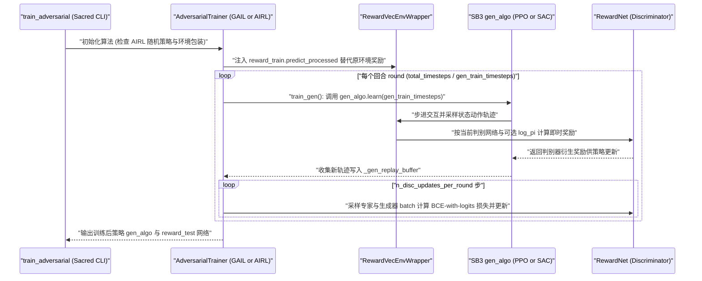

# 逆强化学习（IRL）

## 一句话定义

**逆强化学习（Inverse Reinforcement Learning, IRL）**是在无显式奖励函数的 [马尔可夫决策过程（MDP）](../formalizations/mdp.md) 中，从专家示教轨迹 $\mathcal{D}_E=\{\tau_1,\dots,\tau_M\}$ 反推令专家行为近似最优的奖励函数 $R(s,a)$（或其隐式对应策略 $\pi$）的一类[模仿学习](imitation-learning.md)与[奖励设计](../concepts/reward-design.md)方法。

## 英文缩写速查

| 缩写 | 英文全称 | 简要说明 |
|---|---|---|
| IRL | Inverse Reinforcement Learning | 从专家示教轨迹反推潜在奖励函数的方法族 |
| MaxEnt IRL | Maximum Entropy Inverse Reinforcement Learning | 在匹配专家特征期望约束下最大化轨迹熵的概率型 IRL |
| MCE-IRL | Maximum Causal Entropy IRL | 推广至随机 MDP 的因果熵版最大熵 IRL |
| IOC | Inverse Optimal Control | 连续状态-动作控制语境下的逆最优控制 |
| GCL | Guided Cost Learning | 用策略优化采样式估计配分函数的深度逆最优控制 |
| GAIL | Generative Adversarial Imitation Learning | 通过判别器匹配专家占用测度的对抗模仿学习 |
| AIRL | Adversarial Inverse Reinforcement Learning | 分离势函数塑形项以提升奖励跨动力学迁移性的对抗 IRL |
| AMP | Adversarial Motion Priors | 将对抗风格奖励接入物理仿真的机器人运动先验方法 |

## 为什么重要

在机器人操作与全身控制任务中，「写出不触发 reward hacking 的稠密奖励」往往比采集少量专家演示更困难，而直接用 [Behavior Cloning (BC)](behavior-cloning.md) 拟合动作会在长视野状态分布偏移下产生复合误差：

- **紧凑可迁移的任务目标**：相较于与特定本体动力学强耦合的策略 $\pi(a|s)$，奖励函数往往表达「任务是什么」而非「关节怎样动」，在物理参数或拓扑变化时更有机会通过重新做 [强化学习](reinforcement-learning.md) 迁移。
- **连接 IL 与 RL 的理论桥梁**：经典 IRL（Ng & Russell 2000; Abbeel & Ng 2004; Ziebart 2008）解释了“为什么匹配特征期望或占用测度就能保证策略回报下界”，而 [Ho & Ermon (2016) 的 GAIL](../../sources/papers/gail_reading_arxiv_1606_03476.md) 进一步把极大极小占优测度匹配与[生成对抗网络（GAN）](../concepts/generative-adversarial-network.md)和信任域[策略优化](policy-optimization.md)统一起来。
- **工程落地谱系清晰**：人形与四足[运动控制](../tasks/humanoid-locomotion.md)广泛使用的 [AMP](amp-reward.md) 风格奖励，本质上就是把专家动作片段的状态转移判别器作为任务辅助奖励接入仿真训练。

## 核心原理

### 1. 解集刻画与奖励退化性（Ng & Russell 2000；Ng et al. 1999）

在有限状态空间 $S$、动作转移矩阵 $\{P_a\}$ 与折扣因子 $\gamma\in(0,1)$ 的 MDP 中，Ng & Russell (2000) Theorem 3 给出了令平稳策略 $\pi(s)\equiv a_1$ 最优的奖励向量 $R$ 的充要线性不等式组：

$$(P_{a_1} - P_a)(I - \gamma P_{a_1})^{-1} R \succeq 0, \quad \forall a \in A \setminus \{a_1\}$$

该刻画直接暴露出 IRL 的根本难点——**不适定性与退化性（Degeneracy）**：$R\equiv 0$ 与任意常数奖励总满足不等式；且根据 Ng, Harada & Russell (1999) 的势函数塑形定理，任意加性势差 $\gamma\Phi(s')-\Phi(s)$ 都会保持最优策略不变。因此，仅靠“让专家最优”无法唯一确定 $R$：

- **最大间隔与 $\ell_1$ 稀疏启发式**：Ng & Russell (2000) 在有界约束 $|R_i|\le R_{\max}$ 下最大化专家动作相对次优动作的单步价值间隔，并减去惩罚项 $\lambda\|R\|_1$；对于大/连续状态空间采用线性基展开 $R(s)=\sum_{j=1}^d \alpha_j \phi_j(s)$，当仅能从初始状态 $s_0$ 采样专家轨迹时则迭代收集最坏反例策略约束解线性规划（论文在 $5\times 5$ 随机网格、26 个高斯基 Mountain-Car 及 $15\times 15$ 连续 $[0,1]^2$ 域上验证了该策略）。
- **学徒学习转向期望匹配**：Abbeel & Ng (2004) 指出若只需策略性能逼近专家，则不必恢复真实权向量 $w^*$——只要使特征期望差 $\|\mu(\pi)-\mu(\pi_E)\|_2 \le \varepsilon$，即可对所有满足 $\|w\|_1\le 1$ 的线性奖励保证价值差距有界。

### 2. 最大熵与消除标签偏置（Ziebart et al. 2008）

最大化边缘或学徒模型仍留有多解歧义，且逐状态局部归一化的动作模型 $P(a|s)\propto e^{Q^*(s,a)}$ 会产生类似条件随机场（CRF）中的 **标签偏置（Label Bias）**——高分支度状态对应的路径概率会被局部归一化异常压低（Ziebart et al. 2008 Fig. 2）。

Ziebart et al. (2008) 提出在匹配专家经验特征期望 $\sum_i P(\zeta_i)f_{\zeta_i}=\tilde{f}$ 的前提下**最大化完整轨迹分布的熵**，导出全局归一化的指数族轨迹分布：

$$P(\zeta_i \mid \theta) = \frac{1}{Z(\theta)} \exp\big(\theta^\top f_{\zeta_i}\big), \qquad \nabla L(\theta) = \tilde{f} - \sum_s D_s f_s$$

在有限步长 $N$ 上通过 **Algorithm 1 前向-后向传递** 无需显式枚举指数级路径即可估计期望状态访问频率 $D_s$（先 Backward 递推局部配分比 $Z_{a}/Z_s$，再 Forward 累积各步状态占据概率）；该方法在匹兹堡真实出租车路网（逾 30 万路段状态、90 万动作、25 名司机 12 周逾 10 万英里 GPS 数据）上取得了 78.79% 路径匹配率（对比 Time-based 72.38%、Max Margin 75.29%、Action 77.30%）并支持贝叶斯后验目的地推断。Ziebart (2010) 进一步将其推广为**最大因果熵（MCE-IRL）**以严格处理随机环境转移。

### 3. 采样式深层 IOC 与对抗占优测度匹配（GCL / GAIL / AIRL）

当状态-动作维数高、环境动力学未知且无法构造低维手工特征时，显式求解全局配分函数 $Z(\theta)$ 不可行：

- **GCL（Finn et al. 2016）**：用策略优化同步采样轨迹作为重要度采样提议分布，在连续控制与真机力矩操作中联合更新非线性代价函数与采样策略。
- **GAIL（Ho & Ermon 2016）**：证明了最大因果熵 IRL 的对偶与熵正则化占用测度匹配等价；在采用 Jensen-Shannon 散度替代高代价凸对偶求解后，跳过显式恢复通用奖励函数，直接训练判别器 $D_w(s,a)\in(0,1)$ 区分专家与策略样本，并以软化判别器输出 $-\log D_w(s,a)$（或现代代码中的 $-\log(1-D)$ 变体）作为策略优化（如 TRPO/PPO）的即时信号。
- **AIRL（Fu et al. 2018）**：把判别器结构参数化为 $D_\theta(s,a,s') = \frac{\exp f_\theta(s,a,s')}{\exp f_\theta(s,a,s') + \pi(a|s)}$，并将 $f_\theta(s,a,s') = g_\theta(s,a) + \gamma h_\phi(s') - h_\phi(s)$ 分解为基础奖励项与势能塑形项，从而在测试时剥离势能项并跨环境动力学重训练策略。

### 流程总览

## 主要技术路线

| 路线 | 代表工作 | 求解目标 | 动力学假设 | 奖励可迁移性 | 典型适用边界 |
|---|---|---|---|---|---|
| 最大间隔 / 线性规划 IRL | Ng & Russell (2000)；Abbeel & Ng (2004) | 令专家价值严格占优或匹配线性特征期望 | 表格已知转移模型，或需可反复采样的初始分布 | 中（受线性特征集 $\phi(s)$ 表达力限制） | 低维状态空间与理论分析基准 |
| 最大熵 / 最大因果熵 IRL | Ziebart et al. (2008, 2010)；Deep MaxEnt (2015) | 最大化轨迹熵并匹配特征期望 | 确定性图搜索或已知随机转移模型（`MCEIRL`） | 较高（全局归一化减少局部偏置） | 导航路径预测、网格与有限状态离散域 |
| 采样式逆最优控制 | GCL (Finn et al. 2016) | 重要性采样估计全局配分函数并学深度代价 | 未知动力学（需在线采集真机或仿真轨迹） | 较高（受策略覆盖度约束） | 连续力矩控制、早期低数据量操作任务 |
| 对抗占用测度匹配 | GAIL (Ho & Ermon 2016) | 最小化策略与专家状态-动作占用测度的 JS 散度 | 未知动力学（完全依赖交互采样） | **弱**（判别器平衡态与当前策略及动力学耦合） | 连续控制基准测试（无跨本体重训练需求） |
| 解耦式对抗 IRL | AIRL (Fu et al. 2018) | 借助 $\log\pi(a\|s)$ 分解基础奖励 $g_\theta$ 与势塑形项 $h_\phi$ | 未知动力学（需随机策略提供动作对数概率） | **强**（可仅保留去塑形后的状态奖励重训练） | 需要跨越障碍布局、质量或形态变化的仿真/控制 |
| 运动风格先验判别器 | [AMP](amp-reward.md) (Peng et al. 2021) | 以状态转移判别器 $(s,s')$ 作为无标签动作风格奖励 | 物理仿真交互（结合任务外生奖励 $r^{\text{task}}$） | 风格部分可迁移（与任务奖励加权组合） | 四足与[人形全身运动控制](../tasks/humanoid-locomotion.md) |

## 工程实践

在现代 PyTorch + Gymnasium 生态中，早期研究仓（如已归档的 TensorFlow 仓 `openai/imitation` 与 TF1 时代 `justinjfu/inverse_rl`）已不再推荐作为工程起点；主流清洁参考实现是 UC Berkeley CHAI 维护的 [HumanCompatibleAI/imitation](../../sources/repos/humancompatibleai-imitation.md)（MIT 协议，对应论文 arXiv:2211.11972）。

### `HumanCompatibleAI/imitation` 源码实现对照

1. **只支持 Gymnasium API**：`imitation` 面向 Python 3.8+ 与 `gymnasium` 向量环境；文档明确标注 `MCEIRL` 与 `SQIL` **仅支持离散动作空间**，而 `BC`、`DAgger`、`GAIL`、`AIRL` 支持离散与连续动作空间。
2. **对抗共同基类 `AdversarialTrainer`（`algorithms/adversarial/common.py`）**：
   - 使用 `BufferingWrapper(venv)` 与 `RewardVecEnvWrapper(..., reward_fn=self.reward_train.predict_processed)` 替换环境真实奖励；
   - `train(total_timesteps)` 按 `n_rounds = total_timesteps // gen_train_timesteps` 交替执行 `train_gen()`（调用 Stable-Baselines3 的 `gen_algo.learn(...)` 并将交互轨迹写入 `_gen_replay_buffer`）与 `n_disc_updates_per_round` 次 `train_disc()`（专家标签 1、策略样本标签 0，采用 `F.binary_cross_entropy_with_logits` 更新）。
3. **GAIL 与 AIRL 的代码级差异**：
   - **`GAIL`（`gail.py`）**：`logits_expert_is_high` 直接返回 `_reward_net` 输出并忽略策略对数概率；`RewardNetFromDiscriminatorLogit` 以 `-F.logsigmoid(-logits)`（即 $-\log(1 - D)$）计算奖励，因此 `reward_train` 与 `reward_test` 均不可解耦。
   - **`AIRL`（`airl.py`）**：`logits_expert_is_high` 严格计算 `self._reward_net(...) - log_policy_act_prob`，初始化时会强制检查 `gen_algo.policy` 属于可给出 $\log \pi(a|s)$ 的随机策略（如 `ActorCriticPolicy` 或 `SACPolicy`）；`reward_test` 通过递归剥离 `RewardNetWrapper` 只保留底层可迁移奖励网络。
4. **`MCEIRL` 与非参数基线**：`algorithms/mce_irl.py` 面向已知转移矩阵的 `TabularModelPOMDP`，每步通过 `mce_partition_fh` 执行软 Bellman `logsumexp` 备份，再由 `mce_occupancy_measures` 前向累积状态访问频率并用点积 `(visitations - demo_om) · predicted_r` 回传梯度；`algorithms/density.py` 则直接用 `sklearn.neighbors.KernelDensity` 拟合状态或状态-动作对数密度作为固定基线奖励。

### 源码运行时序图（`HumanCompatibleAI/imitation` 对抗训练闭环）

## 局限与风险

- **奖励非唯一性与误归因**：同一专家行为可被无限多对 $(R, \Phi)$ 解释；即便加入稀疏约束或最大熵，观察不到的状态差异（例如安全边界未曾触发）仍会导致学到的奖励在域外区域坍塌或出错。
- **内循环交互与环境样本成本**：绝大多数 IRL 与对抗 IL 都需要一边学习奖励/判别器、一边反复执行在线[策略优化](policy-optimization.md)采样。在无法高效仿真的真机[操作任务](../tasks/manipulation.md)中，在线试错样本门槛远高于离线 [Behavior Cloning](behavior-cloning.md) 或 VLA 微调。
- **判别器过拟合与奖励漂移**：高维视觉输入或动作频率差异会让判别器迅速记住专家数据的无关伪特征（背景光照、静态帧率等），使 $\nabla_D$ 失去平滑梯度引导并引发策略训练震荡。
- **非专家混合数据敏感**：经典 IRL/GAIL 假定演示分布接近最优；当数据包含大量次优操作或失败恢复片段时，无条件匹配占用测度会把次优行为一并学入，工程上常需先筛选或转向带优势加权/离线强化学习的混合方案。

## 与其他页面的关联

- 上位范式与对比：[模仿学习](imitation-learning.md)、[强化学习与模仿学习对比](../comparisons/rl-vs-il.md)
- 关键前置形式化与概念：[MDP](../formalizations/mdp.md)、[奖励设计](../concepts/reward-design.md)、[生成对抗网络](../concepts/generative-adversarial-network.md)
- 同族策略优化与行为模仿方法：[Behavior Cloning](behavior-cloning.md)、[DAgger](dagger.md)、[策略优化](policy-optimization.md)、[强化学习](reinforcement-learning.md)
- 下游机器人控制延伸：[AMP](amp-reward.md)、[人形运动控制](../tasks/humanoid-locomotion.md)、[机器人操作](../tasks/manipulation.md)
- 纵深学习路线：[模仿学习纵深路线（Stage 1）](../../roadmap/depth-imitation-learning.md)

## 参考来源

- [HumanCompatibleAI/imitation 仓库核对归档](../../sources/repos/humancompatibleai-imitation.md) — 核对 `AdversarialTrainer`、`GAIL`、`AIRL`、`MCEIRL`、`DensityAlgorithm` 源码入口与类实现（MIT，PyTorch + Gymnasium）。
- [Ho & Ermon (2016) GAIL 原文通读归档](../../sources/papers/gail_reading_arxiv_1606_03476.md) — 核对占用测度对偶、JS 散度近似与 TRPO 交替优化推导（arXiv:1606.03476）。
- [模仿学习基础与经典论文归档](../../sources/papers/imitation_learning.md) — 整理 IL 分类定位与与 BC / DAgger 的理论对照。
- [策略优化综述归档](../../sources/papers/policy_optimization.md) — 对照内循环使用的 TRPO / PPO 信任域更新机理。
- [逆强化学习一手论文索引](../../sources/papers/inverse_reinforcement_learning_primary_refs.md) — 含 **Ng & Russell (2000)** ICML PDF（Theorem 3、$\ell_1$ LP 启发式与连续实验）与 **Ziebart et al. (2008)** AAAI PDF（全局归一化、Algorithm 1 与匹兹堡出租车实证）全文逐页核对摘录，及 Russell (1998)、Ng et al. (1999)、Abbeel & Ng (2004)、Wulfmeier et al. (2015)、Finn et al. (2016) GCL 文献条目。

## 推荐继续阅读

- **对比范式取舍**：[强化学习与模仿学习对比](../comparisons/rl-vs-il.md) — 决定任务到底该写显式奖励、做纯 BC，还是引入 IRL/混合范式。
- **人形运动中的对抗继承**：[AMP（Adversarial Motion Priors）](amp-reward.md) — 看 GAIL/AIRL 的判别器思路如何在 Isaac Gym / legged_gym 中落到全身步态风格控制。
- **先学基线再进复杂方案**：[Behavior Cloning](behavior-cloning.md) → [DAgger](dagger.md) → 本页（工程上先确认有交互环境且专家演示分布一致，再启用 `HumanCompatibleAI/imitation` 跑通 AIRL/GAIL）。
