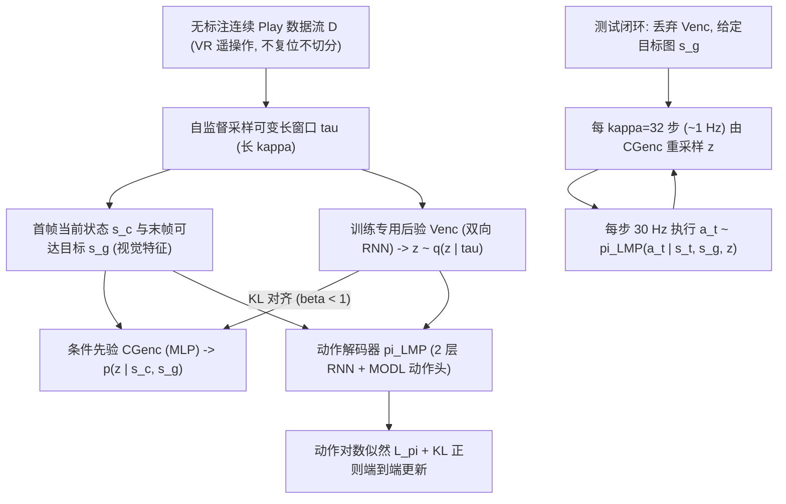

# Learning from Play（Play-LMP）

## 一句话定义

**Learning from Play（Play-LMP，Lynch et al. CoRL 2019）** 是一种面向目标条件[模仿学习](imitation-learning.md)的自监督序列建模方法：直接利用人类在不预设任务、不做片段切分、也不复位场景条件下连续遥操作产生的「游乐（play）」数据流，通过双向后验编码与条件先验对齐学习 256 维连续潜计划空间 $z$，再以单一通用策略 $\pi_{\mathrm{LMP}}(a_t\mid s_t, s_g, z)$ 复现并推广多类桌面操控技能。

## 英文缩写速查

| 缩写 | 英文全称 | 简要说明 |
|---|---|---|
| Play-LMP | Play-supervised Latent Motor Plans | 从无标注 play 数据学习潜计划空间的 Seq2Seq CVAE 方法 |
| Play-GCBC | Play Goal-Conditioned Behavior Cloning | 不带潜变量 $z$、直接由 $(s_t, s_g)$ 映射动作的消融基线 |
| CVAE | Conditional Variational Autoencoder | 条件变分自编码器，用于分离高层潜计划推断与低层单峰控制 |
| KL | Kullback-Leibler Divergence | 度量后验计划编码器与条件先验分布一致性的散度项 |
| MODL | Mixture of Discretized Logistics | 离散化 Logistic 混合输出分布，用于表达连续末端执行器动作 |
| LfP / LfD | Learning from Play / Demonstration | 从无结构游乐流学习 vs 传统的分段、按任务收集专家演示学习 |
| HER | Hindsight Experience Replay | 目标重标记策略对比范式：用可达终点作伪目标（RL vs 自监督 IL） |

## 为什么重要

传统示教学习（LfD / [Behavior Cloning](behavior-cloning.md)）要求为每个离散任务单独采集大量「从重置态到终点」的演示片段，面临三重瓶颈：单任务采集吞吐低、演示分布过于窄化导致[分布外泛化](../concepts/out-of-distribution-generalization.md)脆弱、以及多任务标签难缩放。Play-LMP 改变了这一数据收集与策略建模假设：

- **4.2 倍与 14.4 倍交互空间覆盖率**：Lynch et al. 在 11 维桌面物体交互状态空间（各维 10 分箱统计访问量）实测表明，相同 **90 分钟**采集时间下，无任务 Play 数据覆盖的交互状态空间是 18 任务专家演示（1800 条）的 **4.2 倍**，是随机探索的 **14.4 倍**，且在扩展至 7 小时期间几乎保持线性覆盖增长。
- **廉价采集与自然复原轨迹**：人类操作员出于好奇心连续交互物理对象时，既受物体 **affordance（可操作性）** 驱动而避免无效瞎碰，又会在摆弄过程中自然留下大量「碰偏、退回、调整、再尝试」的过渡与恢复样本——省去了人为设计[奖励函数](../concepts/reward-design.md)或强行重置桌面环境的昂贵开销。
- **单策略超越分任务专家**：仅用 30 分钟无标注 play 训练出的单一 `Play-LMP` 策略（状态输入 18 任务平均成功率 **71.8%**），就超过了用 90 分钟 18 任务精选演示分别训练的 18 个专用 BC 策略（**70.3%**），开创了后来诸多无标签多任务[机器人操作](../tasks/manipulation.md)数据集的组织思路。

## 核心原理

### 1. 无分段自监督切片与多峰困境

Play-LMP 将「任务」统一形式化为连续的当前–目标状态对 $(s_c, s_g)$。给定一段无标签连续日志 $\mathcal{D}=\{(O_1,a_1),\dots,(O_T,a_T)\}$，算法无需人工划分边界，只需在训练中随机抽取时长 $\kappa \sim U(\kappa_{\text{low}}, \kappa_{\text{high}})$ 的时间窗口 $\tau$：以窗口首帧作初始当前状态 $s_c$、末帧作保证物理可达的合成目标 $s_g$（类似 [HER](her.md) 的事后目标构造思想，但纯离线监督而非 RL 值更新），中间动作序列作监督目标。

若直接套用目标条件 [BC 损失](../formalizations/behavior-cloning-loss.md) 训练 `Play-GCBC` $\pi(a_t\mid s_t, s_g)$，会遭遇**多峰行为冲突**：面对同一组起点 $s_c$ 与终点 $s_g$，人类往往存在多种合理路径（例如抓取方块放入杯中 vs 推滑入杯），直接用简单条件策略拟合会把不同轨迹模式混杂拉扯。

### 2. Seq2Seq CVAE 潜计划解耦（`Venc` + `CGenc` + $\pi_{\mathrm{LMP}}$）

Play-LMP 借助[变分目标](../formalizations/variational-objective.md)把「推断怎么到达目标」与「闭环控制执行」拆分给三个神经网络协同完成：

1. **Plan Recognition（后验识别器 $q_\phi(z\mid \tau)$，训练专用）**：
   双向 RNN 编码器 `Venc`（前向 2048 + 后向 2048 → 256 维对角高斯 $\mu_\phi,\sigma_\phi^2$）读取整段未来窗口序列 $\tau^*=\Phi(\tau)$，重参数化采样具体执行本次演示路径所对应的潜计划 $z$。**测试阶段完全丢弃 `Venc`**。
2. **Plan Proposal（条件先验 $p_\theta(z\mid s_c, s_g)$，训练 + 测试）**：
   4 层 2048 维 ReLU MLP `CGenc` 仅输入起点与目标状态 $(s_c, s_g)$，预测 256 维高斯分布 $(\mu_\psi, \sigma_\psi^2)$，用来刻画从 $s_c$ 抵达 $s_g$ 所有可能高阶行为策略的概率集合。
3. **Plan & Goal-Conditioned Policy（动作解码器 $\pi_{\mathrm{LMP}}(a_t\mid s_t, s_g, z)$）**：
   2 层 2048 维 RNN 接收当前观测 $s_t$、目标 $s_g$ 与潜计划 $z$，将 8-DoF 末端动作（3D 位置 + 3D 欧拉角 + 2 指角度，各维量化为 256 bins）建模为 **离散化 Logistic 混合分布（MODL）** 以保留局部精细多模态执行自由度。

训练目标是最小化动作重建负对数似然与后验-先验 KL 散度的加权和：

$$\mathcal{L}_{\mathrm{LMP}} = -\frac{1}{\kappa}\sum_{t=1}^{\kappa} \log \pi_{\mathrm{LMP}}(a_t \mid s_t, s_g, z) + \beta\, D_{\mathrm{KL}}\!\Big(\mathcal{N}(\mu_\phi,\sigma_\phi^2)\,\big\|\,\mathcal{N}(\mu_\psi,\sigma_\psi^2)\Big)$$

其中 $\beta < 1$ 用于避免经典 VAE 的后验坍塌（posterior collapse）。

### 3. 闭环重规划与实验实证

- **视觉编码与目标不对称设计（Fig. 9）**：像素版策略接收 `299×299×3` RGB（经 3 层卷积 `8×8 s4 → 4×4 s2 → 3×3 s1` + `spatial softmax` 64 关键点 + `512→64` 全连接得到 64 维视觉特征）与 8 维本体感知拼接成的 72 维表征；**目标 $s_g$ 仅使用 64 维视觉特征**而不含目标时刻的关节内状态，使人类只需给一张目标图像即可下达任务。
- **测试期双速率闭环（1 Hz 重规划 + 30 Hz 控制）**：测试时无需 `Venc`，每步以 **30 Hz** 根据当前观测采样闭环动作 $a_t \sim \pi_{\mathrm{LMP}}(a_t\mid s_t, s_g, z)$，每隔 $\kappa = 32$ 步（约 **1 Hz**）调用 `CGenc(s_c, s_g)` 重新采样潜计划 $z$，从而对中途滑落或外力扰动自适应重规划。
- **实证表现（Playground 18 项任务）**：
  - **像素输入**：`Play-LMP` 达到 **69.4% ± 10.8**，超过分任务标注训练的 18 个 `BC`（**66.5% ± 12.1**）与 `Play-GCBC`（**58.7% ± 11.6**）；
  - **真值状态输入**：`Play-LMP` 达到 **85.5%**，显著超越 `BC`（**70.3%**）、`Multitask BC`（**66.2%**）和 `Play-GCBC`（**77.9%**），单项任务最高领先 BC 逾 50 个百分点；
  - **抗扰与自发重试**：在末端初始位置施加最高 `0.4 m` 空间扰动时性能退化明显慢于专家 BC，并在未显式教导重试的前提下自发涌现出碰倒方块后再抓起、推拉门多次尝试合拢等恢复行为。

### 流程总览

## 主要技术路线

| 路线 / 对比方法 | 数据收集要求 | 任务条件表示 | 多峰与潜变量建模 | Playground 实验定位与核心差异 |
|---|---|---|---|---|
| **Play-LMP（本页主线）** | 无任务标签、无复位连续 play | 目标状态/目标图像 $s_g$ | 256D Seq2Seq CVAE 潜计划 $z$ + MODL 动作头 | 单一通用策略，像素 `69.4%` / 状态 `85.5%`，具备 1 Hz 重规划与自发重试 |
| **Play-GCBC（无潜变量消融）** | 同上（无标注 play） | 目标状态/目标图像 $s_g$ | 无潜变量，直接条件拟合 $(s_t,s_g)\to a_t$ | 像素 `58.7%` 明显掉队（甚至低于有标注 BC），验证多峰场景下潜计划瓶颈的必要性 |
| **Multitask BC（多任务监督基线）** | 18 任务分项录制（每任务 100 条） | 离散 one-hot 任务标签 | 无潜计划空间 | 真值状态 `66.2%` 落后于单任务 BC `70.3%`，且难向未预设任务泛化 |
| **物理风格嵌入 [ASE](ase.md)** | 无标注运动捕捉片段 | 冻结底层 + 高层任务策略 | 64D 单位超球面 + vMF 互信息发现 | 面向 Isaac Gym 仿真角色与 RL 下游迁徙；Play-LMP 面向离线桌面视觉操作自监督 |
| **现代生成式动作策略（[Diffusion Policy](diffusion-policy.md) / [ACT](action-chunking.md)）** | 以分段任务示教或混合数据为主 | 语言指令或任务图像条件 | 扩散去噪或 CVAE 动作块并行预测 | [Action Chunking](action-chunking.md) 的 CVAE 潜变量思想与 Play-LMP 一脉相承，但聚焦短程高精度动作块生成 |

## 工程实践

尽管未随本次离线工作区拉取 `learning-from-play.github.io` 压缩包（需另行从官方项目页核对具体代码分支），论文 §3–§4 与附录 A.1–A.5 给出了清晰的可复现工程设计原则：

1. **避免直接用静态目标图强绑低层关节状态**：设计目标编码器时应像 Play-LMP 那样把 $s_g$ 限定在纯粹的外部视觉特征空间（`64` 维 `spatial softmax` 关键点特征），否则部署时用户几乎不可能先摆出完全一致的机械臂目标关节角。
2. **用 $\beta < 1$ 与 `Venc` 双向性防止潜空间被忽视**：若 KL 权重过大，RNN 解码器会忽略 $z$ 退化为平庸条件模型；保持 $\beta < 1$ 并让后验编码器同时看到窗口未来动作上下文，能确保 $z$ 真正编码跨时间步的高阶子目标意图。
3. **数据采样与采集纪律（App. A.5）**：Play 虽不需要切分任务，但仍要求操作员对场景内各类可交互物体（抽屉、门、按钮、桌面积木）保持大致均衡的触达频次；如果采集者长期只把玩同一件物体，多任务采样窗口会被高频事件主导。
4. **控制与重规划双频解耦**：执行期以高频（30 Hz）维持闭环接触稳定性，以低频（约 1 Hz，即每 $\kappa=32$ 步）从 `CGenc(s_c, s_g)` 重采样潜计划 $z$，既能防止策略在两套等价方案之间每帧来回跳变，又保留了失败后重新规划的能力。

## 局限与风险

- **目标图像无法表达过程约束（App. A.5）**：仅用终点图像 $s_g$ 定义任务，只能描述「做到什么结果」，无法指定「以什么风格或路径做到」（例如「轻拿轻放」或「绕开某障碍物」），这类过程指令通常需要后续引入语言条件扩展（如 MCIL / 语言-Play 对齐）。
- **同房间与单物体分布假设**：原实验的所有训练与测试均在同一桌面场景拓扑下展开，未涵盖跨房间布局、全新物体几何或剧烈背景光照变化时的零样本迁移。
- **高斯单峰潜分布的表达瓶颈**：论文自陈 `Venc` 后验与 `CGenc` 先验仍采用对角高斯，当两个状态之间存在离散强分叉且方差结构复杂时，隐计划覆盖质量受限。
- **官方仓未在本地拉取验证**：本知识节点严格依据 arXiv:1903.01973v2 全文撰写，代码压缩包与实际运行依赖未在本地复现验证（论文报告资源入口为 `learning-from-play.github.io`）。

## 与其他页面的关联

- 核心继承与方法对比：[模仿学习](imitation-learning.md)、[Behavior Cloning](behavior-cloning.md)、[HER](her.md)、[ASE](ase.md)、[Action Chunking (ACT)](action-chunking.md)、[Diffusion Policy](diffusion-policy.md)
- 数学与概念底座：[变分目标（Variational Objective）](../formalizations/variational-objective.md)、[BC 损失](../formalizations/behavior-cloning-loss.md)、[分布外泛化](../concepts/out-of-distribution-generalization.md)、[奖励设计](../concepts/reward-design.md)
- 范式定位与任务落地：[强化学习与模仿学习对比](../comparisons/rl-vs-il.md)、[机器人操作](../tasks/manipulation.md)
- 纵深学习路线：[模仿学习纵深路线（Stage 4）](../../roadmap/depth-imitation-learning.md)

## 参考来源

- [Learning Latent Plans from Play (arXiv:1903.01973v2) 原文通读归档](../../sources/papers/learning_latent_plans_from_play_arxiv_1903_01973.md) — 完整通读 §1–§5 与附录 A.1–A.5（核对 4.2x/14.4x 覆盖率、Seq2Seq CVAE 架构与超参、Playground 18 任务画素/状态对比数据、0.4 m 抗扰及局限分析）。
- [Ted Xiao 具身智能三时代演进与一手索引归档](../../sources/blogs/ted_xiao_embodied_three_eras_primary_refs.md) — 梳理 Play-LMP 在从任务专用 BC 向无标注多任务通用策略过渡中的谱系位置。

## 推荐继续阅读

- **对比潜变量 RL 思路**：[HER（Hindsight Experience Replay）](her.md) — 看同样利用“可达终点即有效目标”的思路在稀疏奖励强化学习中如何工作。
- **对比现代桌面模仿主力**：[Action Chunking (ACT)](action-chunking.md) → [Diffusion Policy](diffusion-policy.md) — 看 CVAE 潜变量与多模态动作生成如何在真实双手精细操作上继续演进。
- **对比仿真全身技能嵌入**：[ASE（Adversarial Skill Embeddings）](ase.md) — 对照无标注动捕在物理仿真中的超球面互信息表征。
